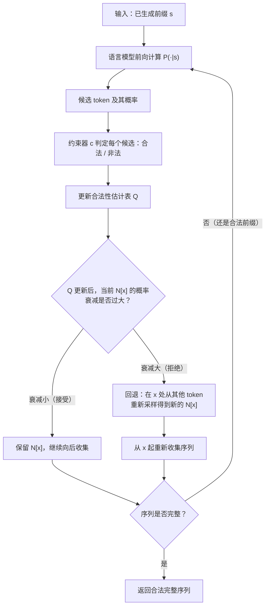

# AdapTrack：不扭曲大模型输出意图的约束解码（AdapTrack: Constrained Decoding without Distorting LLM's Output Intent）

> 说明：本文档是基于原论文的详细中文总结式翻译，重点保留研究动机、方法细节、实验与结论，并补充大量背景解释，方便零基础读者读懂。

## 论文信息

- 英文标题：AdapTrack: Constrained Decoding without Distorting LLM's Output Intent
- 作者：Yongmin Li、Jia Li、Ge Li（通讯作者，corresponding author）、Zhi Jin
- 机构：
  - Yongmin Li：北京大学高可信软件技术教育部重点实验室（Key Lab of High Confidence Software Technology, Ministry of Education）；北京大学计算机学院
  - Jia Li：清华大学人工智能学院（College of AI, Tsinghua University）
  - Ge Li：北京大学高可信软件技术教育部重点实验室；北京大学计算机学院
  - Zhi Jin：北京大学高可信软件技术教育部重点实验室；北京大学计算机学院
- 来源／会议与年份：论文未标明具体会议或期刊。PDF 使用 ACM 会议模板，页眉页脚均为模板占位文字（"Conference acronym 'XX, June 03–05, 2018, Woodstock, NY"），收稿日期一栏同样是模板占位（"Received 20 February 2007; revised 12 March 2009; accepted 5 June 2009"）。预印本编号为 arXiv:2510.17376v1 [cs.SE]，提交日期 2025 年 10 月 20 日。
- 页数：论文正文未标明正式页码；本文档所依据的抽取文本覆盖 13 页（PAGE 1 至 PAGE 13，最后一页为参考文献）。
- 开源链接：论文未给出。正文中仅声明"我们修改了约束器（constrainer）以修复若干缺陷并加速计算，并把修改后的包连同源码一起开源"，没有给出仓库地址。
- 资助信息（致谢）：国家重点研发计划（No. 2023YFB4503801）、国家自然科学基金（No. 62192733、62192730、62192731）、湖北省重大专项（No. 2023BAA024）。

## 1. 一句话总结

AdapTrack 在约束解码的每一步统计"候选 token 里有多少概率质量被约束器判为非法"，一旦这个比例过大，就回退（backtrack）到更早的位置重新采样，让模型既能满足语法／API 约束，又能保住自己原本想表达的内容；作者还给出了证明：它产生的分布与"把语言模型分布按约束截断后再归一化"得到的理想分布严格一致。

## 2. 前置知识补课（读不懂这节就先读这节）

这一节把读懂本文所需的全部概念按顺序铺开。每个概念先给大白话，再给严谨一点的说法。读的时候不用背，只要明白"为什么要这样设计"即可。

### 2.1 自回归生成（autoregressive generation）

大白话：模型一次只吐一个 token，吐完就把它接到已经写好的文字后面，然后再吐下一个。

严谨说法：给定已生成的前缀 $s_{<i} = (s_0, s_1, \dots, s_{i-1})$，模型给出下一个 token 的条件概率分布 $P(s_i \mid s_{<i})$；按这个分布采样（或取概率最大的那个）得到 $s_i$，接着进入第 $i+1$ 步。整段文本的联合概率等于每一步条件概率的连乘：

$$P(s_0, \dots, s_n) = \prod_{i=0}^{n} P(s_i \mid s_{<i}).$$

类比：写作文时一个字一个字往下写，前面写下的每个字都会影响下一笔写什么。（类比仅用于帮助理解）

这个"逐字推进、不能回头"的特性，是全文所有问题的根源。

### 2.2 token 与词表（token / vocabulary）

token 是模型处理的最小文本单位，可以是一个单词、一个子词片段，甚至一个标点。同一个字符串在不同模型里会被切成不同的 token 序列。举例：论文的主角字符串 `matrix_rank` 很可能被切成 `matrix`、`_`、`rank` 三个 token；`linalg.matrix_rank` 会被切成 `l`、`inal`、`g`、`.`、`matrix`、`_`、`rank` 之类。

词表（vocabulary）就是模型认识的全体 token 的集合，常见规模从 3 万到 15 万不等。论文在描述真实数据集 TFv1Real 时特意提到：CodeLlama 7B Python 的词表相对较小，只有 32,000 个 token（论文原文为 "a relatively small vocabulary of 32,000 tokens"）。

词表大小为什么重要：约束器必须逐个 token 判断合法性，词表越大，这一步就越慢。这也是后续工作（见第 10 节）要专门优化的开销来源。

### 2.3 logits 与 softmax

模型最后一层吐出来的是一串原始打分，叫做 logits，记作 $z_1, z_2, \dots, z_{|V|}$，每个 token 一个；这些数字还不是概率。softmax 负责把打分变成概率：

$$P(t) = \frac{e^{z_t}}{\sum_{u \in V} e^{z_u}}.$$

小例子：假设只有三个候选 token，logits 分别是 $2.0$、$1.0$、$0.0$。取指数得 $e^2 \approx 7.389$、$e^1 \approx 2.718$、$e^0 = 1$，相加得 $11.107$。归一化后概率约为 $66.5\%$、$24.5\%$、$9.0\%$。这就是"模型此刻最想说什么"的量化表达。

### 2.4 遮罩（mask）与约束解码（constrained decoding）

遮罩是一张与词表等长的 0／1 表：某位为 1 表示这个 token 此刻合法，为 0 表示非法。约束解码的做法是：把非法 token 的 logits 设成 $-\infty$（等价于把概率置 0），再把剩下的概率重新归一化，然后照常采样。

一句话：约束解码 = 普通的自回归采样 + 每一步都强行擦掉不合规的选项。

论文对它的形式化描述很精准：约束解码可以看成一厢情愿改造过的拒绝采样（rejection sampling）——本来应该"反复采样、把非法整段丢掉"，但那样太慢，于是改成"每一步就把非法选项删掉"。

### 2.5 上下文无关文法（Context-Free Grammar, CFG）

上下文无关文法由四样东西组成，通常写成四元组 $(V, \Sigma, R, S)$：

- $V$：非终结符（nonterminal）集合，是可以继续展开的抽象符号，比如"表达式"、"语句"；
- $\Sigma$：终结符（terminal）集合，是最终真正写出来的字符或 token，比如 `a`、`b`、`if`；
- $R$：规则（production）集合，形如"左边这个非终结符可以展开成右边这一串符号"；
- $S$：开始符号（start symbol），一切推导都从它出发。

"上下文无关"的意思是：某条规则能不能用，只看当前正在展开的那个非终结符，和它周围已经写了什么无关。真实编程语言的语法、JSON 的 schema、正则表达式都能用文法来描述（正则那一类其实用更弱的文法就够，后面第 3.2 节会提到这一点为什么重要）。

### 2.6 词法分析器与语法分析器（lexer / parser）

- 词法分析器（lexer）负责把连续的字符流切成 token 流，例如把 `matrix_rank(` 切成 `matrix`、`_`、`rank`、`(`。
- 语法分析器（parser）负责判断 token 流是否是文法的一个合法句子，并给出它的结构。

约束解码里的约束器（constrainer）本质就是一个"增量 parser"：每加入一个新 token，就问一次"加了它之后，还有没有机会补成一个合法句子"。论文引用的 Picard、Synchromesh 都属于这一类做法。

这里有个必须分清的关键区别，全篇都用得上：

- 合法前缀（valid prefix）：还能继续补成完整合法句子的半成品；
- 完整句子（complete sequence）：已经补完、栈里没有待展开符号的成品。

约束器在第 3.2 节那个经典事故里，正是因为"`matrix_` 是个合法前缀"而放行，结果后面才发现只能走上歪路。

### 2.7 下推自动机与栈（pushdown automaton, PDA / stack）

问题来了：为什么判断合法性需要一个栈？看文法 $S \to aSb \mid ab$，它生成的语言是 $a^n b^n$，也就是"若干个 a 后面跟同样数量的 b"。读到第一个 `b` 的时候，怎么知道后面该有 1 个还是 3 个 `b`？答案来自前面数过几个 `a`。这个"计数"没法存在有限个状态里，只能存在一个可以无限增长的栈里。

下推自动机就是"有限状态机 + 一个栈"。每读一个终结符就压栈或弹栈，栈顶符号决定下一步允许出现哪些终结符。（类比仅用于帮助理解：栈像一摞盘子，只能在顶上放、从顶上拿。）

CFG 与 PDA 表达能力等价，这是形式语言理论里的经典结论。理解了栈，就理解了为什么 PSC（第 10 节）选择"对 parser 栈做分类"来加速遮罩计算——栈的内容其实就浓缩了"现在允许什么"的全部信息。

### 2.8 手玩迷你文法：$S \to aSb \mid ab$

把文法写成两行：

```text
S -> 'a' S 'b'
S -> 'ab'
```

它生成的语言是 $\{a^n b^n \mid n \ge 1\}$，即 `ab`、`aabb`、`aaabbb`、……。约定：栈顶写在左边，初始栈为 `[S, $]`，`$` 是栈底标记。展开时把栈顶的非终结符换成规则右部；匹配时把栈顶终结符与输入对齐后弹出。

下表沿着一条具体路径演示。注意"允许的下一个终结符"这一列，它就是约束器每一步给出的合法性答案：

| 已生成前缀 | 一条可能的栈内容（顶在左） | 允许的下一个终结符 | 说明 |
| --- | --- | --- | --- |
| （空） | `[S, $]` | `a` | 两条规则右部都以 `a` 开头，所以 `b` 绝不能作为第一个字符 |
| `a` | `[S, b, $]` | `a` | 走规则 $S \to aSb$，栈顶的 `a` 与输入匹配后弹出，栈顶又回到 `S`；`S` 仍须先展出一个 `a` |
| `aa` | `[b, b, $]` | `b` | 这次走规则 $S \to ab$，`a` 匹配弹出后栈顶是终结符 `b`，输入必须接 `b` |
| `aab` | `[b, $]` | `b` | 弹出的 `b` 对应里层括号 |
| `aabb` | `[$]` | 无，序列接受 | 栈只剩栈底标记，输入读尽，`aabb` 是合法完整句子 |

同一前缀 `a` 其实还有另一条路径：如果第一步就走规则 $S \to ab$，栈会变成 `[b, $]`，此时允许的下一个终结符是 `b`，再接一个 `b` 就得到完整句子 `ab`。这说明"同一个前缀可以对应多个不同的栈"，一个严谨的增量 parser 必须同时跟踪一个栈的集合，而不能只记一个。（这个观察和 PSC 把"栈分类"当作特征来加速的动机直接相关。）

再补一句负例：前缀 `aa` 之后接 `a` 是**非法**的（栈是 `[b, b, $]`，栈顶已经是终结符 `b`）；前缀 `ab` 之后接任何字符也是非法的（栈已经只剩 `$`，句子结束了）。

### 2.9 约束解码的暗面：遮罩如何逼模型说违心话

把 2.4 的遮罩机制和 2.8 的合法性判断拼起来，就得到约束解码。它能保证输出合法，代价是"改写模型的意愿"。这里有两种性质完全不同的情形。

第一种情形比较好接受：某一步模型最想说的 token 非法，那只能从剩下的合法 token 里挑概率最高的。约束本来就要求这样，谈不上扭曲。

第二种情形才是灾难。看一份更贴近论文的迷你文法与约束：

```text
S -> 'matrix' '_' 'rank'
S -> 'matrix' '_' 'power'
S -> 'linalg' '.' 'matrix' '_' 'rank'
```

假设额外有一条版本约束：在 PyTorch 2.0 里 `matrix_rank` 已被删除，只剩下 `matrix_power` 和 `linalg.matrix_rank`。逐步看会发生什么：

1. 空前缀下，三个规则的首终结符是 `matrix` 与 `linalg`，两者都合法。模型更想说 `matrix`（例如 60.46%），于是写下 `matrix`。
2. 前缀变成 `matrix`，只剩前两条规则存活，下一个必须是 `_`（合法性 100%），于是写下 `_`。
3. 前缀变成 `matrix_`。这时候版本约束杀掉了 `matrix_rank`，只剩下 `matrix_power` 一条路。

模型此刻有 99.59% 的意愿想写 `rank`，却被判非法；剩下 `power` 的原始意愿只有 0.35%，归一化之后被抬到 97.07%。最终模型被迫吐出 `matrix_power`——一个它自己认为完全不适合当前上下文的答案。

问题的要害在于：第 1 步写下 `matrix` 时它**确实合法**，约束器无法预知后面的塌方；而自回归生成不能回头，于是错误被永久固化。人类程序员遇到这种情况会怎么做？把刚写的 `matrix_` 删掉，重新敲 `linalg.`。AdapTrack 的全部灵感就来自这个动作。

## 3. 研究背景：这篇论文在解决什么问题

### 3.1 领域现状（生活化比喻）

代码补全工具（论文以 GitHub Copilot 为例）已经广泛使用，它们从上下文推测开发者意图并生成代码。但"能跑的代码"还要额外满足一堆约束：语法要对、调用的 API 得存在、类型得匹配、括号得配对。

语言模型的训练目标只有一个——预测下一个 token 的分布，它本身没有任何机制去保证这些约束被满足。于是就有了约束解码：给模型配一个"语法检查员"，每写一个 token 就核对一次规则，不合规的选项当场擦掉。

类比：约束解码像一位严格的填空题监考老师，手里拿着标准答案模板，你每写一个字他都要查一遍模板，不合模板的字直接不许写。（类比仅用于帮助理解）

### 3.2 现有方法的具体缺陷

论文用一个真实感很强的例子说明问题。输入上下文是：

```python
# pytorch 2.0.0
import torch
def matrix_rank(x: torch.Tensor):
    return torch.
```

用户想计算矩阵的秩。历史上 `torch.matrix_rank` 用于 PyTorch 1.0–1.8，PyTorch 1.8 之后改为 `torch.linalg.matrix_rank`。当前版本是 2.0.0，所以正确答案是 `linalg.matrix_rank`。

论文给出的模型原始意愿（Figure 1b）：

| 候选 API | 模型给出的概率 | 在 PyTorch 2.0.0 中可用 |
| --- | ---: | :---: |
| `matrix_rank` | 57.44% | 不可用 |
| `linalg.matrix_rank` | 19.21% | 可用 |
| `matrix_power` | 0.20% | 可用 |

在无约束解码下，模型有 57.44% 的概率写下 `matrix_rank`（语法上没毛病，只是这个 API 在 2.0 里没了）。

在约束解码下，结果变成了这样（Figure 1c）：

| 候选 API | 约束解码下的概率 |
| --- | ---: |
| `matrix_power` | 57.70% |
| `linalg.matrix_rank` | 20.12% |

也就是说，一个原始意愿只有 0.20% 的 API，被抬成了头号选项。论文 Figure 1d 逐步还原了事故现场：

1. 第一步，合法的首 token 包括 `matrix`、`l` 以及其他若干可能性很小的 token。因为还有 `matrix_power`、`matrix_exp` 这些以 `matrix` 开头的合法 API，约束器不会禁止 `matrix`。模型于是以 60.46% 的概率写下 `matrix`。
2. `matrix` 之后是 `_`（合法性 100%）。
3. 到了第三步，占据模型 99.59% 意愿的 `rank` 被约束器禁止。既然 `matrix_` 已经写死，只能继续走下去，于是 `power` 从 0.35% 被归一化到 97.07%，`exp` 从 0.01% 被抬到 2.81%。最终输出 `matrix_power`，概率 57.70%。

论文对这个机制有一句总结：约束器一次只能识别一步的错误，所以 `matrix` 这个选项看起来一直合法；等到发现模型的主要意图被扼杀时，前面写下的 token 已经无法撤销，只能硬着头皮继续。

Figure 2 进一步把"回退"的思路量化。把"走到某个完整候选"的累计概率算出来（Figure 2b）：

- `matrix_rank`：$60.46\% \times 99.59\% \approx 60.21\%$，被约束抹掉后变成 0.00%；
- `matrix_power`：$60.46\% \times 0.35\% \approx 0.21\%$，归一化后变成 0.53%；
- `matrix_exp`：$60.46\% \times 0.01\% \approx 0.01\%$，归一化后变成 0.02%；
- `l`：22.51%，归一化后变成 56.58%。

重新整理这些数字（Figure 2c）会看到一个符合直觉的结果：`matrix` 的概率从 60.46% 掉到 0.55%，而 `l` 涨到 56.58%。这个 0.55% 正是"得知头号候选非法之后，模型应该改投第二名"的量化表达。问题在于，`matrix` 已经被写出去了，怎么把它 60.46% 的概率回调成 0.55%？

直接重采样整条序列当然可以，但代价离谱：约束器可能只是在很靠后的位置发现一个小问题，却要整段重来，时间和算力都被浪费。论文提出的判断标准是"概率变化幅度"：变化大，说明确实该离开这条分支；变化小，说明模型的主要意愿仍在这条分支上，继续走即可。

论文给出的实现手段是拒绝采样（Figure 2d）：既然 `matrix` 原本有 60.46% 的概率被抽中，现在希望它只有 0.55%，那就对已经抽中的 `matrix` 再做一次伯努利试验，接受率取

$$\text{接受率} = \frac{0.55\%}{60.46\%} \approx 0.91\%.$$

接受就继续用 `matrix`，拒绝就改从其他 token 里重新采样。两次采样叠加后，`matrix` 被最终采用的概率恰好是 0.55%。Figure 2e 给出了一次可能的回退结果：首 token 改成了 `l`，于是模型走上了它真正想要的第二名 `linalg.matrix_rank`。

论文同时给出了形式化的诊断。约束解码的逐步概率是

$$P_{\text{con}}(s_i \mid s_{<i}) = \frac{P(s_i \mid s_{<i})\,\llbracket s_i \in C(s_{<i}) \rrbracket}{\sum_{t \in C(s_{<i})} P(t \mid s_{<i})},$$

其中 $\llbracket \cdot \rrbracket$ 是示性函数（条件成立取 1，否则取 0），$C(s_{<i})$ 是前缀 $s_{<i}$ 之后所有合法 token 的集合。比较两条合法完整序列 $s$ 与 $s'$ 的生成概率之比，得到

$$\frac{P_{\text{con}}(s)}{P_{\text{con}}(s')} = \frac{P(s)}{P(s')} \cdot \frac{\prod_{i=0}^{n'} \sum_{t \in C(s'_{<i})} P(t \mid s'_{<i})}{\prod_{i=0}^{n} \sum_{t \in C(s_{<i})} P(t \mid s_{<i})}.$$

对照理想目标（第 5.1 节的公式 (1)），多出来的第二个乘积项**无法约掉**。这就是"分布扭曲"的数学证据：两条合法序列在约束解码下的概率之比，不再等于它们在原模型下的概率之比。

论文还梳理了前人三条修补路线，各自都有明显代价：

- GeDi（Krause 等，2021）：训练另一个模型来估计每个前缀的期望合法性，训练代价很高；
- ASAp（Park 等，2024）：从语言模型采样多条序列，用历史样本里的合法性信息指导后续采样；论文明确指出 ASAp 可以看作 AdapTrack 的一个变体，区别在于**它不回退**，只把信息留给同一道题的后续样本使用；
- Gen-C（Ahmed 等，2025）：用约束电路建模并做邻域重采样，但约束电路只对正则表达式可构造，因此不适合代码生成。

（这里补一句背景：正则语言不需要栈就能识别，纯正则在理论上用有限状态机就够；需要栈的那类是上下文无关文法。Gen-C 卡在"只对正则可构造"，意味着它无法处理编程语言这种带嵌套结构的文法。）

### 3.3 本文切入的角度

论文的切入点是"自适应回退"。判断的标准是当前下一步候选里非法选项所占的概率质量比例：比例大，说明模型很可能不想沿这条分支继续，应当换分支；比例小，说明模型的主要意愿仍在这条分支上，可以继续生成。

和前面三条路线相比，AdapTrack 的差异在于：

- 相比 GeDi，它不需要额外训练模型，也没有额外参数；
- 相比 ASAp，它会在当前这次生成里主动回退，调整所有已抽样的历史决定；
- 相比 Gen-C，它只依赖一个能判定合法性的约束器，不要求约束是正则的。

一个容易被忽略的设计选择在于：本文把"回退"实现成了拒绝采样，因此能给出分布层面的严格保证，而不只是一套"看起来合理"的工程启发式。

## 4. 研究意义与目的（为什么重要、对谁有用、应用场景）

目标：在保持约束（语法正确、API 存在、类型安全）的同时，不扭曲语言模型原本的输出意图。论文把这件事写成了一个分布对齐目标（见 5.1 节的公式 (1)）。

谁会用得上：

- IDE 里的代码补全功能。只要补全工具挂了约束器（比如语法检查、类型检查、语言服务器返回的合法性信息），就可能踩到这个坑。
- 库版本升级／API 迁移场景。论文的场景就是"老 API 被新 API 取代"，模型不知道用户用的哪个版本，于是候选里同时包含两代 API。这类问题在 TensorFlow v1→v2、PyTorch 1.x→2.x 里反复出现。
- 需要结构化输出（JSON、DSL、SQL、化学表达式）的场景。只要用约束解码保证格式，就存在同样的分布扭曲风险。
- 代码生成 agent。这类系统通常不会"生成一段就交差"，它们会反复采样、比较、重试；分布被扭曲意味着采样多样性和排序信号都被污染。

论文的目标不是让生成的代码"跑得通"，它要解决的是"合法但违背本意"这一更隐蔽的失败模式。这个区分很重要：`matrix_power` 在 PyTorch 2.0 里完全合法、语法无误，但它算的是矩阵的幂，和用户要的矩阵秩毫无关系。

## 5. 方法详解（本文核心）

### 5.1 问题形式化

**记号。** 设 $s_{<i} = (s_0, \dots, s_{i-1})$ 是已生成的前缀，$s_i$ 是第 $i$ 个 token。自回归语言模型给出 $P(s_i \mid s_{<i})$，整段序列的联合概率为

$$P(s_0, \dots, s_n) = \prod_{i=0}^{n} P(s_i \mid s_{<i}).$$

**约束器。** 约束器是一个定义在序列上的函数 $c: s \mapsto \{0, 1\}$。取值为 0 表示"以 $s$ 为前缀的所有序列都不可能合法"（也就是这个前缀已经走进死胡同），取值为 1 表示还有救。定义

$$C(s) = \{\, t \mid c(s :: [t]) = 1 \,\}$$

为前缀 $s$ 之后所有合法 token 的集合，其中 $::$ 表示序列拼接。

**目标分布。** 希望在所有合法序列上定义一个新分布 $P(\cdot \mid c)$，使得任意一条序列在这个分布下的概率与它在原语言模型下的概率成正比，写作

$$P(s \mid c) \propto P(s)\,c(s).$$

对于两条合法的完整序列 $s$ 与 $s'$，这等价于要求概率之比保持不变：

$$\frac{P(s \mid c)}{P(s' \mid c)} = \frac{P(s)}{P(s')}. \tag{1}$$

**为什么这算"不扭曲意图"。** 举个数值例子：假设词表只允许生成两条合法句子 $s$ 和 $s'$，模型原本给它们的概率是 $0.3$ 与 $0.1$（比值 $3:1$）。满足公式 (1) 的分布会把它们的概率变成 $0.75$ 与 $0.25$——绝对值因为归一化变了，但在合法序列内部，模型"更想说什么"的比例被完整保留下来：它依然认为 $s$ 的可能性是 $s'$ 的三倍。约束解码不满足这个性质，它会把 $s$ 压到很低、把 $s'$ 抬得很高（论文 Figure 1 里 `matrix_power` 从 0.20% 变 57.70% 就是极端案例）。

### 5.2 总体框架

AdapTrack 把整个解码组织成一个"采样—更新—拒绝—回退"的循环。下面用 Mermaid 画出数据流：



一句话概括各块的分工：

- **$Q$ 表**负责"记账"，记录每个已知前缀到底还有多少合法出路；
- **$N$ 表**负责"存票"，为每个前缀保存一个从修正后分布里抽出的下一个 token；
- **回退机制**负责"纠错"，只在记账结果说明"这条分支的意思已经不大了"时触发。

### 5.3 各模块逐步拆解

#### 模块 1：合法性估计表 $Q$

$Q$ 是一个关联数组（可以理解成哈希表），键是前缀 $x$，值是当前对 $P(c \mid x)$ 的估计——也就是"从这个前缀出发，最终能落到一条合法完整序列上的概率有多大"。

论文把前缀分成两种状态：**新前缀（new）**指还没有计算过 $P(\cdot \mid x)$ 的前缀；**旧前缀（old）**指已经展开过、知道它有哪些合法后继的前缀。更新规则为

$$Q[x] := \begin{cases} c(x) & \text{若 } c(x) = 0 \text{ 或 } x \text{ 是新前缀}; \\[6pt] \sum_{u} P(u \mid x)\, Q[x :: [u]] & \text{若 } c(x) = 1 \text{ 且 } x \text{ 是旧前缀}. \end{cases} \tag{2}$$

逐项解释：

- $c(x)$：约束器对前缀 $x$ 的判定。取 0 时 $Q[x]$ 直接置 0，这条分支作废。
- "新前缀用 1 作估计"：这是一个**乐观估计**。还没探索过的路，先假设它全身而退（$Q = 1$），因为悲观地判死会误杀。代价是后面一旦探索发现此路不通，$Q$ 只能往下调，这就是"为什么拒绝采样总有东西可做"。
- "旧前缀用加权和"：把后继 token 的模型概率 $P(u \mid x)$ 当作权重，对后继各自的存活概率 $Q[x::[u]]$ 做加权平均。这在直觉上就是"从 $x$ 出发能活下来的概率 = 各个下一步能活下来的概率按模型意愿加权平均"。

**数值小例子。** 假设某个前缀 $x$ 有两个后继：$u_1$ 概率 0.9，$u_2$ 概率 0.1。$u_1$ 是死路（$Q = 0$），$u_2$ 通畅（$Q = 1$）。那么 $Q[x] = 0.9 \times 0 + 0.1 \times 1 = 0.1$。也就是说，这个前缀只有 10% 的希望，回退概率应当很高。

#### 模块 2：修正后的采样分布 $P_Q$

用 $Q$ 表把语言模型的分布"打折"：

$$P_Q(s_i \mid s_{<i}) \propto P(s_i \mid s_{<i})\, Q[s_{<i} :: [s_i]]. \tag{3}$$

逐符号：

- $P(s_i \mid s_{<i})$：模型原本的意愿；
- $Q[s_{<i} :: [s_i]]$：加上这个 token 之后还有多大活路；
- 两者相乘再归一化，等价于"既考虑模型想不想写，也考虑写了之后走不走得通"。

一个 token 的原始概率再高，只要它的 $Q$ 是 0，在这个分布下就会被彻底排除；反过来，一个原始概率很低但走得很通的 token，会被相对抬高。这正是理想约束分布想要的行为。

#### 模块 3：下一步采样表 $N$ 与序列收集

对每个遇到过的前缀 $x$，算法维护一个抽样得到的下一个 token $N[x]$，它服从 $P_Q(\cdot \mid x)$。把 $N$ 串起来就能"收集"出一条样本序列，论文给出的过程如下（Algorithm 1）：

1. 令 $s$ 为空序列 $\varepsilon$；
2. 若 $N$ 中存在以 $s$ 为键的项，取出 $N[s]$ 拼到 $s$ 后面；
3. 重复第 2 步直到 $N$ 中没有对应的键，返回 $s$。

这个"顺着 $N$ 一路走下去"的动作，就是从一个全局分布 $P_Q(\cdot)$ 里抽出一条样本。

#### 模块 4：主循环与回退（Algorithm 2）

主流程可以逐步讲成下面这样：

1. 初始化：$Q \leftarrow \emptyset$（所有已知前缀的 $P(c \mid s)$ 估计），$N \leftarrow \emptyset$（所有已知前缀的下一步样本）。
2. 进入循环，先调用模块 3 从 $N$ 收集出一条序列 $s$。
3. 若 $s$ 已是合法完整序列，直接返回它。
4. 否则为 $s$ 采样下一个 token：$N[s] \sim P_Q(\cdot \mid s)$。
5. 用公式 (2) 更新 $Q$，记更新后的版本为 $Q'$。更新顺序**从最长的序列到最短的序列**（这一句是原文注释，原因是长前缀的结果要先算好，短前缀求和时才能取到最新值）。
6. 对该序列的每一个真前缀 $x$（不含 $s$ 本身）依次做：
   a. 取出旧的下一步样本 $n \leftarrow N[x]$；
   b. 计算更新前概率 $p \leftarrow P_Q(n \mid x)$；
   c. 计算更新后概率 $p' \leftarrow P_{Q'}(n \mid x)$；
   d. 以 $\text{Bernoulli}(p' / p)$ 抽一个 0/1；
   e. 若抽到 0，说明拒绝，触发**回退**：在 $x$ 处从其他 token 里重新采样 $N[x]$。
7. 回到第 2 步，继续循环。

**为什么 $p' \le p$。** $Q$ 的更新只会让乐观估计下降（新前缀的 1 被更真实的加权和替代，旧前缀的加权和也随子节点下降而下降），而这个下降会沿着公式 (3) 传导到归一化分母上。论文脚注专门提醒：接受率 $p'/p$ 与 $Q'[x::[N[x]]] / Q[x::[N[x]]]$ 并不相等，因为分母也变了——这个细节容易被忽略，但在实现里必须处理。

**回退时如何重采样。** 拒绝之后，新的下一步样本从"排除掉旧 token"的分布里抽取：

$$P'_Q(n' \mid x, n) \propto P_Q(n' \mid x)\,\llbracket n' \neq n \rrbracket. \tag{4}$$

逐符号：$n$ 是被否决的旧 token，$n'$ 是候选新 token，$\llbracket n' \neq n \rrbracket$ 保证不会原地抽回同一个 token（否则就成了无用功）。这就是"删掉重写"这个人类动作的算法化版本。

#### 模块 5：并行更新（效率模块）

Algorithm 2 第 10–19 步逐个 token 做的话会很慢。论文指出这部分可以在 GPU 上并行：若 $Q[x]$ 从 1 更新为 $q$（$x$ 在本次更新中从新前缀变成旧前缀），且 $x = \mathrm{Concat}(s, x')$，那么对 $s$ 的更新可以直接写成

$$Q[s] \leftarrow Q[s] - P_{\text{LM}}(x' \mid s)\,(1 - q).$$

逐符号：$P_{\text{LM}}(x' \mid s)$ 是"从 $s$ 出发生成 $x'$ 这一段"的模型概率，$1 - q$ 是这个子分支损失掉的存活概率。直觉：父节点的存活概率要按"这个子分支有多大概率被走到"来扣除损失。由于 $x$ 的所有前缀 $s$ 对应的 $P_{\text{LM}}(x' \mid s)$ 都能一次算出来，整批更新可以并行完成，随后的拒绝采样也能并行。论文还提到，拒绝采样与拒绝之后的重新采样可以融合成一次采样，进一步减少分支。

### 5.4 训练目标 / 损失函数（本文没有可训练参数）

AdapTrack 不需要训练任何模型，因此没有神经网络意义上的损失函数。它要优化的目标就是 5.1 节的公式 (1)，即"合法序列之间的概率比例保持不变"。算法通过拒绝采样在数学上精确实现这个目标，而不是近似逼近期望损失。

**定理 5.1（论文 Theorem 5.1）。** 算法 2 只会返回合法的完整序列，并且对于解码过程中探索过的不同序列，其生成概率满足公式 (1)。

证明分两步。第一步看合法性：算法里唯一的返回语句在第 7 步，因此返回的必然是完整序列；又因为 $N[x] \sim P_Q(\cdot \mid x) \propto P(\cdot \mid x) Q[x::[\cdot]]$ 保证 $N[x]$ 对任何前缀 $x$ 都是合法后继 token，所以返回的序列一定合法。第二步看分布对齐，由定理 5.2 保证"从 $N$ 收集样本等价于从 $P_Q$ 采样"。于是对任意新序列 $s = (s_0, \dots, s_n)$：

$$P_Q(s) = \prod_{i=0}^{n} P_Q(s_i \mid s_{<i}) = \prod_{i=0}^{n} \frac{P(s_i\mid s_{<i})\,Q[s_{<i}::[s_i]]}{\sum_u P(u\mid s_{<i})\,Q[s_{<i}::[u]]},$$

把分子里的 $Q$ 逐步约掉（每一步的分子恰好等于上一步分母的延伸）：

$$= \prod_{i=0}^{n} P(s_i \mid s_{<i}) \frac{Q[s_{\le i}]}{Q[s_{<i}]} = \frac{Q[s]}{Q[\varepsilon]}\,P(s) = \frac{1}{Q[\varepsilon]}\,P(s).$$

逐项解读：$Q[s_{\le i}]$ 与 $Q[s_{<i}]$ 是相邻两级前缀的存活概率，连乘后中间项全部相消，只剩下头尾。最终结果说明 $P_Q(s)$ 与 $P(s)$ 只差一个与 $s$ 无关的常数因子 $1 / Q[\varepsilon]$（$Q[\varepsilon]$ 就是空前缀的存活概率，即"模型原分布落在合法序列上的总概率"）。由于只差常数，两条序列的概率之比自然与模型原分布一致，公式 (1) 成立。

**定理 5.2（论文 Theorem 5.2）。** 算法 2 第 11–19 步对 $N$ 的更新过程，使得 $N[x]$ 始终服从分布 $P_Q(\cdot \mid x)$。

证明用归纳法。归纳基：第 9 步直接抽 $N[x] \sim P_Q(\cdot \mid x)$，成立。归纳步：设 $Q$ 更新为 $Q'$，原有样本记为 $n$，接受率取 $p'/p \le 1$（记 $p = P_Q(n \mid x)$，$p' = P_{Q'}(n \mid x)$）。两条分支的概率分别算一遍：

- 保留 $n$ 的总概率：$P_Q(n\mid x) \times \dfrac{P_{Q'}(n\mid x)}{P_Q(n\mid x)} = P_{Q'}(n \mid x)$；
- 换成 $n' \neq n$ 的总概率：先以 $P_Q(n' \mid x)$ 直接抽中，或者先抽中 $n$ 又被拒绝、再从"排除 $n$"的分布里抽到 $n'$。

论文把第二种情形化简为

$$P_Q(n'\mid x) + P_Q(n\mid x)\left(1 - \frac{P_{Q'}(n\mid x)}{P_Q(n\mid x)}\right)\frac{P_Q(n'\mid x)}{1 - P_Q(n\mid x)} = \left(1 - P_{Q'}(n\mid x)\right)\frac{P_Q(n'\mid x)}{1 - P_Q(n\mid x)},$$

再用 $P_Q(n'\mid x) \propto P(n'\mid x) Q[x::[n']]$ 把分子分母里的 $Q$ 都换成 $Q'$（因为除 $n$ 之外的后继在这一步没有变化），

$$= \left(1 - P_{Q'}(n\mid x)\right)\frac{P_{Q'}(n'\mid x)}{1 - P_{Q'}(n\mid x)} = P_{Q'}(n' \mid x).$$

两条分支的概率之和为 $P_{Q'}(n\mid x) + \sum_{n' \neq n} P_{Q'}(n'\mid x) = 1$，且各自恰好等于更新后分布下的概率。归纳完成。

**直觉总结：** 拒绝采样就像一个"配重"装置。样本是从旧分布抽的，而分布已经变了，于是按新旧概率之比决定"要不要留着这个样本"；留下来的和重抽出来的加在一起，正好还原成新分布。这也是为什么 AdapTrack 不需要训练就能得到理论上的正确分布。

### 5.5 推理 / 使用方法

使用方式很轻：把一个现成的约束器接在语言模型采样循环里，把原来的"逐 token 掩码 + 采样"替换为 Algorithm 2 的循环即可。论文说明了几个工程细节：

1. **词表太大时的采样策略。** 对每个前缀都检查整张词表太慢，论文引入了一个 top-$p$（nucleus）采样的变体：从概率最高的 token 往最低的扫，边走边累计"已知合法 token 的概率之和"，当它与"可能合法 token 的总概率"（已确认合法 + 尚未检查）之比超过阈值 $p$ 时，剩下的未检查 token 一律当作非法。在无约束解码的情形下，这个策略自然退化成经典的 top-$p$ 采样。
2. **约束器卡死怎么办。** 若约束器在 60 秒内无法判定某个 token 的合法性，就重新开始生成。由于贪心采样对同一问题总会给出相同答案，若同一问题的贪心采样被重启 20 次，该样本计为空（empty）。
3. **约束器本身要先修。** 论文提到他们修改了约束器以修复若干缺陷并加速计算，并把修改后的包与源码一起开源（未给出链接）。
4. **可以限制回退距离。** 为了效率也可以牺牲一点理论完整性，例如给回退概率设下界（低于阈值就不回退）、给回退距离设上界（超过最大距离就不回退）。

### 5.6 开销与效率分析

论文从两个角度回应效率担忧。

**（1）更新可以并行。** 5.3 模块 5 已给出并行更新公式，$Q$ 与 $N$ 的更新不必逐 token 串行。

**（2）语言模型调用次数。** 解码里最贵的部分是调用语言模型。论文在 RQ1 中统计了每个样本的平均调用次数（Table 5）：

| 模型 | 方法 | TFv1（v1 设置）平均（最小, 最大） | TFv1（v2 设置）平均（最小, 最大） |
| --- | --- | --- | --- |
| Qwen2.5 Coder 7B | 无约束解码 | 5.85 (4.12, 8.47) | 5.85 (4.12, 8.47) |
| Qwen2.5 Coder 7B | 约束解码 | 4.64 (2.75, 6.07) | 5.04 (2.91, 7.82) |
| Qwen2.5 Coder 7B | AdapTrack | 5.56 (4.12, 7.42) | 7.94 (4.41, 11.73) |
| DeepSeek Coder Base 6.7B | 无约束解码 | 10.36 (6.32, 15.59) | 10.36 (6.32, 15.59) |
| DeepSeek Coder Base 6.7B | 约束解码 | 8.27 (4.93, 11.43) | 8.82 (4.74, 14.40) |
| DeepSeek Coder Base 6.7B | AdapTrack | 9.85 (6.24, 11.37) | 13.90 (6.70, 22.87) |
| StarCoder2 7B | 无约束解码 | 9.11 (5.75, 13.65) | 9.11 (5.75, 13.65) |
| StarCoder2 7B | 约束解码 | 7.62 (4.47, 10.03) | 7.70 (4.33, 12.50) |
| StarCoder2 7B | AdapTrack | 8.83 (5.93, 12.60) | 12.08 (5.47, 20.32) |
| CodeLlama Python 7B | 无约束解码 | 10.68 (7.56, 12.90) | 10.68 (7.56, 12.90) |
| CodeLlama Python 7B | 约束解码 | 8.41 (5.38, 10.75) | 9.73 (5.88, 14.02) |
| CodeLlama Python 7B | AdapTrack | 10.03 (7.36, 13.45) | 14.29 (8.81, 20.25) |

论文的结论：在 TensorFlow v1 设置下，AdapTrack 的调用次数平均比约束解码多约 20%；在 TensorFlow v2 设置下，这个数字上升到平均多约 60%。论文认为这个代价可以接受，理由是 AdapTrack 的 EM@1 常常与约束解码的 EM@5 相当（对照 Table 1 与 Table 2 可见，例如 TFv1Real 上 Qwen2.5 Coder 7B 的 AdapTrack EM@1 为 49.30%，约束解码 EM@5 为 47.64%）。

**（3）限制回退距离的效果（Figure 7）。** 论文测试了最大回退距离 1、2、4、8 的效果（CodeLlama Python 7B 配 TFv1，Qwen2.5 Coder 7B 配 TFv1Real）。结论：距离越大性能越高，但到某个阈值后不再上升；TFv1 v1 设置需要 2 或 4，TFv1 v2 设置需要 4 或 8，TFv1Real 需要 2。也就是说，多数场景下短距离回退已经够用。

## 6. 实验设置与结果

论文用四个研究问题组织实验：

- RQ1：AdapTrack 在"预测正确且合法的 API"上表现如何？
- RQ2：在真实世界的 API 补全场景里表现如何？
- RQ3：在通用代码生成上表现如何？
- RQ4：AdapTrack 与"约束下的 oracle 分布"有多接近？

### 6.1 数据集与模型

**数据集 TFv1（合成，用于 RQ1）。** 基于 TensorFlow v1 到 v2 的 API 迁移构建。做法是：在一个无法推断库版本的上下文里，提示模型生成一个 v1 独有的 API，然后分别评估它在 "v1 设置" 与 "v2 设置" 下能否正确生成该 API。版本信息会告知约束器，因此约束器知道当前设置下哪些 API 合法。为了让模型倾向于使用某个特定 API，论文把函数显式标注成 wrapper，引导模型直接把调用转发给该 API。

数据构造细节：从 TensorFlow 官网收集 TensorFlow 2.16 下的全部合法 API；筛选出所有以 `tf.compat.v1.` 开头的 API；剔除在 v2 中存在同名对应物的 API；为避开类与方法干扰，只保留名字各部分均以小写字母开头的 API；为避开子包干扰，剔除所有可能成为其他 API 前缀的 API。最终得到 **419 个独立的 TensorFlow v1 专属 API**。

论文给出的例子：正确输出在 v1 设置下是 `.losses.mean_pairwise_squared_error`，在 v2 设置下是 `.compat.v1.losses.mean_pairwise_squared_error`。

**数据集 TFv1Real（真实，用于 RQ2）。** 从 GitHub 收集这些 API 的真实用法：对 TFv1 里的每个 v1 API 搜索 `tf.compat.v1.API(`，收集到 **46,785 个 Python 文件**；去重后，在每个文件第一次出现 `tf.compat.v1.` 处切分；剔除前缀中已包含 `tf.compat.v1` 的文件；若后缀不以 API 调用开头也一并剔除。清洗后剩 **14,237 个文件**。用前缀作为补全上下文，用后缀开头的 API 调用作为标准答案。

随后处理长度：用 CodeLlama 7B Python 的分词器统计（论文解释选它的理由是词表较小，只有 32,000 个 token，更容易触发最大位置溢出）。前缀平均长度 **1,624.78 个 token**，90% 的前缀不超过 **3,463.0 个 token**。为照顾上下文窗口更小的模型，剔除前缀长于 $4096 - 512 = 3584$ token 的文件，剩 **12,883 个文件**，再随机抽取 **1,000 个**构成 TFv1Real。

**通用基准（用于 RQ3）。** HumanEval 与 MBPP。使用类型约束器（Mündler 等，2025）保证生成程序类型安全。由于该约束器只支持 TypeScript 程序，论文使用 MultiPL-E 提供的 TypeScript 翻译版本。

**模型。** RQ1–RQ3 使用四个模型：Qwen2.5 Coder 7B、DeepSeek Coder Base 6.7B、StarCoder2 7B、CodeLlama Python 7B。论文说明只用 base 模型，因为代码补全任务与 base 模型的训练目标更契合，instruct 模型反而不合适。RQ4 沿用前人工作（Park 等）的设置，使用 Mistral-7B。

**硬件。** 64 核 Intel Xeon 机器，8 张 NVIDIA RTX A6000 GPU。

### 6.2 基线方法

- **无约束解码（unconstrained decoding）**：不加约束器，每一步直接从模型分布采样。
- **约束解码（constrained decoding）**：即第 3.2 节描述的方法，每一步把非法 token 的概率置 0 再采样。
- **ASAp**（仅 RQ4 使用）：Adaptive Sampling with Approximate Expected Futures。论文把它视为 AdapTrack 的一个变体——从 $P_Q$ 采样一条序列后，不回退、不调整已有的采样结果，只是继续沿用当前已生成的前缀，把 $Q$ 里收集到的信息留给同一道题的后续样本使用。为对齐它的行为，RQ4 中 $Q$ 在不同生成之间共享，只有样本数据 $N$ 会为新样本重置。

### 6.3 评价指标

**EM@$k$（exact match，精确匹配）。** 用于 RQ1 与 RQ2，计算方式为

$$\text{EM@}k := \mathbb{E}_{\text{Problems}}\left[\, 1 - \frac{\binom{n - c}{k}}{\binom{n}{k}} \,\right], \tag{5}$$

逐符号：

- $n$：样本总数；
- $c$：$n$ 个样本中与标准答案完全一致的数量；
- $k$：允许的尝试次数，取 $1, 3, 5, 10, 20$；
- $\binom{n-c}{k} / \binom{n}{k}$：从 $n$ 个样本里随机抽 $k$ 个、全部都不是正确答案的概率；
- 外层取期望，是对所有题目求平均。

含义：EM@$k$ 表示"给 $k$ 次尝试，至少命中一次标准答案"的期望值。$k$ 越大，指标越高。

采样协议：每个方法在每道题、每个设置下先贪心采样一个结果，再随机采 20 个结果。EM@1 用贪心结果，样本量为 1；$k > 1$ 的 EM@$k$ 用那 20 个随机样本计算。由于无约束解码不依赖版本信息，两个设置复用同一批采样结果，只更换标准答案。

**pass@$k$。** 用于 RQ3，计算方式与公式 (5) 相同，只是把 $c$ 换成"能通过测试的样本数"。

**KL 散度。** 用于 RQ4，衡量采样得到的分布与语言模型分布之间的差距，越低越接近。论文用的具体形式为

$$D_{\text{KL}}(Q \| P(\cdot \mid c)) = \sum_s Q(s) \log \frac{Q(s)}{P(s \mid c)} = \sum_s Q(s)\log\frac{Q(s)}{P_{\text{LM}}(s)\,Z} = D_{\text{KL}}(Q \| P_{\text{LM}}) - \log Z,$$

其中 $Z$ 是 $P(\cdot \mid c)$ 的归一化常数。因为所有方法的结果都被加上了同一个未知常数 $\log Z$，论文特别提醒：这些数值只在同一道题内部比较才有意义，跨题目比较没有意义。

### 6.4 主实验结果

**（a）RQ1：TFv1 上的精确匹配（论文 Table 1）。** 下表把原表按"两种设置 × 五个 $k$ 值"重绘。

| 模型 | 方法 | v1 EM@1 | v1 EM@3 | v1 EM@5 | v1 EM@10 | v1 EM@20 | v2 EM@1 | v2 EM@3 | v2 EM@5 | v2 EM@10 | v2 EM@20 |
| --- | --- | ---: | ---: | ---: | ---: | ---: | ---: | ---: | ---: | ---: | ---: |
| Qwen2.5 Coder 7B | 无约束 | 61.58% | 73.07% | 81.51% | 88.85% | 92.84% | 7.16% | 19.04% | 26.17% | 37.77% | 50.60% |
| Qwen2.5 Coder 7B | 约束 | 66.11% | 76.35% | 83.50% | 90.10% | 94.03% | 18.38% | 31.84% | 39.63% | 50.34% | 60.86% |
| Qwen2.5 Coder 7B | AdapTrack | 80.19% | 87.36% | 91.86% | 95.96% | 98.33% | 54.89% | 62.51% | 68.87% | 76.52% | 82.82% |
| DeepSeek Coder Base 6.7B | 无约束 | 62.53% | 68.63% | 78.50% | 88.43% | 94.27% | 5.97% | 16.91% | 24.12% | 36.49% | 50.60% |
| DeepSeek Coder Base 6.7B | 约束 | 65.63% | 73.34% | 82.03% | 90.26% | 94.75% | 10.98% | 25.31% | 33.32% | 45.90% | 59.43% |
| DeepSeek Coder Base 6.7B | AdapTrack | 83.29% | 86.98% | 92.47% | 96.48% | 98.09% | 50.60% | 56.62% | 64.76% | 74.57% | 82.82% |
| StarCoder2 7B | 无约束 | 72.79% | 76.37% | 85.12% | 92.30% | 96.18% | 1.67% | 12.66% | 18.62% | 29.76% | 44.15% |
| StarCoder2 7B | 约束 | 73.99% | 79.99% | 87.36% | 93.23% | 96.42% | 10.26% | 21.48% | 28.83% | 40.48% | 53.70% |
| StarCoder2 7B | AdapTrack | 83.53% | 88.78% | 92.97% | 96.36% | 98.33% | 45.35% | 50.90% | 59.70% | 69.75% | 77.57% |
| CodeLlama Python 7B | 无约束 | 59.90% | 70.63% | 78.86% | 86.61% | 91.41% | 11.93% | 25.20% | 32.52% | 43.46% | 55.37% |
| CodeLlama Python 7B | 约束 | 66.35% | 76.36% | 83.47% | 89.78% | 93.56% | 21.24% | 38.35% | 46.12% | 56.96% | 67.54% |
| CodeLlama Python 7B | AdapTrack | 83.29% | 89.37% | 92.82% | 95.70% | 97.14% | 60.86% | 68.20% | 73.37% | 79.56% | 85.20% |

逐条解读：

1. **v1 设置里，约束解码的帮助有限。** Qwen2.5 Coder 7B 无约束时 EM@1 已有 61.58%，加上约束器只升到 66.11%。论文的解释是：模型确实会生成一些在 v1 里非法的 API 调用，被约束器挡住了，所以有小幅收益，但主要瓶颈不在这里。
2. **v1 设置里，AdapTrack 的提升才是大头。** 同样的 Qwen2.5 Coder 7B 从 66.11% 提到 80.19%。论文的解读是：约有 14% 的情况，模型在约束下本来就把标准答案当成最佳候选，只是约束解码不允许它修改已经生成的 token，于是没能生成出来。换个说法，约束解码把 14 个百分点的正确率白白丢掉。
3. **v2 设置里，差距被放大成鸿沟。** Qwen2.5 Coder 7B 无约束时 EM@1 只有 7.16%——因为模型把 61.58% 的意愿放在了 v1 风格的 API 上，而这些在 v2 里已经失效。加约束器后升到 18.38%。而 AdapTrack 达到 54.89%，相对提升 **198.70%**。
4. **最有说服力的一句对比：** AdapTrack 的 EM@1（54.89%）超过了约束解码的 EM@10（50.34%）。用一次尝试打赢别人十次尝试，这说明差异来自分布本身，而非采样次数。
5. **全表最大相对提升出现在 v2 设置的 DeepSeek Coder Base 6.7B：** EM@1 从 10.98% 升到 50.60%，相对提升 **360.87%**。论文明确把 360.87% 这个标题数字归给这一格。
6. **四个模型结论一致。** v1 设置下四个模型的 AdapTrack EM@1 都在 80.19%–83.53% 区间，v2 设置下在 45.35%–60.86% 区间，没有出现某个模型失效的情况。

**（b）RQ2：TFv1Real 上的精确匹配（论文 Table 2）。**

| 模型 | 方法 | EM@1 | EM@3 | EM@5 | EM@10 | EM@20 |
| --- | --- | ---: | ---: | ---: | ---: | ---: |
| Qwen2.5C 7B | 无约束 | 21.70% | 29.45% | 35.28% | 43.88% | 53.00% |
| Qwen2.5C 7B | 约束 | 35.60% | 41.86% | 47.64% | 55.29% | 62.30% |
| Qwen2.5C 7B | AdapTrack | 49.30% | 53.87% | 59.28% | 65.84% | 71.70% |
| DSC Base 6.7B | 无约束 | 18.90% | 25.62% | 30.93% | 38.66% | 47.10% |
| DSC Base 6.7B | 约束 | 31.10% | 38.45% | 44.09% | 51.23% | 57.70% |
| DSC Base 6.7B | AdapTrack | 41.90% | 49.45% | 55.26% | 62.25% | 68.30% |
| SC2 7B | 无约束 | 15.90% | 21.91% | 27.33% | 35.59% | 44.70% |
| SC2 7B | 约束 | 29.80% | 35.55% | 41.69% | 49.59% | 56.60% |
| SC2 7B | AdapTrack | 41.40% | 47.60% | 53.85% | 61.62% | 68.10% |
| CL Python 7B | 无约束 | 19.60% | 26.88% | 32.26% | 40.48% | 49.40% |
| CL Python 7B | 约束 | 34.40% | 40.77% | 46.99% | 55.10% | 62.30% |
| CL Python 7B | AdapTrack | 46.80% | 52.61% | 58.75% | 66.41% | 73.00% |

逐条解读：

1. **全表 AdapTrack 均优于约束解码，最大相对提升 38.93%**，出现在 StarCoder2 7B 的 EM@1：从 29.80% 升到 41.40%。
2. **以 Qwen2.5 Coder 7B 为例：** 无约束 21.70%，加约束器后 35.60%（说明模型确实生成了不少非法 API），AdapTrack 进一步到 49.30%，相对约束解码提升 **38.48%**。
3. **提升幅度比 TFv1 小。** 论文自己承认这一点，并解释真实数据的上下文更杂乱，模型的候选分布更分散。
4. **限制放宽后仍是大幅提升。** AdapTrack 的 EM@1（49.30%）再次超过了约束解码的 EM@5（47.64%）。

**（c）RQ3：通用代码生成（论文 Table 3）。** HE 表示 HumanEval，MB 表示 MBPP。

| 模型 | 方法 | HE pass@1 | HE pass@3 | HE pass@5 | HE pass@10 | HE pass@20 | MB pass@1 | MB pass@3 | MB pass@5 | MB pass@10 | MB pass@20 |
| --- | --- | ---: | ---: | ---: | ---: | ---: | ---: | ---: | ---: | ---: | ---: |
| Qwen2.5 Coder 7B | 无约束 | 65.41% | 63.05% | 73.66% | 84.36% | 90.57% | 66.92% | 72.28% | 79.10% | 85.04% | 88.72% |
| Qwen2.5 Coder 7B | 约束 | 64.15% | 70.66% | 79.00% | 86.08% | 89.31% | 66.67% | 75.13% | 80.60% | 85.56% | 88.46% |
| Qwen2.5 Coder 7B | AdapTrack | 69.18% | 72.22% | 79.98% | 86.65% | 92.45% | 70.77% | 76.26% | 81.55% | 86.59% | 89.74% |
| DeepSeek Coder Base 6.7B | 无约束 | 44.65% | 46.52% | 56.26% | 68.23% | 77.36% | 36.41% | 65.62% | 73.77% | 81.17% | 85.38% |
| DeepSeek Coder Base 6.7B | 约束 | 47.17% | 51.88% | 60.36% | 70.00% | 78.62% | 60.00% | 67.87% | 74.26% | 80.24% | 84.10% |
| DeepSeek Coder Base 6.7B | AdapTrack | 49.69% | 55.43% | 63.84% | 73.16% | 80.50% | 63.85% | 70.29% | 76.54% | 82.26% | 85.90% |
| StarCoder2 7B | 无约束 | 37.74% | 28.00% | 35.79% | 46.85% | 57.86% | 56.67% | 45.94% | 55.72% | 66.36% | 74.36% |
| StarCoder2 7B | 约束 | 37.11% | 37.67% | 46.35% | 58.18% | 68.55% | 52.05% | 57.43% | 65.09% | 73.17% | 78.72% |
| StarCoder2 7B | AdapTrack | 37.74% | 40.72% | 49.62% | 60.75% | 69.18% | 54.36% | 58.60% | 66.17% | 74.33% | 80.51% |
| CodeLlama 7B | 无约束 | 33.96% | 32.15% | 39.50% | 49.89% | 61.64% | 48.72% | 45.68% | 54.57% | 64.42% | 71.54% |
| CodeLlama 7B | 约束 | 34.59% | 35.19% | 42.62% | 53.43% | 65.41% | 45.90% | 52.25% | 60.19% | 68.89% | 75.64% |
| CodeLlama 7B | AdapTrack | 36.48% | 35.89% | 43.41% | 53.89% | 64.15% | 47.69% | 53.26% | 61.25% | 70.34% | 77.18% |

逐条解读：

1. **AdapTrack 几乎全面优于约束解码**，pass@1 在 HumanEval 上最高提升 **7.84%**、在 MBPP 上最高提升 **6.42%**（均为相对提升）。7.84% 对应 Qwen2.5 Coder 7B 的 HumanEval：从 64.15% 到 69.18%；6.42% 对应 DeepSeek Coder Base 6.7B 的 MBPP：从 60.00% 到 63.85%。
2. **唯一例外是 CodeLlama 7B 在 HumanEval 的 pass@20：** 从约束解码的 65.41% 降到 64.15%。
3. **AdapTrack 有时会输给无约束解码**，例如 StarCoder2 7B 在 MBPP 上的 pass@1（无约束 56.67%，AdapTrack 54.36%）与 CodeLlama 7B 在 MBPP 上的 pass@1（无约束 48.72%，AdapTrack 47.69%）。论文把原因归给约束器本身的局限：按道理，如果无约束的贪心样本能通过测试，它必然满足类型约束，那么它也应该出现在约束解码的贪心结果里；反过来说，无约束在这里胜过约束，说明约束器有额外影响。
4. **表格里存在 pass@3 低于 pass@1 的现象**（例如 StarCoder2 7B 的 HumanEval：pass@1 为 37.74%，pass@3 为 28.00%）。这不是笔误：论文的 pass@1 取自贪心样本，其余 $k$ 取自随机采样，两组样本来源不同，因此不存在单调性保证。这个细节在引用数字时容易被误解（此为本文档的观察，论文未加说明）。

**（d）RQ4：与 oracle 分布的对齐（论文 Table 4）。**

| 方法 | SLIA | INV-BV | CP | binary | 平均（加权） |
| --- | ---: | ---: | ---: | ---: | ---: |
| 约束解码（CD） | 11.37 | 7.13 | 19.86 | 23.05 | 11.46 |
| ASAp | 12.05 | 7.76 | 19.85 | 19.87 | 11.90 |
| AdapTrack | 9.31 | 7.04 | 16.86 | 19.53 | 9.97 |

数值为 KL 散度，越低越接近 oracle 分布。四个数据集分别是：

- **SLIA**（strings with linear integer arithmetic，带线性整数算术的字符串）与 **INV-BV**（loop invariant generation with bit-vector arithmetic，带位向量算术的循环不变式生成）：各含 15 道 Syntax-Guided Synthesis（SyGuS）题目。给定 DSL 的文法与规格，目标是生成满足规格的函数。每题的文法与逻辑规格都放进 prompt，且每题附带 3 个 (Problem, Solution) 形式的上下文示例。
- **CP**（constituency parsing，成分句法分析）：6 道题，从英文句子生成成分句法树，约束用于保证括号配对正确。
- **binary**：只有 1 道题，要求生成 5 位随机序列，但约束只允许 `00000` 以及任何以 1 开头的 5 位串。合法的 5 位串共 17 个（`00000` 加上以 1 开头的 16 个），正确方法应给 `00000` 约 $1/17$ 的概率；而约束解码会给它约 $1/2$ 的概率，因为第一步只有 `0` 和 `1` 两个合法选项，两者概率接近。

采样规模：SLIA、INV-BV、CP 每题生成 2000 个样本，binary 生成 100 个样本。此外还计算"每 500 个样本的滑动窗口"与模型分布的 KL 散度（窗口大小为每题采样量的四分之一），用来看各方法的收敛过程。

逐条解读：

1. **AdapTrack 在四个数据集上全部优于两个基线**，平均 KL 从 11.46（约束解码）与 11.90（ASAp）降到 9.97。
2. **SLIA 与 CP 上，约束解码与 ASAp 表现接近，AdapTrack 优势明显**；CP 上从 19.86／19.85 降到 16.86。
3. **INV-BV 上三者几乎打平**（11.37／12.05／7.04）。论文推测这个数据集里非法 token 在不同位置的占比大致相同，因此逐步归一化的偏差积累不起来。
4. **binary 是唯一 ASAp 明显优于约束解码的数据集**（19.87 对 23.05），但 AdapTrack 仍以 19.53 领先 ASAp。
5. **收敛速度（Figure 4）**：SLIA、CP、binary 上 AdapTrack 从最初就有很低的 KL 且全程保持，说明前四分之一的样本就找到了好分布；INV-BV 上 KL 随采样持续下降，说明它还在从重复采样中学习新信息。

### 6.5 消融实验与关键发现

论文没有以"消融实验"为名的独立小节，但有几组去掉／限制某个组件的对照，作用等同消融，加上一组稳健性实验：

**（1）回退距离的截断（Figure 7）。** 把最大回退距离限制为 1、2、4、8：性能随距离上升，越过阈值后饱和；TFv1（v1）需要 2 或 4，TFv1（v2）需要 4 或 8，TFv1Real 需要 2。结论是回退不必太远，多数收益来自近距离纠错。（这个结果反过来提示：扭曲主要发生在"刚写错几个 token"的场景。）

**（2）温度稳健性（Figure 5）。** 在 TFv1（两种设置）与 TFv1Real 上，用温度 0.1 到 0.9 测试（图横轴覆盖 0.0 到 1.0）。对 $k \in \{1,3,5,10,20\}$，AdapTrack 始终优于约束解码与无约束解码。温度升高时所有方法都变好，论文的解释是较高温度能鼓励模型在更大范围内探索，而 EM@$k$ 只要 $k$ 次里有一次命中就算成功（EM@1 例外，因为贪心采样总是给出同一结果）。实验使用的是各自最优的模型：TFv1 用 CodeLlama Python 7B，TFv1Real 用 Qwen2.5 Coder 7B。

**（3）模型规模稳健性（Figure 6）。** 用 Qwen2.5 Coder 系列（0.5B、1.5B、3B、7B、14B、32B）在 TFv1 与 TFv1Real 上测试，超过 7B 的模型推理时使用 bfloat16 以节省显存。所有规模下 AdapTrack 都优于两个基线。TFv1 上的性能随规模增大而饱和甚至在某阈值后下降，论文推测原因是 TFv1 是合成的、过于简单，规模差异体现不出来；TFv1Real 上所有方法随规模增大而提升，说明更大的模型对 API 补全的理解更好。

**（4）基线替换（RQ4）。** 把 ASAp 作为"去掉回退的 AdapTrack"这一变体来对照，KL 散度全面更差，间接证明了回退机制的必要性。

### 6.6 案例分析

论文的案例集中在 Figure 1 与 Figure 2，前面第 2.9 与 3.2 节已经完整还原。这里再补两个来自论文正文的例子。

**案例一（TFv1 的构造样例，论文 Figure 3）。** 输入是：

```python
import tensorflow as tf

def mean_pairwise_squared_error(*args, **kwargs):
    """
    wrapper for losses.mean_pairwise_squared_error
    """
    return tf
```

函数被显式标注为 wrapper，引导模型直接把调用转发给目标 API。在 v1 设置下正确答案为 `.losses.mean_pairwise_squared_error`，在 v2 设置下为 `.compat.v1.losses.mean_pairwise_squared_error`。这个设计让"新旧 API 只在前缀长度上不同"这一特征变得更纯粹，从而把测试目标锁定在"模型能否在约束下改弦更张"。

**案例二（binary 数据集的概率论证，论文 RQ4）。** 约束只允许 `00000` 与所有以 1 开头的 5 位串。合法的 5 位串共 17 个，如果要求"每个合法串概率相等"，那么 `00000` 应得 $1/17 \approx 5.88\%$。约束解码却给它约 $1/2 = 50\%$，因为在第一步只有 `0`、`1` 两个合法选项，约束器把原本可能分给其他串的概率质量全部压到了这两条分支上，而 `0` 开头的分支之后只剩一条路可走。这个思想实验用一个极小的例子把"逐步归一化累积偏差"说明白了：偏差发生在早期分支，后期无从补救。

## 7. 结论（作者自己的总结，逐条）

论文第 9 节给出的总结可以拆成这几条：

1. 提出新的解码方法 AdapTrack，通过把"对失效概率质量自适应"的回退机制引入生成过程，修复约束解码的分布扭曲问题。
2. 构建两个数据集：合成的 TFv1 与真实世界的 TFv1Real，用以验证 AdapTrack 的有效性。
3. 在通用代码生成基准上的实验验证了 AdapTrack 的泛化性。
4. 给出理论证明，说明该方法确实遵循模型的输出意图；并在 DSL 问题上用实验验证了这一点。
5. 未来工作方向有二：在更多 API 上探索这一现象；探索如何帮助模型更好地与约束对齐。

论文第 1 节的贡献列表与之呼应，另外补充了具体数字：TFv1 上最高提升 360.87%，TFv1Real 上最高提升 38.93%，HumanEval 与 MBPP 上验证泛化性。

## 8. 局限性 / 作者承认的问题

论文没有名为 "Limitations" 的独立小节，第 7.3 节 "Threats to validity"（有效性威胁）承担了这部分职责，另外第 7.2 节讨论了效率边界。

**（1）数据集选择的威胁。** 作者自己提出的疑问是：这个现象是否只出现在被废弃的 API 上，或者只出现在 API 补全任务里？他们用两组实验缓解这一威胁——RQ1 里专门构造了"在 v1 设置下使用 v1 API，此时该 API 并未被废弃"的情形，AdapTrack 仍带来显著提升；RQ3 在通用代码生成基准上复现了同类扭曲。

**（2）模型选择的威胁。** 作者提出的疑问是：这会不会只是模型能力不足导致的？他们用多个模型与多个规模做了验证，结论是一致提升。作者同时强调：这是约束解码的固有缺陷，只要使用约束解码，这个问题就会以某种程度存在。

**（3）效率与可扩展性。** 论文承认两处担忧：第 10–19 步更新 $Q$ 与 $N$ 可能低效；生成一条完整序列可能等待过久。给出的回应是并行更新公式与语言模型调用次数的实测（v1 设置多约 20%，v2 设置多约 60%）。论文还承认，为了效率可以牺牲理论完整性，给回退概率设下界、给回退距离设上界。

**（4）约束器本身不可靠。** 论文提到他们修改了约束器以修复缺陷并加速计算，还设置了 60 秒超时重启、贪心 20 次重启视为空样本的兜底规则。这些工程让步说明理论保证成立的前提（约束器总能正确、及时地判定合法性）在现实中并不自动满足。

**（5）没有与使用公开测试用例的方法结合。** 论文在相关工作里明确说明：PG-TD、Rocode 这类方法用公开测试用例过滤错误程序，AdapTrack 没有做类似的事，因为它更关注分布扭曲问题而非"跑通测试"。

## 9. 我的批判性评价（以下为解读者判断，非论文原文）

### 9.1 优点

1. **问题定位准，例子有说服力。** `matrix_power` 从 0.20% 被抬到 57.70% 这个例子，把一个抽象的"分布扭曲"变成了任何人都能看懂的事故现场。相比之下，很多约束解码的批评停留在"可能损害多样性"这种模糊表述。
2. **理论工作是实打实的。** 论文不只提出启发式，还证明了输出分布恰好等于 $P(\cdot \mid c)$。证明结构干净：定理 5.1 负责合法性，定理 5.2 负责采样正确性，最后一步 $\prod Q[s_{\le i}]/Q[s_{<i}]$ 的望远镜式相消给出了 $P_Q(s) \propto P(s)$ 的漂亮结论。
3. **零训练开销。** 不需要额外模型、不需要微调，工程上可以直接替换采样循环。这一点让它与所有"训练一个判别器"的路线（如 GeDi）形成了清晰的成本对比。
4. **实验维度比较完整。** 合成与真实数据集、通用基准、分布度量、温度、模型规模、回退距离，六个维度都覆盖了；四个骨干模型结论一致，避免"单模型巧合"的质疑。
5. **与已有工作的关系界定清晰。** 明确把 ASAp 定位为"不回退的 AdapTrack"，并在 RQ4 里直接对照，这种自我定位有助于读者判断增量在哪。

### 9.2 可疑或薄弱之处（含"如果我是审稿人会问什么"）

1. **相对提升的分母偏小，头条数字容易误读。** 360.87% 看着惊人，但它来自 v2 设置里 DeepSeek Coder Base 6.7B 的 EM@1：10.98% → 50.60%。10.98% 这个基线本身说明约束解码在这类场景下快崩了。审稿人会问：有没有报告绝对提升的置信区间？不同随机种子下的方差多大？
2. **评测方法学上有一处要澄清：HumanEval/MBPP 用的是 TypeScript 版本（MultiPL-E）。** 因此表 3 里的数字不能与 Python 原版 HumanEval/MBPP 的常见榜单直接对比。论文说明了理由（约束器只支持 TypeScript），但这个转移会让读者失去一个公共参照系。
3. **pass@$k$ 的采样协议导致表格非单调。** pass@1 来自贪心，其余 $k$ 来自 20 个随机样本，于是出现 pass@3 < pass@1 这种反直觉现象。这是"两个来源不同的估计量"造成的，读者若不注意会误以为数据有误。审稿人应当要求论文在表注里写明这一点。
4. **存在明确的负例但没有深挖。** CodeLlama 7B 在 HumanEval 的 pass@20 下降，StarCoder2 7B 与 CodeLlama 7B 在 MBPP 的 pass@1 低于无约束解码。论文只用"约束器的局限"一句带过。审稿人会问：这些负例里，究竟是约束器误判（把合法 token 判为非法）还是 AdapTrack 的回退引入了新的偏差？如果是约束器误判，AdapTrack 的原则应当能让它退化到接近无约束的行为，为什么没有？
5. **超时兜底规则可能引入评测偏差。** "约束器 60 秒判不出合法性就重启生成；同一题目贪心样本重启 20 次后计为空样本"。空样本如何处理、是否计入分母，论文没有说明。如果空样本被排除，就等于删除了最难的那些题目，指标会被高估。
6. **没有报告墙钟时间与吞吐。** 只报告了语言模型调用次数。调用次数增加 60% 与端到端延迟增加 60% 完全不同：回退会打断批处理（batch）的同步性，实践中可能造成远超 60% 的吞吐下降——这一点在 LLM 推理服务里是硬约束。
7. **$Q$ 表的内存与缓存开销未量化。** 需要为解码中遇到的每个前缀保存 $Q$ 与 $N$。在长上下文（TFv1Real 里 90% 的前缀不超过 3,463 token）下，这可能相当可观。GPU 显存被 $Q$ 挤占后还能不能开大 batch，论文没有说。
8. **泛化边界不清楚。** 论文只与无约束解码、约束解码、ASAp 比较。更强的对手至少有 Gen-C 与"训练一个合法性价值模型"的路线（虽然论文说明了二者的构造性限制）。审稿人会问：在约束是正则语言（Gen-C 可构造）的任务上，AdapTrack 还能不能取胜？
9. **一个可以深挖的理论点：** 论文乐观地把新前缀初始化为 $Q = 1$，然后靠"更新只会下调"来驱动拒绝采样。这在直觉上意味着长序列上会有大量无谓回退（因为一路上都是乐观估计）。回退距离实验显示"短距离就够"，说明这套机制在实践中收敛很快，但"为什么快"缺乏分析。
10. **回退与 tokenizer 粒度的耦合没讨论。** 论文的核心例子 `matrix`／`_`／`rank` 依赖特定分词方式。换一个把 `matrix_rank` 切成一个 token 的 tokenizer，这个事故根本不会发生。这既是 AdapTrack 的机会（它本来就不依赖特定切分），也提示实验结论对 tokenizer 敏感，值得做一次跨 tokenizer 的稳健性检验。

### 9.3 可复现性评估

**偏好的部分：**

- 数据集构造流程写得相当细，可以重走一遍：46,785 个文件 → 清洗后 14,237 → 长度过滤后 12,883 → 随机抽 1,000 构成 TFv1Real；TFv1 的 419 个 API 及其四步筛选规则（以 `tf.compat.v1.` 开头、剔除 v2 有对应物的、只留全小写开头的、剔除可作为其他 API 前缀的）都有明确说明。
- 硬件（64 核 Intel Xeon + 8×A6000）、模型清单与规模、dtype 选择（>7B 用 bfloat16）、温度范围、样本量（每题 2000 个样本，binary 100 个）、指标公式全部给出。
- RQ4 说明复用了 ASAp 的代码与 transformers-CFG 库，这意味着这条实验线的环境是可对齐的。

**存疑的部分：**

- **开源链接缺失。** 论文声明"源码与修改后的约束器包一起开源"，但没有给出地址。这是复现最大的障碍，因为约束器的缺陷修复方式直接影响所有数字。
- **约束器版本漂移。** 论文用的是 MultiPL-E 的 TypeScript 版本 HumanEval/MBPP 加一个会持续演进的类型约束器。作者提到"修复了若干 bug"，但没有列出修复清单，后来者拿到的约束器行为可能与论文评测时不同。
- **API 清单的时效性。** TFv1 基于 TensorFlow 2.16 官网的 API 列表构建，TensorFlow 版本更新后这个列表会变，419 这个数字可能不再可复现。
- **超时参数不完整。** 除了 60 秒这个阈值，其他与效率相关的超时设置（如最长生成步数）没有报告。
- **随机性控制未说明。** 是否固定随机种子、是否多次重复求均值与方差，论文没有交代。EM@$k$ 本身是 Monte Carlo 估计，缺少方差信息会削弱结论的统计说服力。

总体判断：方法层面的可复现性高（算法完整、证明完整），实验层面的可复现性中等（流程清楚但缺代码、缺种子控制、依赖会变的外部资源）。

## 10. 与 CodePRM / 本工作区其他约束解码论文的关系

本目录下还有两篇同方向的论文，摘要部分已在 `tmp/pdftext/` 中抽取，下面做简要对比和定位。

**（1）PSC：Efficient Grammar-Constrained Decoding via Parser Stack Classification（Yongmin Li、Yihong Dong、Jia Li、Ge Li）。** 第一作者与 AdapTrack 相同。它针对的痛点是**速度**：现有 GCD 方法在每个解码步都要对整张词表逐个 token 判断合法性，延迟随词表大小线性增长，吞吐上不去。PSC 的做法是在预处理阶段把所有词表 token 的接受条件合并成一个"parser 栈分类器"，于是每个解码步只需对 parser 栈检查一次，时间复杂度与词表规模无关。摘要给出的数字是：在复杂编程语言文法上算 mask 比基线快最多 700×，对符合 schema 的 JSON 快最多 30×，端到端吞吐接近无约束解码。论文还给出预处理开销与盈亏平衡点分析。

**（2）LAVE：Lookahead-Then-Verify: Reliable Constrained Decoding for Diffusion LLMs under Context-Free Grammars（Yitong Zhang、Yongmin Li、Yuetong Liu、Jia Li、Xiaoran Jia、Zherui Li、Ge Li）。** 它针对的痛点是**可靠性 + 适用范围**：扩散大语言模型（diffusion LLM, dLLM）不是自回归的，绝大多数约束解码方法根本用不了；而为 dLLM 专门设计的做法又可能允许"不可能补全成合法句子"的中间输出。LAVE 利用 dLLM 一次前向就能给出所有位置 token 分布的特性，在每次提议新 token 时做前向展望（lookahead）来验证合法性，保证中间输出始终保有补全成合法句子的潜力。摘要称在 4 个 dLLM 与 5 个基准上一致优于基线，运行开销可忽略。

**（3）三者的分工与互补。**

| 论文 | 目标模型 | 主要痛点 | 负责的维度 | 关键手段 | 摘要中的代表数字 |
| --- | --- | --- | --- | --- | --- |
| PSC | 自回归 LLM | 每一步都要扫整张词表，慢 | **速度／吞吐** | 把词表接受条件预先编译成 parser 栈分类器 | mask 计算最多快 700×（复杂文法）/ 30×（JSON） |
| AdapTrack | 自回归 LLM | 逐步掩码导致分布扭曲、意图被压掉 | **质量／忠实性** | 自适应回退 + 拒绝采样，并给出分布一致性证明 | TFv1 最高 +360.87%，TFv1Real 最高 +38.93% |
| LAVE | 扩散 LLM（dLLM） | 非自回归，既有方法不适用；中间输出可能不可补全 | **可靠性／可用性** | 用并行分布的 lookahead—verify 保证中间状态可补全 | 4 个 dLLM、5 个基准一致提升，开销可忽略 |

三者的关系可以这样理解：PSC 让遮罩**算得快**，AdapTrack 让遮罩**遮得准**，LAVE 让遮罩**在非自回归模型上也站得住**。它们解决的问题互不重叠，理论上可以叠加——例如用 PSC 加速合法性判定，同时用 AdapTrack 修正分布扭曲。AdapTrack 论文里其实保留了这样的接口：它只要求约束器能回答"这个 token 合法吗"，并不关心这个回答是逐个 token 算出来的还是分类器一次算出来的。

与 CodePRM 的关系：CodePRM 属于"生成后如何评价与修正"这条线（过程奖励模型 + Generate-Verify-Refine 搜索），它关心思路质量，把执行反馈纳入评价；AdapTrack 属于"生成过程中如何不被约束带偏"这条线，关心的是解码分布本身。两者的交点在于排序信号：如果采样分布被约束扭曲，那么无论用 Best-of-N 还是奖励模型排序，候选池本身的质量都已经受损。AdapTrack 修的是候选池，CodePRM 修的是候选池的排序方式，方向正交。

## 11. 一页速记卡（组会汇报用）

1. **问题**：约束解码逐步抹掉非法 token 并重新归一化，会导致分布扭曲；论文例子中 `matrix_power` 从 0.20% 的原始意愿被抬成 57.70% 的首选，因为 `matrix_` 已写死、`rank` 被判非法。
2. **要害**：约束器一次只能看一步，合法前缀可能埋雷；自回归生成不能回头，于是错误固化。
3. **方法**：维护合法性估计表 $Q$ 与下一步样本表 $N$，用 $Q$ 打折后的分布 $P_Q$ 采样；当 $Q$ 更新导致当前样本概率下降时，以接受率 $p'/p$ 做拒绝采样，拒绝则在"排除旧 token"的分布里重抽，等价于回退。
4. **理论**：论文证明 $P_Q(s) = \frac{1}{Q[\varepsilon]} P(s)$，即只差一个常数因子，因此合法序列之间的概率之比与模型原分布完全一致。
5. **数据**：合成数据集 TFv1（419 个 TensorFlow v1 专属 API，源自 TensorFlow 2.16 官网）；真实数据集 TFv1Real（46,785 个 GitHub 文件清洗到 14,237，长度过滤到 12,883，随机抽 1,000）。
6. **主结果**：TFv1 上最高提升 **360.87%**（DeepSeek Coder Base 6.7B，v2 设置 EM@1 从 10.98% 到 50.60%）；TFv1Real 上最高提升 **38.93%**（StarCoder2 7B EM@1 从 29.80% 到 41.40%）；HumanEval pass@1 最高 +7.84%、MBPP pass@1 最高 +6.42%。
7. **分布证据**：四个 DSL 数据集上的 KL 散度平均从 11.46（约束解码）/ 11.90（ASAp）降到 9.97，且 AdapTrack 的 EM@1 常超过约束解码的 EM@5。
8. **代价**：语言模型调用次数在 TFv1 v1 设置平均多约 20%、v2 设置平均多约 60%；回退距离限制在 2–8 就基本饱和；温度（0.1–0.9）与模型规模（0.5B–32B）下结论稳定。

## 12. 术语速查表

| 英文 | 中文 | 一句话解释 |
| --- | --- | --- |
| Autoregressive generation | 自回归生成 | 一次生成一个 token，并把已生成内容接回去影响下一步 |
| Token | 词元 | 模型处理的最小文本单位，可能是一个词、子词或标点 |
| Vocabulary | 词表 | 模型认识的全部 token 集合，常见规模 3 万–15 万 |
| Logits | 原始打分 | softmax 之前的未归一化分数，每个 token 一个 |
| Softmax | 归一化指数函数 | 把 logits 转成和为 1 的概率分布 |
| Constrained decoding (CD) | 约束解码 | 每步把非法 token 概率置 0 再采样 |
| Grammar-Constrained Decoding (GCD) | 文法约束解码 | 用 CFG 定义合法性并据此遮罩的约束解码 |
| Constrainer | 约束器 | 判断 token 在当前位置是否合法的组件 |
| Mask | 遮罩 | 与词表等长的 0/1 指示表，标记哪些 token 可用 |
| Context-Free Grammar (CFG) | 上下文无关文法 | 四元组 $(V,\Sigma,R,S)$，规则左部只有一个非终结符 |
| Nonterminal / Terminal | 非终结符 / 终结符 | 可继续展开的抽象符号 / 最终写出的字符 |
| Lexer | 词法分析器 | 把字符流切成 token 流 |
| Parser | 语法分析器 | 判断 token 流是否符合文法并给出结构 |
| Pushdown automaton (PDA) | 下推自动机 | 有限状态机加一个栈，与 CFG 表达能力等价 |
| Stack | 栈 | 后进先出的结构，用于记录嵌套与计数信息 |
| Valid prefix | 合法前缀 | 还能补成合法完整句子的半成品 |
| Complete sequence | 完整序列 | 已经补完的合法句子 |
| Rejection sampling | 拒绝采样 | 按某个接受率决定是否保留样本，用以把样本分布校正为目标分布 |
| Backtracking | 回退 | 撤回已生成的部分 token 并重新采样 |
| Distortion of output intent | 输出意图扭曲 | 生成结果合法，但偏离模型原本想表达的内容 |
| Oracle distribution | 参照分布 | 作为对照的"标准"分布，本文中指 $P(\cdot \mid c)$ |
| Exact Match@$k$ (EM@$k$) | $k$ 次尝试精确匹配率 | $k$ 次采样中至少命中一次标准答案的期望概率 |
| pass@$k$ | $k$ 次尝试通过率 | $k$ 次采样中至少有一个样本通过测试的概率 |
| KL divergence | KL 散度 | 衡量两个概率分布差异的非对称度量，越小越接近 |
| Temperature | 温度 | 采样时的分布缩放系数，越大越随机 |
| Top-$p$ / nucleus sampling | 核心采样 | 只在累计概率达到 $p$ 的最小 token 集合内采样 |
| Type constrainer | 类型约束器 | 保证生成程序类型正确的约束器（本文用于 HumanEval/MBPP） |
| DSL (domain-specific language) | 领域特定语言 | 面向特定领域的受限语言，如 SyGuS 语法 |
| Deprecated API | 废弃 API | 在新版本库中已失效的接口 |
