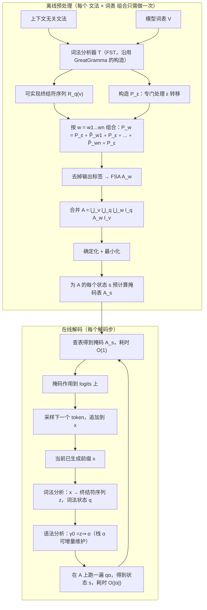

# 通过解析器栈分类实现高效语法约束解码（Efficient Grammar-Constrained Decoding via Parser Stack Classification）

> 说明：本文档是基于原论文的详细中文总结式翻译，重点保留研究动机、方法细节、实验与结论，并补充大量背景解释，方便零基础读者读懂。原论文本身只有 25 页（含参考文献），没有专门的"案例分析"章节，本文档中标注为"解读者补充"的内容均为我自己的理解和判断。

## 论文信息

- 英文标题：Efficient Grammar-Constrained Decoding via Parser Stack Classification
- 作者：Yongmin Li（李永民音译，北京大学）、Yihong Dong（董一鸿音译，上海交通大学）、Jia Li（李佳音译，清华大学，论文中列在作者列表第三位）、Ge Li（李戈，北京大学，通讯作者）
  - 原文给出的联系方式：`liyongmin@pku.edu.cn`、`dongyh@sjtu.edu.cn`、`jia_li@mail.tsinghua.edu.cn`、`lige@pku.edu.cn`
  - 通讯作者标记：原文在作者列表中用 ✉（信封符号）标在 Ge Li 上
- 机构：北京大学高可信软件技术教育部重点实验室（Key Laboratory of High Confidence Software Technology (PKU), MoE）与北京大学计算机学院；上海交通大学计算机学院；清华大学人工智能学院
- 来源/期刊与年份：ACM 期刊格式，ACM Reference Format 写作 "Yongmin Li, Yihong Dong, Jia Li, and Ge Li. 2026. Efficient Grammar-Constrained Decoding via Parser Stack Classification. 1, 1 (August 2026), 25 pages."。**论文未标明具体期刊名称**（模板中留下的期刊名、卷号、文章编号与 DOI 均为占位符：`ACM XXXX-XXXX/2026/8-ART`、`https://doi.org/10.1145/nnnnnnn.nnnnnnn`）。arXiv 编号为 `arXiv:2608.03065v1 [cs.SE]`，日期 2026 年 8 月 4 日
- 页数：25 页（正文到第 20 页结束，第 21 页起为参考文献）
- 开源链接：论文给出 `https://github.com/Gompyn/PSC`（论文在 "Data Availability" 一节声明开源了 PSC 实现、实验数据集、复现脚本以及实验中用到的所有预处理结果）
- 资助信息：国家重点研发计划 2023YFB4503801；国家自然科学基金 62192733、62192730、62192731；北京市科技计划 Z251100008425005；清华大学-科电电气（浙江）具身多模态人工智能联合研究中心（JCEMAI）；北京市自然科学基金 4264107

## 1. 一句话总结

PSC 在离线阶段把"词表里每一个 token 在当前解析器栈上是否合法"这件事，整体编译成一个确定有限自动机（DFA），使得在线解码时只需把当前的"词法状态 + 解析器栈"喂给这个自动机跑一遍、再查一次预计算好的掩码表，就能得到完整的词表掩码，从而让掩码计算的时间复杂度不再与词表大小相关，在复杂编程语言文法上比最强基线快最多 700 倍。

## 2. 前置知识补课（读不懂这节就先读这节）

这一节假设你完全没接触过自然语言处理，目标是让你在读完论文正文之前，先把所有会卡住你的名词搞懂。论文里出现的公式，本质上都在描述这一节讲的东西。

### 2.1 自回归生成：模型是"一次蹦一个词"的机器

大语言模型（Large Language Model, LLM）生成文本的方式，叫**自回归生成（autoregressive generation）**。可以把它想象成一个只会玩"接词游戏"的人：

1. 你给他一句开场白（prompt，提示词），比如 `def gcd(x, y):`；
2. 他看完后，对"下一个词应该是什么"给出一个打分表；
3. 你根据打分表挑一个词，拼到后面；
4. 他再看着"开场白 + 刚挑的词"，重新给出下一轮打分表；
5. 重复第 3、4 步，直到他吐出一个"结束符"。

关键点在于：**每一步他只决定"下一个"，不决定"后面一串"**。这带来一个直接后果——他完全可能在第一步就挑了一个让后面无法收场的词。比如写 JSON 时先蹦出一个多余的 `}`，那么不管后面怎么接，这个 JSON 都不可能合法了。

（类比仅用于帮助理解：人说话会有全局规划，模型没有，它是纯粹的"每一步只看当前进度"。）

### 2.2 词表、logits、softmax 与采样

**词表（vocabulary, 记作 $V$）**就是模型认识的所有"词"的集合。这个"词"不是语言学意义上的词，后面 2.3 会详细说。现代模型的词表很大，论文里举的例子是 Llama-3 的 128k（128256 个）、Qwen 系列的 151k（151665 个）、Gemma 3 的 262k（262145 个）。

**logits** 是模型最后一层输出的原始分数，长度等于词表大小。"下一个 token 是 `}` "这件事对应词表里的一个下标，模型会给每个下标打一个分数。分数可以是负数，可以是很大的正数，本身没有概率含义。

**softmax** 是把这一串任意实数压成"加起来等于 1 的一串正数"的函数，压完之后第 $i$ 个位置的值就是"下一个 token 是词表第 $i$ 个词的概率"。

$$\text{softmax}(z)_i = \frac{e^{z_i}}{\sum_{j=1}^{|V|} e^{z_j}}$$

逐符号解释：
- $z$：长度 $|V|$ 的 logits 向量，$z_i$ 是第 $i$ 个 token 的原始分数；
- $e^{z_i}$：把分数变成正数（指数函数恒正），分数越大变得越大；
- 分母 $\sum_j e^{z_j}$：所有 token 的正数之和，起归一化作用；
- 结果 $\text{softmax}(z)_i$：第 $i$ 个 token 的概率，取值范围 $(0,1)$。

直觉：softmax 就是一个"按指数放大差距、再按比例分配 100% 份额"的转换器。

**采样（sampling）**就是从这串概率里按概率大小随机抽一个 token。如果永远抽概率最大的那个，叫**贪心解码（greedy decoding）**；如果按概率分布随机抽，通常配合温度参数 `temperature`（论文中 pass@$k$ 的 $k>1$ 时用 temperature 1.0、不开 top-$p$ / top-$k$ 过滤）。

### 2.3 token 与 BPE：一个 token 可能横跨好几个字符

**字节对编码（Byte Pair Encoding, BPE）**是一种把文本切成 token 的算法。做法大致是：先把所有文本拆成单个字符（或字节），然后统计哪两个相邻单元最常一起出现，就把它们合并成一个新单元；重复很多轮，最后得到一份"高频片段"清单，这份清单就是词表。

后果非常关键：**词表里的 token 长度不一样，而且一个 token 可以横跨多个字符**。举例来说，代码里的 `public static void main`，模型可能把它切成 `public`、` static`（带前导空格）、` void`、` main` 这几个 token；而 C 语言里的一小段 `;}\n`（分号、右花括号、换行）也可能被合并成**一个** token。

这件事为什么会给"语法约束"添麻烦？因为：

1. 你要判断"这个 token 合不合法"，就得知道它拼到当前文本后面之后，**相当于给语法分析器喂了几个语法记号、分别是什么**。一个 token 可能对应 0 个、1 个或多个语法记号。
2. 同一个 token 在不同位置能被"拆解"成不同的记号序列。论文里的例子正是这个：`;}\n` 里那个 `}` 到底是在关闭函数体，还是在关闭类，取决于此前的结构；而 `;;\n` 这种 token 在某个具体栈状态下根本没法处理（论文 Figure 2(b) 的原话是：第二个 `;` 无法在栈状态 11 上被处理，因此非法）。
3. 反过来，可能出现"某个 Unicode 字符被 tokenizer 切成多个 token"，这会打断词法分析器对字符的假设（论文在 RQ1 的错误分析里就把这列为第一类错误原因）。

### 2.4 上下文无关文法（CFG）

**上下文无关文法（Context-Free Grammar, CFG）**是描述"合法句子长什么样"的一套规则。它由四部分组成：

- 终结符（terminal）集合 $\Gamma$：句子里真正出现的原子符号，比如 `{`、`}`、`;`、标识符、数字；
- 非终结符（nonterminal）集合：表示"某一类结构"的占位符，比如 `Statement`、`Expression`；
- 产生式（production）：形如 `A -> 右部` 的重写规则；
- 起始符号：整个文本必须能由它推导出来。

"上下文无关"的意思是：一条产生式能不能用，只看当前的占位符是什么，不看它周围的文本是什么。与之相对的"上下文有关文法"会额外关心邻接关系，处理起来复杂得多。

论文正文用到的例子（第 2.1 节）是：语言 $L$ 由某个上下文无关文法定义时，"给定前缀 $x$，哪些 token 合法"这个问题写成

$$c(x\in\Sigma^{*}) := \{\,v\in V \mid \exists y\in\Sigma^{*},\ xvy\in L\,\}$$

逐符号解释：
- $\Sigma$：模型用的字符集合（通常是 Unicode）；
- $\Sigma^{*}$：由字符拼成的任意长度字符串的集合（$*$ 是 Kleene 星号，表示"零次或多次"）；
- $x$：已经生成好的前缀；
- $v$：词表 $V$ 里的某个候选 token；
- $y$：一个"还可以再补什么"的占位串；
- $xvy\in L$：把 $v$ 接在 $x$ 后面、再接上某个 $y$，整个结果落在合法语言 $L$ 里；
- $c(x)$：在当前前缀 $x$ 下所有合法 token 构成的集合，也就是我们要算的**掩码（mask）**。

一句话直译：**$v$ 合法，当且仅当存在某种后续补全方式，让 $x + v + $ 后续能构成合法文本。** 注意这里说的是"存在"，也就是"还有救"就算合法。

（类比仅用于帮助理解：这像下象棋时判断"这一步会不会把棋走死"。只要还存在一条通往合法终局的路，这一步就允许走。）

### 2.5 词法分析器与语法分析器（lexer / parser）

判断一段文本语法是否合法，标准做法分两个阶段（论文第 2.1 节的脚注专门强调过这一点）。

**第一阶段：词法分析（lexical analysis）**。词法分析器（lexer，论文记作 $\mathcal{T}$）负责把字符流切成"记号流"。比如把 `int x = 1;` 切成 `int`、`x`、`=`、`1`、`;` 五个终结符。论文把词法分析器建模成一个**确定有限状态转换器（deterministic finite-state transducer, FST）**，写成

$$w\in L \iff \mathcal{T}(w)\in \mathcal{P}$$

逐符号解释：
- $w$：一段字符文本；
- $\mathcal{T}(w)$：词法分析器把 $w$ 转成的终结符序列（属于 $\Gamma^{*}$）；
- $\mathcal{P}$：语法分析器（parser）所接受的语言，即"所有合法的终结符序列"；
- $\iff$："当且仅当"。

直觉：**字符层面的合法性可以完全交给词法分析器，终结符序列层面的合法性交给语法分析器**，两者拼起来等价于原文法的判定。

**第二阶段：语法分析（syntax analysis）**。语法分析器（parser，论文记作 $\mathcal{P}$，注意跟上面的 $\mathcal{P}$ 是同一个记号的两种用法，原文如此）负责判断终结符序列是否符合文法。它通常被建模为一个**终止的确定下推自动机（terminating deterministic push-down automaton, PDA）**。

论文还给出了几个配套定义，读论文时会反复遇到：

- **FST（有限状态转换器）**：读入一个符号、输出一个符号串、同时换状态的机器。它的"输出字母表接到另一台机器的输入字母表"，两台机器串起来就是**复合（composition）**，记作 $S\circ T$。论文后面把多个 FST 串起来，用的就是这个操作。
- **FSA（有限状态自动机）**：把 FST 的所有输出标签删掉，就得到 FSA。它只回答"接受 / 不接受"，不输出东西。$A$ 接受 $w$ 记作 $w\in A_q$。FSA 可以做**确定化（determinization）**（把非确定变确定）和**最小化（minimization）**（在等价的前提下把状态数压到最少）。
- **FSA 的并（union）**：$A\cup B$ 接受"被 $A$ 或被 $B$ 接受的任意序列"。
- **FSA 的连接（concatenation）**：$AB$ 接受形如 $x=yz$ 的序列，其中 $A$ 接受前段 $y$、$B$ 接受后段 $z$。
- **稳定状态（stable）**：机器"眼下不需要立刻再做任何动作"的状态。论文规定：对词法分析器 FST，状态 $q$ 若 $\delta(q,\varepsilon)=\varnothing$ 就是稳定的；对解析器 PDA，栈 $\beta=\beta_1\dots\beta_n$ 若栈顶 $\beta_1$ 是终态，或者还存在某个终结符 $a$ 使得 $\delta(\beta_1\beta_2,a)\neq\varnothing$，就是稳定的。**通俗地说，稳定栈就是"解析器已经处理完手头的活、正等着读下一个记号"或"已经接受整个输入了"。**
- **$\varepsilon$ 转移**：不需要读入任何输入就能发生的状态迁移（解析器在读完一个记号后，常常要连续做若干次这种"内部清理"动作），这部分是 2.6 要讲的难点。

### 2.6 下推自动机与栈：论文的核心

**下推自动机（Push-Down Automaton, PDA）**是一台比有限状态机更强大的机器，它额外带一个**栈（stack）**。

栈是什么？想象一摞盘子，你只能从最上面放盘子、也只能从最上面取盘子。这个"后进先出（LIFO）"的结构就是栈。在解析器里，栈里存的是"我还欠着什么没处理完"。

论文给出的 PDA 定义（第 2.4 节）：

- 输入字母表 $\Gamma$（就是终结符集合）；
- 栈字母表 $\Pi$（栈里允许出现哪些符号）；
- 初始栈 $\gamma_0\in\Pi^{2}$（论文打了个脚注解释：这里把传统定义里的"状态"和"栈符号"合并了，等价性来自"把栈顶符号当作状态"这个视角；文中的 $\Pi^{2}$ 系原论文排版，读者按"初始栈是一个长度很短的固定栈"理解即可）；
- 终态集合 $F\subseteq\Pi$；
- 转移关系 $\delta:\Pi^{2}\times\Gamma_{\varepsilon}\to 2^{\Pi^{+}}$。

转移写成 $\alpha\xrightarrow{a}\mathcal{P}\ \beta$，意思是从栈 $\alpha$（只看栈顶那几个符号）出发、读入终结符 $a$、把栈变成 $\beta$。如果 $\alpha\xrightarrow{a}\mathcal{P}\ \beta$，那么对任意 $\gamma\in\Pi^{*}$ 也有 $\alpha\gamma\xrightarrow{a}\mathcal{P}\ \beta\gamma$——这就是"栈顶操作、底下不动"的形式化表达。$w\in\mathcal{P}$ 的定义是：存在终态 $X\in F$ 与 $\gamma\in\Pi^{*}$，使得初始栈能一路走到 $X\gamma$。

**为什么栈能决定一个 token 合不合法？** 看两个例子。

例一：模板化的嵌套结构。假设你在写 `{ "a": { "b": 1 } }`。当你已经读入 `{ "a": {` 时，栈里欠着两个 `}`；当你只读入 `{ "a":` 时，栈里欠着一个 `}`。此时输入 `}`：前一种情况下合法（先关内层的），后一种情况下也合法（关外层）。但输入 `}` 之后再想来一个 `}`，只有在第一种情况才合法。**"还欠几个花括号"这件事就存在栈里**，看栈才能判断。

例二：论文 Figure 2(a) 的真实例子。给出的前缀是

```java
public class C {
  public static int gcd(int x, int y) {
    if (y == 0) return x
```

（注意这行末尾少了分号）此时论文给出的栈是（左端为栈顶）：

$$\underbrace{2}_{\text{栈顶}}\ \ 79\ \ 540\ \ 483\ \ 326\ \ 406\ \ 574\ \ 11\ \ \cdots$$

论文在图注里说明：token `;}\n` 与 `;;\n` 的差别就在这里——`;;\n` 非法，原因是"第二个 `;` 无法在栈状态 11 上被处理"。也就是说，**合法性依赖的是栈的深层结构（第 8 个符号是 11），光看栈顶那一个符号远远不够**。这正是现有方法没法离线预判、必须在运行时真跑解析器的原因。

### 2.7 用迷你文法手动走一遍栈与合法 token 的判定

论文要求的迷你文法：

$$S \to \texttt{'a'}\ S\ \texttt{'b'} \quad|\quad \texttt{'ab'}$$

它生成的语言是 $a^{n}b^{n}$（$n\ge 1$），也就是 `ab`、`aabb`、`aaabbb`…… 这些串。它比正则语言更"强"，必须用栈才能数清楚"已经吃了几个 `a`"。

下面用 LR 风格的移进-规约（shift-reduce）视角手动走。为了简化，我把栈写成"还没配平的记号序列"，栈顶在右端。

**起点：栈为空（等价于 LR 的初始状态 $I_0$）**

- 允许的 token：`a`（因为两条产生式右部都以 `a` 开头）
- 不允许的 token：`b`（句子不可能以 `b` 开头）、以及"结束符"

**读入 `a`：栈 = `[a]`**

- 现在处在"刚吃掉一个 `a`，可能是 `ab` 的开头，也可能是 `a S b` 的开头"的岔路口
- 允许的 token：`a`（进一步嵌套）或 `b`（走 `S -> ab` 这条）

**分支 A：读入 `b`：栈 = `[a, b]` → 规约**

- 用 $S\to\texttt{ab}$ 把 `a b` 整体规约成 $S$，栈 = `[S]`
- 此时栈里只剩一个完整的 $S$，就是整个句子。允许的 token：**只有结束符（EOS）**，再写任何东西都非法
- 这一步很能说明问题：**同一个 token `b`，在栈 `[a]` 时读到它会让句子结束；在别的位置读到它可能只是补完一层嵌套**

**分支 B：读入 `a`：栈 = `[a, a]`**

- 允许的 token：`a` 或 `b`（和栈 `[a]` 时看起来一样）

**继续：读入 `b`：栈 = `[a, a, b]` → 规约**

- 先把最上面的 `a b` 规约成 $S$，栈 = `[a, S]`
- 此时栈顶是完整的 $S$，而更下面那个 `a` 还欠一个 `b`（对应 $S\to\texttt{a}\,S\,\texttt{b}$），所以允许的 token：**只有 `b`**
- 读入 `b` 后栈 = `[a, S, b]`，规约成 `[S]`，又回到"只允许结束符"的状态

从这趟手动推演能看出三件事，它们都是 PSC 的理论基础：

1. **"合法 token 集合"完全是栈的函数**。给定栈，就能算出这一刻哪些 token 合法；换个栈，答案通常就变了。
2. **栈是有"深度"的**。`[a]` 和 `[a, a]` 表面上看都允许 `a` 和 `b`，但它们后续允许的东西不同（这一点在本例中被文法结构掩盖了，论文 Figure 2 的 Java 例子则直接暴露出深层依赖）。真实编程语言的栈会到几十层深，栈里存的是状态编号。
3. **token 可能对应多个终结符**。如果词表里恰好有 token `"ab"`，它一次性顶掉两个终结符，栈会连跳两下（先移进 `a` 再移进 `b`，然后规约）。这就是 2.3 讲的 BPE 麻烦。

### 2.8 GCD 的核心机制：把不合法的位置打成 $-\infty$

**语法约束解码（Grammar-Constrained Decoding, GCD）**做的事情，用一句话说就是：在每一步采样之前，先把"违反文法"的那些 token 的分数改成 $-\infty$。

论文 Figure 1(a) 画的就是这个流程：

1. LLM 给出**预测 logits（predicted logits）**；
2. 约束模块（constraint）算出一个**掩码（mask）**，掩码是一个和词表等长的布尔向量，合法位置为真；
3. 两者逐位相乘，得到**受约束的 logits（constrained logits）**——非法位置的分数变成 $-\infty$（实践中就是把该位置概率置 0）；
4. 从受约束的 logits 采样，得到**下一个 token（next token）**；
5. 把 token 拼到已生成文本后面，进入下一步。

因为 $-\infty$ 经过 softmax 后概率为 0，所以非法 token 永远抽不到，**输出在语法上必然合法**。这也是论文反复强调的对比基准：不加约束的模型可能存在语法错误，加了约束就能保证结构性。

对照论文 Figure 1(b) 与 1(c)：

- **Figure 1(b)，朴素实现（naive GCD）**：每一解码步，把词表里**每一个** token 依次拿去问解析器"这个行不行"。运行时间正比于 $|\mathcal{V}|$（论文原文写作 $|\mathcal{V}|$，即词表大小）。
- **Figure 1(c)，本文方法 PSC**：离线预处理阶段把"接受每个 token 所需的栈条件"编译成自动机并合并，运行时只把**当前栈**过一遍这个自动机，运行时间与 $|\mathcal{V}|$ 无关。

## 3. 研究背景：这篇论文在解决什么问题

### 3.1 领域现状（生活化比喻）

"让 LLM 输出结构化内容"已经是主流需求，论文开头列了三类场景：

- 源代码可以看作"符合编程语言语法的结构化输出"，GitHub Copilot、Cursor 这类编码助手已被开发者广泛采用；
- 把 LLM 当工具调用时，用户期望输出符合特定格式，例如 Markdown，或符合自定义 schema（模式）的 JSON；
- 论文引用的调查类工作（参考文献 [29]、[32]、[41]）都指向同一件事：使用者确实需要"对输出施加格式约束"。

问题是：**语言模型本质上是概率模型**，它只是"预测下一个 token 的分布"，没有任何内置机制保证输出符合目标文法。论文在 Introduction 里明确指出这一点。

（类比仅用于帮助理解：这像一个从没学过语法的"接词机"，让他接中文句子，他可能接得挺通顺，也可能接出"我吃饭了昨天在"这种语序错乱的句子。你可以事后检查一遍把它划掉，但更省事的做法是让他每一笔都只能写合法组合。）

### 3.2 现有方法的效率瓶颈（论文给出的数字依据）

**瓶颈的根源**。GCD 相对普通解码多了一步：算合法性。论文说得很直白——朴素实现要求"对词表里的每一个 token 都调用一次解析器"，因此每个解码步的时间复杂度正比于 $|\mathcal{V}|$。论文进一步指出：文献里提出的各种加速技术**无法从根本上改变最坏情况下的 $O(|V|)$ 复杂度**（原文："they cannot fundamentally change the $O(|V|)$ worst-case time complexity"）。

**为什么这事现在变得特别严重**。论文列举了现代模型的词表规模：

- Llama-3：128k tokens（实验表格中精确值为 128256）
- Qwen 系列：151k tokens（精确值 151665）
- Gemma 3：262k tokens（精确值 262145）

词表越大，朴素方法每步要跑的解析次数越多。论文还点出一个反直觉的推论：**模型越小，GCD 的相对开销越刺眼**，因为小模型的推理时间本来就短，多出来的掩码计算时间占比就高。这直接决定了论文后面为什么要专门用 Llama 3 1B、Qwen 2.5 0.5B、Gemma 3 270M 这些小模型做吞吐实验。

**实验数据如何佐证"延迟随词表线性增长"**。论文公开声明"延迟通常随词表大小线性增长（latency typically scaling linearly with vocabulary size）"，这句话在实验里可以验证：固定文法、只换模型词表，基线方法的单步掩码开销会跟着词表一起涨。我用论文 Table 3 的数据算一下放大倍数（以下倍数为本文作者的换算，原始数字来自论文）：

| 文法 | 方法 | Llama 3（128256） | Gemma 3（262145） | 放大倍数 |
| --- | --- | --- | --- | --- |
| Java | XGrammar | 309514.2 μs | 649321.1 μs | 约 2.10× |
| Java | GreatGramma | 21402.8 μs | 43218.6 μs | 约 2.02× |
| Go | XGrammar | 281500.9 μs | 458952.0 μs | 约 1.63× |
| SQL | GreatGramma | 20954.5 μs | 40026.9 μs | 约 1.91× |
| Java | LLGuidance | 1352.4 μs | 1802.6 μs | 约 1.33× |
| SQL | LLGuidance | 826.1 μs | 1180.8 μs | 约 1.43× |
| Java | **PSC** | **2.4 μs** | **2.3 μs** | **约 0.96×（基本不变）** |

词表本身放大了 $262145/128256\approx 2.04$ 倍。XGrammar 与 GreatGramma 的耗时放大约 2 倍，跟词表放大倍数基本吻合；LLGuidance 放大 1.3–1.4 倍，说明它靠 trie（字典树）跳过被拒绝前缀的子树等手段把常数压得很低，但趋势仍然是随词表上升。PSC 那一行纹丝不动——这就是"时间复杂度和词表无关"的可见证据。

**再补一层：为什么在编程语言上比在 JSON 上更慢**。论文的解释是：基线需要在每个解码步**反复**跑解析过程，文法越复杂，单次解析越贵，重复很多次的总开销就爆炸。论文 Table 3 里 XGrammar 在 Java 上要 30 万微秒级（0.3 秒左右）而 JSON schema 上只要 2.6 万微秒级，差了约 12 倍，就是这个机制在起作用。

### 3.3 本文切入的角度

论文换了一个观察视角，把注意力从"token"挪到"解析器本身"。

原文的推理链条是这样的：

1. "解析器怎么处理一个 token"这件事，是**两个东西的函数**：token 本身，和解析器的状态。而解析器状态通常是一个**栈**。
2. 既然合法性由栈决定，那么对每一个 token，我们可以不厌其烦地把"**要接受这个 token，栈必须长什么样**"这个条件完整地刻画出来。
3. 这个条件可以被一个**有限状态自动机（FSA）**精确表示：把"栈"当作输入字符串喂进去，自动机接受它，当且仅当用这个栈的解析器能够接受该 token。
4. 把词表里所有 token 的这些 FSA 合并成**一个** FSA，它就变成了一个"栈分类器"：它把任意栈分到有限多个类别里，每个类别对应一份不同的词表掩码。
5. 于是运行时只需要**把当前栈喂进去一次**，就能直接读出掩码。

论文把这个方法叫做 **PSC（Parser Stack Classification，解析器栈分类）**。能不能做到这一步，卡点在于第 3 步：栈的集合是不是能用有限状态自动机刻画？毕竟栈是一个可以无限长的东西。论文用 Theorem 3 给出了正面回答（见 5.6 节）。

## 4. 研究意义与目的（为什么重要、对谁有用）

**对谁有用：**

- **模型开发者 / 推理服务提供方**：论文把 PSC 的使用者分成两类角色——"预处理提供方（preprocessing providers）"和"解码使用者（decoding users）"。模型开发者可以为常见文法（Java、Go、SQL、JSON）做一次预处理，把结果分享给所有人用，因为它只跟"文法 × 词表"这一对组合有关，跟具体某次推理无关。
- **自建服务的团队**：论文在 Discussion 里提到，用户使用自建 JSON schema 时往往需要自己做预处理。论文为此专门给出**盈亏平衡点（break-even point）分析**，帮用户判断"值不值得自己预处理"。
- **做结构化输出应用的开发者**：只要需要"输出必须符合 JSON schema / 必须是合法 SQL / 必须是合法代码"，都会直接受益。

**为什么重要：**

- **吞吐是硬指标**。论文的核心论点是：现有 GCD 的在线开销限制了 LLM 吞吐，尤其在大词表模型上。PSC 把在线开销压到几乎为零，使"带约束解码的吞吐"逼近"不带约束解码的吞吐"。
- **小模型场景收益最大**。论文明确论证过：模型越小，推理本身越快，GCD 开销占比越高。反过来，小模型能力弱、更容易写出语法错误的输出，**恰恰更需要语法约束来兜底**。这个"需求最大处正好是开销最大处"的矛盾，是本文的一个有力动机。
- **结构正确性不等于语义正确**。论文在 RQ4 里反复澄清：所有正确实现的 GCD 方法**算出来的合法掩码是一样的**，因此下游任务表现应该相近。所以 PSC 的贡献落在"用更低的代价拿到同样的语法保证"这一侧，跟"让模型更聪明"无关。理解这一点，才不会误读论文的实验设计。

**适用范围（论文原文列举的）：** 源代码（Java / Go / SQL / Python 在论文里都提到）、符合 schema 的 JSON。论文还提到形式语言的一般性，例如化学表达式出现在同一作者团队的姊妹论文（本文第 10 节会讲）里。

## 5. 方法详解（本文核心）

### 5.1 问题形式化（关键公式与逐符号解释）

**（1）GCD 的判定条件。** 如 2.4 节所述：

$$c(x\in\Sigma^{*}) := \{\,v\in V \mid \exists y\in\Sigma^{*},\ xvy\in L\,\} \tag{1}$$

$c(x)$ 就是要算的掩码。逐符号解释见 2.4 节，这里只强调一点：这是"**存在性**"判定——只要还能救活就算合法。

**（2）把字符层面和终结符层面接起来。**

$$w\in L \iff \mathcal{T}(w)\in\mathcal{P} \tag{2}$$

- $\mathcal{T}$：词法分析器（FST），把字符流 $w$ 转成终结符序列；
- $\mathcal{P}$：语法分析器（PDA），判定终结符序列是否合法；
- 两者合起来等价于"原文法是否接受 $w$"，论文脚注明确说过：**前文提到的"解析器"应当理解成"词法分析器 + 语法分析器"的组合，"解析器栈"应当理解成"词法分析器状态 + 无内部结构的简单状态 + 一个栈"三者拼起来的东西。**

这条脚注非常重要，它决定了后面所有公式里 $\alpha$ 的含义：$\alpha$ 里既有词法分析器的状态，也有语法分析器的栈。

**（3）把判定条件改写成"栈 + 可实现终结符序列"的形式。** 论文给出

$$\exists y\in\Sigma^{*},\ \mathcal{T}(xvy)\in\mathcal{P} \iff \exists w\in R_q(v),\ \exists\beta\in\Pi^{+},\ \alpha\xRightarrow{w}_{\mathcal{P}}^{*}\beta \tag{3}$$

逐符号解释：
- $x$：已生成的前缀；$q$：跑完 $x$ 之后词法分析器所处的稳定状态；$\alpha$：跑完 $x$ 之后解析器所处的稳定栈；
- $v$：候选 token；$R_q(v)$：**从词法状态 $q$ 出发读入 token $v$ 时，所有可能的终结符序列**（论文 3.1 节定义，见下）；
- $w$：$R_q(v)$ 里的一个可实现的终结符序列；
- $\beta$：读入 $w$ 之后到达的稳定栈；
- $\xRightarrow{w}_{\mathcal{P}}^{*}$：解析器从栈 $\alpha$ 读入终结符序列 $w$、一路走到稳定栈 $\beta$（带上 $\Rightarrow$ 的双线箭头表示"终点必须是稳定栈"）。

**这条改写是整篇论文的枢纽。** 它把"存在一个后续字符串 $y$"换成了"存在一个可实现的终结符序列 $w$"。论文特别说明这个简化的依据是一个常见假设：**只要解析器读完某个终结符序列后进入了稳定栈，后面的输入就不用担心了，总能由词法分析器产出一个终结符序列，让整段文本被接受。** 换句话说，判定问题从"看未来的字符"变成了"看未来的终结符序列会不会让栈卡死"。

**（4）定义 $P_w$。**

$$P_w{}_{(\alpha\in\Pi^{+})} := \{\,\beta\in\Pi^{+}\mid \alpha\xRightarrow{w}_{\mathcal{P}}^{*}\beta\,\} \tag{4}$$

- 输入：当前栈 $\alpha$；
- 输出：读完终结符序列 $w$ 后到达的所有稳定栈 $\beta$ 的集合；
- 若集合为空，说明"在栈 $\alpha$ 上读 $w$ 会失败"。

论文明确指出：**怎么高效地计算 $P_w$，正是 PSC 和以往方法的本质区别。** 已有工作几乎都是"运行时动态算"：对当前 $\alpha$ 和每一个可能的 $w\in R_q(V)$ 现算一遍。即便有各种预计算优化，只要不牺牲正确性，最坏情况仍然需要 $O(|R_q(V)|)$ 的时间。PSC 则把 $P_w$ 整体建模成一个**确定的有限状态转换器（FST）**：它读入栈序列 $\alpha$，若解析器能从 $\alpha$ 读 $w$ 到达 $\beta$，就输出 $\beta$；否则拒绝。

**（5）从"算 $P_w$"到"查掩码"。** 把 (3)(4) 代回 (1)：

$$c(x\in\Sigma^{*}) = \{\,v\in V \mid \exists w\in R_q(v),\ P_w(\alpha)\neq\varnothing\,\} = \{\,v\in V \mid \exists w\in R_q(v),\ \alpha\in A_w\,\}$$

其中 $A_w$ 就是把 $P_w$ 里所有输出标签删掉得到的 FSA。论文说明：算掩码时我们**只关心 $P_w(\alpha)$ 是否非空**，所以输出内容不重要，只留"接受 / 不接受"就够了。

**（6）最终的一次性掩码选择。**

$$A := \bigcup_{v\in V}\bigcup_{q\in Q}\bigcup_{w\in R_q(v)} I_q\,A_w\,I_v,\qquad c(x)=\{\,v\in V \mid q\alpha v\in A\,\} \tag{9}$$

逐符号解释：
- $I_a$：只接受单个符号 $a$ 的 FSA（论文的原话是 "an FSA that accepts only $a$ once"）；
- $I_q$：在前面接上它，用来**校验当前的词法状态确实是 $q$**；
- $I_v$：在后面接上它，用来**标记候选 token 是 $v$**；
- $A_w$：中间的"栈必须满足的条件"；
- 外层三重并：对所有 token $v$、所有词法状态 $q$、所有可实现终结符序列 $w$ 求并；
- 最后 $A$ 要**确定化并最小化**（论文原文："$A$ should be determinized and minimized"）；
- $c(x)$ 的读法：$A$ 接受长度为"$1$（词法状态）+ $|\alpha|$（栈）+ $1$（token）"的序列 $q\alpha v$ 时，$v$ 就是合法 token。

**这条式子就是 PSC 的全部精华**：它把"词表里每个 token 各自的一堆栈条件"拼成了一个统一自动机。运行时把 $q\alpha$ 喂进去走到某个状态 $s$，不管 $s$ 是什么，它天然对应一份预计算好的掩码。

### 5.2 核心创新：把问题变成"分类问题"的直觉

一句话直觉：**与其问"词表里每个 token 合不合法"，不如问"当前这个栈属于哪一类"。类只有有限多个，每一类事先算好一份掩码。**

为什么这样能避免遍历词表？分三步理解：

1. **合法性是栈的函数**。如 2.7 节的迷你文法演示，给一个栈，哪些 token 合法就定了。所以"栈 $\to$ 掩码"是一个函数。
2. **栈能取的值有无穷多个，但"对掩码有影响"的栈只有有限多种**。论文的关键发现是：接受某个 token 的栈集合可以被自动机刻画（因为栈本身就是"栈字母表上的一个字符串"，是有限字母表上的串），因此"栈 $\to$ 掩码"这个函数只可能取**有限多个值**。有多少个状态 $s$ 在 $A$ 里，就有多少种可能的掩码。这些掩码可以在离线阶段全部算完，存成一张表。
3. **于是运行时的工作量退化为"识别当前栈属于哪一类"**。把栈当字符串喂给自动机走一遍，走完停在状态 $s$，查表得掩码，完事。走一遍栈的时间是 $O(|\alpha|)$，$|\alpha|$ 是栈的深度（论文明确说这只需要 $O(|\alpha|)$ 时间），跟 $|\mathcal{V}|$ 一点关系都没有。

论文用一句很重的措辞总结这件事："**每个解码步只需要检查一次解析器状态，这是任何 GCD 方法在理论上的下界（the theoretical minimum for any GCD method）。**"

（类比仅用于帮助理解：考试时老师要判"这个学生能不能报这个专业"。朴素做法是把这个专业的每一条招生要求逐条拿出来问一遍；PSC 的做法是先把所有学生的档案归成有限几类——"文科强理科弱"、"理科强文科弱"、"均衡"…… 然后规定每一类直接对应的录取名单。判断一个学生属于哪一类，看一遍档案就够了，不用把每条要求都过一遍。）

### 5.3 总体框架



图里两条路径的对应关系就是论文的 **Algorithm 1（离线构造）** 与 **Algorithm 2（在线执行）**。论文另外用 Figure 1 做了三层对比：1(a) 是 GCD 的整体工作流程，1(b) 是"每步逐 token 调解析器"的朴素实现（运行时间正比于 $\mathcal{V}$），1(c) 是 PSC（运行时间与 $\mathcal{V}$ 无关）。Figure 2 则用同一个 Java 代码前缀把 1(b) 与 1(c) 的差别具体化了：现有方法必须运行时反复跑解析器，因为合法性依赖栈的深层结构；PSC 直接靠"分类当前栈"得到掩码。

### 5.4 各模块逐步拆解

#### 5.4.1 词法预处理（论文 3.1 节，沿用 GreatGramma）

论文坦率地说词法预处理**不是本文重点**，直接复用了 GreatGramma [33] 的做法，并在本节把它作为 PSC 的铺垫简述了一遍。

给定 token $v\in V$ 与词法状态 $q\in Q$，如果从状态 $q$ 读入 $v$ 会产生终结符序列 $x\in\Gamma^{*}$ 并转移到一个**稳定**状态 $p$，即 $q\xRightarrow{v:x}_{\mathcal{T}}^{*}p$，那么定义**可实现终结符序列集合**：

$$R_q(v) = x\,T_p$$

其中 $T_p = \mathcal{T}_p(\Sigma^{*})$ 表示"从状态 $p$ 出发、再读任意字符序列所可能产生的所有终结符前缀"。论文说明 $R_q(v)$ 会对所有 $q\in Q$、$v\in V$ 在预处理阶段全部算出来。

直觉：读 token $v$ 时，可能"一次只吐一半终结符"（比如 token 是 `whi`，词法分析器还不知道这是 `while` 还是 `white`），所以要把"本 token 已产出的终结符"和"后续可能继续产出的终结符前缀"合起来考虑。

#### 5.4.2 句法预处理的总体思路（论文 3.2 节）

给定一个合法前缀 $x$：先用词法分析器从初始状态跑到稳定状态 $q$、产出终结符序列 $z$（$q_0\xRightarrow{x:z}_{\mathcal{T}}^{*}q$），再让解析器从初始栈 $\gamma_0$ 吃掉 $z$、到达稳定栈 $\alpha$（$\gamma_0\xRightarrow{z}_{\mathcal{P}}^{*}\alpha$）。

接下来就得到 5.1 节里的式 (3) 和式 (4)。论文在这里把方法架构讲清楚了，并给出三条"为什么要这么设计"的理由：

1. **可复合**。每个 $P_w$ 读入栈符号序列、输出栈符号序列，因此它们可以互相复合，得到更大的 FST：$P_t\circ P_s=P_{st}$。
2. **条件已知**。可实现的终结符序列在预处理阶段就全部已知，所以每个 token 的确切合法性条件已知，它们的组合可以预先算好，运行时只需要遍历一次栈。
3. **掩码也能预计算**。所有可能的掩码都能提前算出来，解码时的掩码生成开销直接被消掉。

论文还点明挑战在哪：**$P_w$ 能不能、以及怎么构造成确定 FST？** 困难来自 PDA 里的 $\varepsilon$ 转移。解决思路是"先处理 $\varepsilon$，再处理一般情况"：先构造 $P_\varepsilon$ 专门吃掉所有 $\varepsilon$ 转移，再基于它构造任意 $w\in\Gamma^{*}$ 的 $P_w$。

#### 5.4.3 处理 $\varepsilon$ 转移的 FST：$P_\varepsilon$（论文 3.3 节）

$P_\varepsilon$ 的输入是一个栈，输出是它的**稳定化版本**（把该做的 $\varepsilon$ 转移反复做完）。起始状态是 $\varepsilon$，终止状态是一个特殊状态 `Final`。所有状态的集合是下面四条转移规则的最小闭包，**每个状态代表"当前已知的栈顶"**：

$$\forall X\in\Pi,\ \forall\alpha\in\Pi^{*}:\quad \alpha\xrightarrow{X:\varepsilon}_{P_\varepsilon}\alpha X,\quad \text{若 } |\alpha|<2 \text{ 且 } \alpha[0]\notin F_{\mathcal{P}} \tag{5a}$$

$$\forall\alpha\in\Pi^{*}:\quad \alpha\xrightarrow{\varepsilon:\alpha}_{P_\varepsilon}\text{Final},\quad \text{若 } \alpha[:2]\xrightarrow{a}_{\mathcal{P}}\beta\ (\exists a\in\Gamma) \text{ 或 } \alpha[0]\in F_{\mathcal{P}} \tag{5b}$$

$$\forall\alpha\in\Pi^{*}:\quad \alpha\xrightarrow{\varepsilon:\varepsilon}_{P_\varepsilon}\beta\,\alpha[2:],\quad \text{若 } \alpha[:2]\xrightarrow{\varepsilon}_{\mathcal{P}}\beta \tag{5c}$$

$$\forall X\in\Pi:\quad \text{Final}\xrightarrow{X:X}_{P_\varepsilon}\text{Final} \tag{5d}$$

逐符号解释：
- $\alpha[:2]$：栈 $\alpha$ 最上面的两个符号（论文把状态与栈符号合并，所以判断下一步动作要看栈顶两个符号，这跟 LR 解析器看"状态栈顶 + 前瞻"是一回事）；
- $\alpha[2:]$：去掉栈顶两个符号后的剩余部分；
- $\alpha[0]$：栈顶符号；
- $F_{\mathcal{P}}$：解析器的终态集合。

**四条规则的直觉解释**（论文原文的解读）：

- **(5a)** 如果只看当前已知的栈顶**还不足以判断这个栈是否稳定**，就读入下一个栈符号、进入一个新状态（把"已知栈顶"扩长到 2 个符号）。因为右边长度最多是 2，这条规则只可能引入有限多个状态。
- **(5b)** 如果栈顶已经稳定（存在某个终结符能让解析器继续动作，或栈顶本身就是终态），就转移到 `Final` 状态，输出最终的稳定栈。
- **(5c)** 否则，在栈顶模拟解析器的一次 $\varepsilon$ 转移，转移到代表"执行完这次 $\varepsilon$ 转移之后的新栈顶"的状态。**这是唯一可能无限引入新状态的地方**，但论文指出：解析器是**终止的**（terminating，定义见 2.4 节），对任何栈配置都不会有无穷长的 $\varepsilon$ 转移链，所以这条规则在到达稳定栈之前只能引入有限多个新状态。
- **(5d)** 在 `Final` 状态里，原样输出输入栈，不做任何改动。

**Theorem 1**：式 (5) 构造出的正是一个满足式 (4) 定义的有限状态转换器 $P_\varepsilon$。

证明思路（论文原文）：先证状态有限——只有 (5a) 和 (5c) 会引入新状态，(5a) 有长度上限，(5c) 受"终止性"约束，所以闭包是有限的；再证行为正确——式 (5) 就是简单模拟解析器在当前栈顶上的行为，并且只在稳定时才输出，所以正确性是构造性的（"can be naturally deduced by its construction"）。

$P_\varepsilon$ 是后续构造的基础件。论文解释了它的用法：对任意栈 $\alpha$，$P_\varepsilon(\alpha)$ 给出 $\alpha$ 的稳定化版本，所以**接在 $P_\varepsilon$ 后面的 FST 不需要再处理 $\varepsilon$ 转移**；也可以把 $P_\varepsilon$ 复合到别的 FST 后面，用来满足 $P_w$ 定义里"终点必须是稳定栈"的要求。

#### 5.4.4 任意终结符序列的 FST：$P_w$（论文 3.4 节）

有了 $P_\varepsilon$，$P_w$ 的构造就顺了。先为每个终结符 $a\in\Gamma$ 造一个模拟"单次 $a$ 标记转移"的 FST（论文在上面加波浪线以区别于 $P_w$，因为这里**不要求输出栈是稳定的**）：

$$\tilde{P}_a{}_{(\alpha\in\Pi^{+})} := \{\,\beta\in\Pi^{+}\mid \alpha\xrightarrow{a}_{\mathcal{P}}\beta\,\} \tag{6}$$

起始状态 $\varepsilon$，终止状态 `Final`，转移为：

$$\varepsilon\xrightarrow{X:\varepsilon}_{\tilde{P}_a}X,\qquad X\xrightarrow{Y:\varepsilon}_{\tilde{P}_a}XY,\qquad \varepsilon\xrightarrow{\varepsilon:\beta}_{\tilde{P}_a}\text{Final}\ \ (\forall\,XY\xrightarrow{a}_{\mathcal{P}}\beta),\qquad \text{Final}\xrightarrow{X:X}_{\tilde{P}_a}\text{Final}\ (\forall X\in\Pi) \tag{7}$$

直觉：前两条负责**读入栈顶若干符号**（把它们原样搬到输出里），第三条在读到足够信息（栈顶两个符号 $XY$ 能完成一次 $a$ 转移）后**一次性输出新栈顶 $\beta$ 并跳到 `Final`**，第四条在 `Final` 里把剩下的栈原样透传。

对于任意终结符序列 $w=w_1\dots w_n\in\Gamma^{+}$：

$$P_w = P_\varepsilon \circ \tilde{P}_{w_1} \circ P_\varepsilon \circ \cdots \circ P_\varepsilon \circ \tilde{P}_{w_n} \circ P_\varepsilon \tag{8}$$

论文给了很清晰的一句话解释：输入栈 $\alpha$ 先交给 $P_\varepsilon$ 得到稳定栈，再交给 $\tilde{P}_{w_1}$ 得到读完 $w_1$ 之后的栈，再交给 $P_\varepsilon$ 稳定化，如此反复，直到经过 $\tilde{P}_{w_n}$ 并由 $P_\varepsilon$ 稳定化为止。

**Theorem 2**：上述构造满足式 (4) 的定义。

证明思路（论文原文）：式 (7) 模拟的是解析器在当前栈顶上的单次 $a$ 转移，满足式 (6)；而解析器处理 $w=w_1\dots w_n$ 的过程可以分解成"一串无条件 $\varepsilon$ 转移 → $w_i$ 标记的转移 → 又一串无条件 $\varepsilon$ 转移"，其中 $w_i$ 标记的转移由对应的 $\tilde{P}_{w_i}$ 模拟，无条件 $\varepsilon$ 转移由 $P_\varepsilon$ 处理。因此式 (8) 的复合正确模拟了解析器在栈 $\alpha$ 上处理 $w$ 的全过程，并给出稳定输出栈 $\beta$（若存在）。

**（原文抽取可疑处，谨慎提请注意）** 论文式 (8) 写的顺序是 $P_\varepsilon\circ\tilde{P}_{w_1}\circ\cdots\circ\tilde{P}_{w_n}\circ P_\varepsilon$，而在 Algorithm 1 的第 6 行给出的顺序是 `P_ε ∘ P̃_{wn} ∘ P_ε ∘ ... ∘ P̃_{w1} ∘ P_ε`（$w$ 的下标顺序相反）。二者必有一处是排版/笔误。按 FST 复合的语义（前一台的输出喂给后一台的输入）和 3.4 节的文字说明，应当以式 (8) 的下标顺序为准。（这是原文抽取不清，推测为排版不一致。）

#### 5.4.5 一次通过的 FSA：掩码选择（论文 3.5 节）

$A_w$ 定义：把 $P_w$ 的所有输出标签删掉得到的 FSA。论文说明，算掩码时只关心 $P_w(\alpha)\neq\varnothing$。

把 (1)(3)(4) 串起来：

$$c(x\in\Sigma^{*}) = \{\,v\in V\mid \exists w\in R_q(v),\ P_w(\alpha)\neq\varnothing\,\} = \{\,v\in V\mid \exists w\in R_q(v),\ \alpha\in A_w\,\}$$

其中 $q$ 和 $\alpha$ 只依赖 $x$。此时要为每个 $v\in V$ 都检查 $\alpha$ 是否被 $\bigcup_{w\in R_q(v)}A_w$ 接受，论文指出这样效率太低（仍然是逐 token 检查）。于是引入记号 $I_a$（只接受单个 $a$ 的 FSA），构造出式 (9) 的 $A$，并规定 $A$ 需要**确定化并最小化**。

论文接着给出**所有可能的掩码也能预计算**的办法：对 $A$ 里的每个状态 $s$，定义

$$A_s := \{\,v\in V\mid s\xrightarrow{v}_{A} f_A\,\}$$

其中 $f_A$ 是 $A$ 的终态。也就是说，**$A$ 的状态总数 = 可能的掩码种类数**，每份掩码都可以离线存好。

#### 5.4.6 算法逐步讲解

**Algorithm 1：PSC 的离线构造**（论文原文的伪代码，中文逐步讲解）

```
1: function OfflineConstruction(T, P, V)
2:     P_ε ← EpsilonFST(P)                 # 构造处理 ε 转移的 FST
3:     for all a ∈ Γ do
4:         P̃_a ← TerminalFST(P, a)         # 为每个终结符构造单次转移的 FST
5:     for all w = w1...wn ∈ R(V) do
6:         P_w ← P_ε ∘ P̃_wn ∘ P_ε ∘ ... ∘ P_ε ∘ P̃_w1 ∘ P_ε
7:         A_w ← RemoveOutput(P_w)          # 删掉输出标签，得到 FSA
8:     A ← ⋃_{v∈V} ⋃_{q∈Q} ⋃_{w∈R_q(v)} I_q A_w I_v
9:     A ← Minimize(A)                      # 确定化 + 最小化
10:    return A
```

逐步说明：
- 第 2 步：把 PDA 编译成 $P_\varepsilon$（式 5）；
- 第 3–4 步：为每个终结符造 $\tilde{P}_a$（式 6、7）；
- 第 5–7 步：对所有可实现的终结符序列 $w$，按式 (8) 复合出 $P_w$，再删输出标签得到 $A_w$；
- 第 8 步：按式 (9) 把所有 $(v,q,w)$ 组合并成一个自动机 $A$；
- 第 9 步：确定化并最小化，把状态数降到最少（这一步直接关系到运行时的内存与速度）；
- 第 10 步：返回 $A$。论文在 Discussion 里补充说，**离线阶段还包括"为 DFA 的每个状态预计算所有可能的词表掩码"**。

**Algorithm 2：PSC 的在线执行**

```
1: function OnlineExecution(T, P, A, x)
2:     q0^T  --x:z-->*  q          # 词法分析：前缀 x → 终结符序列 z，到达稳定词法状态 q
3:     γ0    --z==>  *  α          # 语法分析：初始栈 → 稳定栈 α
4:     q0^A  --qα==>  *  s          # 在 A 上跑 qα，得到状态 s
5:     return A_s                  # 返回预计算的掩码
```

论文对这四个在线步骤的说明（原文口径）：
- 第 2 步的词法分析和第 3 步的语法分析**都是 GCD 的标准动作，并且可以增量维护**（也就是说，不需要每步从头重跑，只要把新 token 的影响叠加到已有的 $q$ 与 $\alpha$ 上）；
- 第 4 步把 $A$ 跑在栈 $\alpha$ 与词法状态 $q$ 上得到 $s$，**只需要 $O(|\alpha|)$ 时间**；
- 第 5 步的查表可以预计算成**运行时 $O(1)$**。

### 5.5 训练/构造目标或算法细节

**这一节要说清一件容易被误解的事：PSC 没有神经网络、没有训练、没有数据集划分，也没有损失函数。** 它是一个纯粹的编译式算法，输入是"文法 + 词表"，输出是一个 DFA 加一张掩码表。所以"训练数据构造"这一项对本文不适用。

**实现细节（论文 4.1 节 "Implementation"）：**

- 代码量：**约 1100 行 Python**；
- 解析器来源：与既有工作（[33]、[40]）一样，用 **Lark** 解析库从文法构造词法分析器与 **LALR(1)** 解析器。论文解释了为什么可以这么做：**LR 解析器与确定下推自动机（DPDA）之间存在一一对应关系**（引 Knuth 1965）；
- 词法部分：直接复用 GreatGramma [33] 的词法分析器构造（论文重申这不是本文贡献），并在 RQ1 的错误分析中承认这部分带来的错误不算 PSC 的问题；
- 预处理产物：论文在复现包里提供了实验中用到的全部预处理结果；预处理结果用 **zstandard** 压缩、按需加载。

**输入输出总结：**
- 离线输入：文法 $\mathcal{G}$（上下文无关文法，实践中是 LR 可解析的确定型文法）、模型词表 $V$、词法分析器构造；
- 离线输出：确定化且最小化的 DFA $A$，以及"$A$ 的每个状态 $\to$ 掩码"的映射表；
- 在线输入：已生成前缀 $x$、增量维护的 $(q,\alpha)$；
- 在线输出：长度 $|V|$ 的布尔掩码，直接与 logits 结合。

### 5.6 正确性保证与边界情况

这是本论文最有分量的一部分，因为它回答的是"你凭什么说这个自动机和逐 token 判定等价"。

**Theorem 3（论文原文表述）**：所有能接受某个给定 token 的（词法状态, 解析器栈）对，构成一个**正则语言（regular language）**。

证明思路（论文原文，逐句转述）：因为 $A$ 是按 FSA 构造出来的，它识别的语言是正则的。对某个给定 token $v\in V$，其"所有合法 (词法状态, 解析器栈) 对"的语言，可以通过以下三步得到：

1. 把 $A$ 识别的语言**反转（reverse）**；
2. 对 $v$ 求 **Brzozowski 导数（Brzozowski derivative）**；
3. 再**反转回来**。

因为正则语言类在这三种操作下都是**封闭**的（引 Hopcroft & Ullman 1979），所以得到的语言仍然是正则的。$\square$

**这段证明为什么关键。** 栈是一个"能任意变长"的东西（想想括号可以无限嵌套），直觉上你很难相信"栈的合法集合"能用有限状态机描述。这个定理给出了正式答案：可以。它同时是 PSC 可行性的前提——如果这个集合不正则，就不可能把它编译成一个 DFA，整套方法也就无从谈起。论文在贡献列表里专门写了这一点，并说这为后续 GCD 研究提供了理论基础。

**"必须与逐词表判定等价"这件事，论文怎么保证。** 论文用三层递进：

1. Theorem 1 保证 $P_\varepsilon$ 与"把栈稳定化"这个行为等价；
2. Theorem 2 保证按式 (8) 复合出的 $P_w$ 与"解析器在栈 $\alpha$ 上读 $w$"等价；
3. 式 (9) 的并集构造把"对每个 $v$、每个 $q$、每个 $w$ 的判定"完整地收进一个自动机，因此 $A$ 接受 $q\alpha v$ 与"$v$ 在 (1) 式意义下合法"是同一件事。

论文在 RQ1 用实验做了经验验证（详见 6.4 节）：PSC 在各文法和模型上的样本通过率是 100.0% / 99.9% / 99.9% / 99.6%，而且论文强调"所有错误都是我们采用的 GreatGramma 词法分析器直接拒绝的，没有一个是 PSC 自身造成的"。

**论文讨论的边界情况与前提假设：**

1. **只处理确定型上下文无关文法（DCFG）**。论文在 Threats to Validity 第 (1) 条明确承认：PSC 只能处理 DCFG，理论分析也基于 DCFG；有些既有方法能处理更一般的文法格式（如非确定的 CFG）。论文的理由是：实验中为保证公平只考虑 DCFG，而**绝大多数实用文法（多数编程语言、JSON schema）都能写成 DCFG**。
2. **"进入稳定栈就万事大吉"这个假设**。式 (3) 的简化依赖"解析器读完某个终结符序列进入稳定栈之后，总能由词法分析器继续产出一个序列使整段被接受"。论文把它称为 common assumption（常见假设），并沿用自前作 [33]。
3. **词法分析器的两个已知弱点**（RQ1 错误分析，论文原文）：
   - 词法分析器**假设每个 Unicode 字符都落在单个 token 内部**，但某些 tokenizer 会把一个 Unicode 字符拆到多个 token 里，导致误判。论文说这可以通过改进词法分析器的实现来修。
   - 词法分析器只做**一个字符的前瞻**，某些边界情况会误读。论文说可以靠改进文法缓解，但要彻底解决需要重新设计词法分析器，这"超出本文范围"。论文补了一句：这类错误在实践中很少见。
4. **预处理是必须的**。论文在 Conclusion 里把这一点直接写成"One limitation of PSC"。

### 5.7 复杂度与开销分析

**（一）在线（每个解码步）复杂度对比。** 下表把论文正文里分散的复杂度论断集中起来（复杂度部分是论文原文结论，具体微秒数来自论文 Table 3）。

| 方法类别 | 代表方法 | 每解码步的掩码计算方式 | 时间复杂度的性质 | Llama 3 上 Java 的实测单步开销 |
| --- | --- | --- | --- | --- |
| 朴素 GCD | 论文 Figure 1(b) 的实现 | 对词表中每个 token 都调用解析器 | $O(\lvert V\rvert)$ 次解析调用 | 论文未给出该实现的实测值 |
| 词表预处理 | Outlines、llama.cpp 等（论文列入"未纳入实验"） | 借 BPE 的"前缀也是 token"性质，前缀被拒则整支跳过 | 论文明确说**无法从根本改变最坏情况 $O(\lvert V\rvert)$** | 论文未给出（被排除，理由是太慢） |
| 词法预处理 | GreatGramma、LLGuidance | 预处理把每个 token 映射为终结符序列，解析器只跑在终结符序列上 | 最坏仍需 $O(\lvert R_q(V)\rvert)$ 次动态解析 | 21402.8 μs / 1352.4 μs |
| 解析器预处理 | XGrammar、Formatron | 把词表按解析器状态分成"上下文无关接受/拒绝/上下文相关"三类，只对第三类跑解析器 | 最坏同样无法突破 $O(\lvert V\rvert)$ | 309514.2 μs / 393540.4 μs |
| **本文 PSC** | PSC | **每个解码步只遍历当前栈一次，再 $O(1)$ 查预计算掩码表** | **与 $\lvert V\rvert$ 无关；$O(\lvert\alpha\rvert)$ 遍历 + $O(1)$ 查表** | **2.4 μs** |

论文对"理论下界"的表述值得原样保留：由于任何 GCD 方法至少要读一遍当前解析器状态才能确定掩码，而 PSC 恰好只读一次，所以这是**理论上的最小值**。

**（二）预处理开销（时间 + 内存）。** 数据来自论文 Table 6。论文说明这里的预处理包括 Algorithm 1 的全部步骤，外加"为 DFA 的每个状态预计算所有可能的 token 掩码"。

| 指标 | 模型 | Java | Go | SQL | JSON Schemas |
| --- | --- | --- | --- | --- | --- |
| 预处理耗时（秒） | Llama 3 | 466.9 | 1171.7 | 4662.7 | 28.3 |
| 预处理耗时（秒） | Qwen2.5 | 464.5 | 1166.8 | 4770.0 | 28.6 |
| 预处理耗时（秒） | Gemma 3 | 472.1 | 1362.2 | 1367.4 | 53.2 |
| 预处理内存（GiB） | Llama 3 | 40.8 | 87.7 | 255.3 | 3.04 |
| 预处理内存（GiB） | Qwen2.5 | 40.4 | 86.6 | 254.2 | 3.13 |
| 预处理内存（GiB） | Gemma 3 | 36.0 | 88.8 | 188.7 | 5.95 |

论文的读法（原文口径）：
- **JSON schema**：平均每个 schema 的预处理时间是"半分钟到一分钟左右"，内存占用在 Llama 3 / Qwen2.5 上约 3 GiB、在 Gemma 3 上约 6 GiB。论文评价为"相当实用合理，可以快速适配新 schema"。
- **编程语言**：预处理时间从 Java 的约 8 分钟到 SQL 的约 1.3 小时；内存从 Java 的约 40 GiB 到 SQL 的约 250 GiB。论文的辩护是：**每个"文法 × 词表"组合只需做一次**，而且编程语言文法通常稳定、词表在同系列模型间共用，所以只需要由有资源的"预处理提供方"低频地做一次。
- 论文提到，如果需要也可以把预处理放到大内存云实例上做，并举例说明 AWS 上 500 GiB 内存的按需实例价格约为每小时 2.5 美元。论文还指出内存占用**有可能**通过更高效的数据结构或算法进一步降低。

**（三）盈亏平衡点分析（论文 Table 6 下半部分）。** 论文定义了 "break-even point"：**与使用 LLGuidance（论文实验中最快的基线）相比，用户需要用 PSC 解码多长时间，才能把预处理时间赚回来。**

| 模型 | Java | Go | SQL | JSON Schemas |
| --- | --- | --- | --- | --- |
| Llama 3 1B | 146.6 秒 | 论文表格记为 "-" | 2826.2 秒 | 25.1 秒 |
| Qwen2.5 0.5B | 101.5 秒 | 论文表格记为 "-" | 2760.7 秒 | 20.1 秒 |
| Gemma 3 270M | 67.2 秒 | 论文表格记为 "-" | 508.5 秒 | 40.0 秒 |

（Go 一列记为 "-"，我推测原因是 LLGuidance 在 Go 文法上直接报 ParserTooComplex 错误（见 Table 2、Table 3 的脚注 b），没有基线可比，自然算不出盈亏平衡点。这一条是我基于论文数据的推断，论文本身没有解释。）

论文给出的图（Figure 4，基于 Llama 3.2 1B + JSON Schemas 的数据）给出了三条曲线的数值：不受约束解码 7524.7 tokens/s、LLGuidance 3077.0 tokens/s、PSC 6553.1 tokens/s；预处理耗时 28.3 秒，盈亏平衡点 25.1 秒，交点处对应 **164.2k tokens**。我换算一下（以下为本文作者的换算）：$6553.1/7524.7\approx 87.1\%$，也就是 PSC 的吞吐达到"无约束解码"的约 87%；$6553.1/3077.0\approx 2.13$ 倍，即相对 LLGuidance 约 2.1 倍加速。按 25.1 秒 × 3077.0 tokens/s ≈ 7.7 万 token 的 LLGuidance 产出量来算，用户只要生成十几万 token 并解码半分钟左右，就能追平预处理成本。

**（四）解码用户侧的运行时开销。** 数据来自论文 Table 7。

| 指标 | 模型 | Java | Go | SQL | JSON Schemas |
| --- | --- | --- | --- | --- | --- |
| DFA $A$ 的运行时内存 | Llama 3 | 162.8 MiB | 752.2 MiB | 3.42 GiB | 296.8 KiB |
| DFA $A$ 的运行时内存 | Qwen2.5 | 165.2 MiB | 763.4 MiB | 3.37 GiB | 284.6 KiB |
| DFA $A$ 的运行时内存 | Gemma 3 | 124.3 MiB | 932.9 MiB | 1020.4 MiB | 288.7 KiB |
| 预计算掩码的运行时内存 | Llama 3 | 227.3 MiB | 1.68 GiB | 2.82 GiB | 1.84 MiB |
| 预计算掩码的运行时内存 | Qwen2.5 | 264.5 MiB | 1.98 GiB | 3.33 GiB | 2.02 MiB |
| 预计算掩码的运行时内存 | Gemma 3 | 457.4 MiB | 6.32 GiB | 2.78 GiB | 3.31 MiB |
| 预处理结果的磁盘占用 | Llama 3 | 13.27 MiB | 28.16 MiB | 58.95 MiB | 0.54 MiB |
| 预处理结果的磁盘占用 | Qwen2.5 | 12.70 MiB | 28.37 MiB | 57.60 MiB | 0.51 MiB |
| 预处理结果的磁盘占用 | Gemma 3 | 13.13 MiB | 33.52 MiB | 24.04 MiB | 0.76 MiB |

论文的结论：磁盘占用总体很小；运行时内存开销在实践应用中"总体可控"；而运行时间开销（见 6.3 节的微秒级数据）"基本可忽略"。论文在第三个脚注里补了一句实现上的取舍：**在 PSC 里其实可以提前把所有掩码张量预加载到 GPU 显存里，从而彻底省掉传输开销**，但因为传输开销通常太小，不值得为此多吃显存，所以没有默认这么做。

## 6. 实验设置与结果

论文提出四个研究问题（RQ）：

- **RQ1**：PSC 产生的掩码正确吗？
- **RQ2**：PSC 引入的在线开销有多大？
- **RQ3**：PSC 对端到端解码吞吐有什么影响？
- **RQ4**：PSC 能改善下游任务表现吗？

论文非常坦诚地说明了这几个 RQ 的分工：**RQ1 和 RQ4 检验"有用性"，RQ2 和 RQ3 检验"效率"。** 而且论文特意提醒：**所有正确实现的 GCD 方法原则上算出的合法掩码是相同的，所以它们在 RQ1 和 RQ4 上的表现应该差不多。** 本文的主要贡献集中在 RQ2、RQ3（效率）。

### 6.1 数据集与文法

论文开头就坦白：**GCD 方法没有标准评测基准**。作者自建了评测集。

| 任务 | 数据来源 | 规模 | 文法来源 |
| --- | --- | --- | --- |
| Java 代码生成 | Stack 数据集 [26] 中能被 Lark 解析器成功解析的前若干个样本 | 1000 个 | 取自前作 Syncode [40] 的 Lark 文法 |
| Go 代码生成 | 同上 | 1000 个 | 同上 |
| SQL 代码生成 | 同上 | 1000 个 | 同上 |
| Schema 一致的 JSON 生成 | MaskBench [3]（它是 JSON Schema Bench [20] 的扩展，为每个 schema 补充了符合与不符合的 JSON 实例） | 1000 个 schema；共 1337 个正样本、2072 个负样本 | 用 MaskBench 提供的脚本从 JSON schema 生成 Lark 文法 |
| （RQ4）Go 生成下游 | Multilingual HumanEval [6,14] 的 Go 子集；MBGP [6]（从 MBPP [7] 移植到 Go）；McEval [12] 的 Go 子集 | 160 / 939 / 50 | Go 文法 |
| （RQ4）JSON 生成下游 | JSON-Mode-Eval [31] | 100 条自然语言指令，每条配一个 JSON schema 与正确答案 | 从 schema 生成 |
| （RQ4）Text-to-SQL 下游 | Spider [43] 开发集 | 1034 条 | 固定版 SQL 文法 |

**数据处理细节（论文原文）：**

- 因为 XGrammar 和 Formatron 的文法格式与 Lark 不同，作者**手工把 Lark 文法转换成各基线各自的格式**。
- 对 JSON schema，只保留"Lark 解析器能成功解析所有符合实例、拒绝所有不符合实例"的那些 schema，再随机抽 1000 个。每个 schema 至少含一个正样本和一个负样本。
- RQ4 的 JSON 实验做了小幅修改（论文脚注 7）：**样本 39 的标准答案直接照抄了 schema**（它是合法 JSON，但显然不是期望输出），所以排除该样本；样本 19、24、27、33、45、72 的 schema 被替换成"等价且能被作者的文法生成脚本支持"的 schema；样本 1、15、22、90、97 的 schema 无法转换成等价形式，所以这些样本**只施加 JSON 文法、不施加 schema 特定文法**。
- RQ4 的 SQL 实验（论文脚注 8）：作者发现 **Syncode [40] 使用的 SQL 文法无法解析布尔表达式里的 NOT 运算符**，导致一些合法 SQL 无法解析；作者把 NOT 加进文法修好了这个问题。修正后的文法在开源代码里提供。

**评测方法学（论文原文，这一点很关键）：**
- 在 RQ1、RQ2、RQ3 中，作者准备好标准答案序列，评测时使用 **teacher-forcing**，即每一个解码步都用正确答案的 next token。理由是这样才能保证所有方法在**完全相同**的条件下比较，因为上下文和已生成长度会显著影响掩码计算过程。
- 在 RQ4 中，改为让模型**自回归生成**，不使用 teacher-forcing。

### 6.2 基线方法（每个一句话）

论文选的都是近期有开源实现的最强 GCD 方法：

- **XGrammar [16]**：使用**字符级非确定 PDA**（论文脚注 4 补充：在作者实验所用的最新实现里，已经换成了 Earley [17] 解析器）。它为每个状态预计算"上下文无关接受 / 拒绝"的 token，只对"上下文相关"的 token 调用解析器。还做了许多加速优化，例如扩展规则上下文以进一步减少上下文相关 token，以及用持久化执行栈降低内存消耗。
- **GreatGramma [33]**：使用词法分析器 + 解析器。把每个 token 转换成所有可能的终结符序列，并在共享同一终结符序列的 token 之间复用解析调用，以此减少解析次数；算出被接受的终结符序列后再映射回原 token。它也会为每个解析器状态预计算上下文相关与上下文无关的终结符序列。
- **Formatron [39]**：使用 **Earley 解析器**。在解析过程中动态识别并消除非法或冗余的解析器状态，同时使用上下文无关预过滤来减少需要交给解析器检查的 token 数量。
- **LLGuidance [30]**：使用词法分析器 + Earley 解析器。把词表组织成 **trie（字典树）**，如果某个前缀 token 被拒绝就跳过整棵子树；同时利用词法分析器在词表上预先识别终结符序列。

**论文明确排除的基线及理由（原文）：**

- **Domino [9]** 与 **Koo 等人 [27]**：缺少开源实现；
- **Pre3 [13]**：依赖未公开的代码；
- **Outlines [42]** 与 **llama.cpp [2]**：在这类大评测集上太慢、不具实操性——论文指出这与前作 [33, 39] 的发现一致；
- **Syncode [40]**：拒绝标准答案 token 的次数太多，作者推测是它处理"未词法化的字符（unlexed characters）"的实现有 bug。

### 6.3 评价指标

论文用到的指标及各自的计算方式（原文口径）：

- **样本通过率（sample pass rate）**（RQ1）：被正确处理的样本比例。**正样本**（全部编程语言样本 + 一部分 JSON 样本）**没被拒绝**就算通过；**负样本**（一部分 JSON 样本）**被拒绝**就算通过。
- **平均开销（overhead）**（RQ2）：每个解码步**计算 CPU 掩码张量**的平均耗时，单位微秒。论文明确说明：**把掩码传到 GPU、以及作用到 logits 上的时间被忽略**，因为对所有方法都一样。论文脚注 5 补充：PSC 其实可以预加载掩码到显存从而省掉传输开销，但传输开销通常太小，不值得为此多吃显存。
- **吞吐（throughput）**（RQ3）：**每秒处理的 token 数**，覆盖整个解码过程，同时计入掩码计算时间与模型推理时间。用 vLLM [28] 做真实推理。只统计各方法**被接受的样本**。批量大小为 1、2、4、……、256。
- **pass@$k$**（RQ4）：$k=1$ 时用**贪心解码**；$k>1$ 时用**采样**（temperature 1.0，不开 top-$p$ / top-$k$ 过滤）。论文用每题 50 个样本计算 $k>1$ 的 pass@$k$ 以降低方差。
- **执行准确率（Execution accuracy, Exec Acc）**（RQ4 的 SQL 任务）：使用贪心解码为每个样本生成 1 条 SQL 查询，指标取自 [44]。
- **JSON 正确性判定**（RQ4）：生成的 JSON 必须能被转成"与标准答案完全一致"的 JSON 对象才算正确；对不受约束解码，在检查前先去掉代码块标记（如 ```json ... ```）。

### 6.4 主实验结果

#### 6.4.1 RQ1：掩码计算的正确性

| 模型 | 方法 | Java | Go | SQL | JSON Schemas |
| --- | --- | --- | --- | --- | --- |
| Llama 3 | XGrammar | 99.7% | 100.0% | 99.7% | 100.0% |
| Llama 3 | Formatron | 99.4% | **X** | 67.0% | **X** |
| Llama 3 | GreatGramma | 100.0% | 99.9% | 97.1% | 99.6% |
| Llama 3 | LLGuidance | 100.0% | **X** | 99.9% | 99.9% |
| Llama 3 | **PSC（本文）** | **100.0%** | 99.9% | 99.9% | 99.6% |
| Qwen2.5 | XGrammar | 99.7% | 100.0% | 99.7% | 100.0% |
| Qwen2.5 | Formatron | 99.4% | **X** | 67.0% | **X** |
| Qwen2.5 | GreatGramma | 100.0% | 99.9% | 97.2% | 99.6% |
| Qwen2.5 | LLGuidance | 100.0% | **X** | 99.9% | 99.9% |
| Qwen2.5 | **PSC（本文）** | **100.0%** | 99.9% | 99.9% | 99.6% |
| Gemma 3 | XGrammar | 99.7% | 100.0% | 99.7% | 100.0% |
| Gemma 3 | Formatron | 100.0% | **X** | 67.3% | **X** |
| Gemma 3 | GreatGramma | 100.0% | 99.9% | 97.2% | 99.6% |
| Gemma 3 | LLGuidance | 94.0% | **X** | 99.9% | 99.9% |
| Gemma 3 | **PSC（本文）** | **100.0%** | 99.9% | 99.9% | 99.6% |

**逐条解读数字：**

- 表中 **X** 表示"解析器在算掩码时直接报错"，不是"通过率为 0"，两者含义完全不同。脚注 a 说明 Formatron 在多个样本上停止响应，作者只好终止进程（对应 Go 与 JSON 两列）；脚注 b 说明 LLGuidance 在 Go 上报 `ParserTooComplex` 错误（对应全部三个模型）。**这两处直接暴露了基线在复杂文法上的鲁棒性问题**，也解释了 6.5 节盈亏平衡点表里 Go 一列为空的原因。
- PSC 在三种模型、四种文法下的通过率是 100.0% / 99.9% / 99.9% / 99.6%，**几乎没有变化**（模型更换对它毫无影响，符合"与词表无关"的设计）。论文分析错误样本后得出结论：**这些错误全部是被采用的 GreatGramma 词法分析器直接拒绝的，没有一个是 PSC 自身造成的**。
- 错误的两类原因（论文原文）：(1) 词法分析器假设每个 Unicode 字符都在单个 token 内，而某些 tokenizer 会把一个 Unicode 字符拆成多个 token，造成误读——**可通过改进词法分析器修好**；(2) 词法分析器只做一个字符的前瞻，边界情况下可能误读——只能靠重新设计词法分析器彻底解决，**论文说这超出本文范围**，但补充说实践中很少见。
- 基线里最扎眼的是 **Formatron 在 SQL 上只有 67.0%/67.0%/67.3%**。论文调查后的解释是：**Formatron 拒绝接受查询里的列别名（column alias）**，导致频繁拒绝。论文说确切原因不清楚，但**很可能是它处理某些文法构造的实现有 bug**。
- 另一个异常是 **LLGuidance 在 Gemma 3 的 Java 上掉到 94.0%**（同一方法在 Llama 3 与 Qwen2.5 上是 100.0%，在 Gemma 3 的 SQL 与 JSON 上仍是 99.9%），**论文没有给出这一条的解释**。
- 论文的总结判断：**大多数基线也都在所有文法和模型上拿到 99% 以上的高通过率，说明现有 GCD 方法总体上能产生正确的掩码。**

**RQ1 的回答（论文原文）**：PSC 为语法约束解码产生了正确的掩码，在所测所有文法和模型上取得接近 100% 的样本通过率。

#### 6.4.2 RQ2：掩码计算的开销（论文核心贡献）

| 模型（词表大小） | 方法 | Java | Go | SQL | JSON Schemas |
| --- | --- | --- | --- | --- | --- |
| Llama 3（$\lvert V\rvert$=128256） | XGrammar | 309514.2 | 281500.9 | 324663.6 | 26257.6 |
| Llama 3 | Formatron | 393540.4 | **X** | 303974.1 | **X** |
| Llama 3 | GreatGramma | 21402.8 | 27220.9 | 20954.5 | 8556.2 |
| Llama 3 | LLGuidance | 1352.4 | **X** | 826.1 | 72.7 |
| Llama 3 | **PSC（本文）** | **2.4** | **2.5** | **2.6** | **2.3** |
| Qwen2.5（$\lvert V\rvert$=151665） | XGrammar | 302421.9 | 278333.4 | 299968.6 | 29470.0 |
| Qwen2.5 | Formatron | 378921.0 | **X** | 253311.9 | **X** |
| Qwen2.5 | GreatGramma | 24570.9 | 27649.8 | 24053.9 | 11038.4 |
| Qwen2.5 | LLGuidance | 1408.2 | **X** | 865.2 | 72.1 |
| Qwen2.5 | **PSC（本文）** | **2.4** | **2.5** | **2.5** | **2.2** |
| Gemma 3（$\lvert V\rvert$=262145） | XGrammar | 649321.1 | 458952.0 | 416625.0 | 54164.4 |
| Gemma 3 | Formatron | 696144.6 | **X** | 444810.0 | **X** |
| Gemma 3 | GreatGramma | 43218.6 | 48354.0 | 40026.9 | 25717.3 |
| Gemma 3 | LLGuidance | 1802.6 | **X** | 1180.8 | 72.1 |
| Gemma 3 | **PSC（本文）** | **2.3** | **2.5** | **2.4** | **2.3** |

单位：微秒（μs），含义是每个 token 计算掩码的平均耗时。**X** 表示解析器在算掩码时报错。

**逐条解读数字（加速倍数均为本文作者依据论文原始数字换算）：**

- **PSC 全部落在 2.2–2.6 μs**，跨文法、跨模型几乎不动。这是全表最稳的一行。
- **最强基线是 LLGuidance**，所以论文用"相对 LLGuidance 的加速比"作为宣传口径：
  - Llama 3 + Java：$1352.4 / 2.4 \approx 563$ 倍；Go 上 LLGuidance 报错，无可比；SQL：$826.1/2.6\approx 318$ 倍；JSON：$72.7/2.3\approx 32$ 倍。
  - Gemma 3 + Java：$1802.6/2.3\approx 784$ 倍；SQL：$1180.8/2.4\approx 492$ 倍；JSON：$72.1/2.3\approx 31$ 倍。
  - 论文因此把结论写成 "**300 to 700 times faster** on complex programming language grammars"（编程语言上是 300–700 倍）和 "**generally 30 times faster** on the relatively simple JSON schema grammar"（JSON schema 上大致 30 倍）。摘要里的 "up to 700×" 与 "up to 30×" 就是这两个区间的上端。
- **跟 XGrammar 比更夸张**：Llama 3 + Java 是 $309514.2/2.4\approx 128{,}964$ 倍。论文没有在正文里强调这个数字，原因大概是大模型时代的 XGrammar 主要作为"优化过的参考实现"存在，而 LLGuidance 才是同期最强对手。论文也解释了 XGrammar 为什么这么慢：它每步要为大量"上下文相关"token 反复调用解析器。
- **为什么基线在编程语言上比在 JSON 上慢一截**：论文的解释是，基线在每个解码步需要**重复解析很多次**，文法越复杂单次解析越贵，总开销就被放大。数据上，XGrammar 在 Llama 3 上 Java（309514.2）约为 JSON（26257.6）的 11.8 倍；GreatGramma 在 Gemma 3 上 Java（43218.6）约为 JSON（25717.3）的 1.7 倍。PSC 则平稳，因为它每步只解析当前 token、只遍历一次栈。
- **为什么基线在 Gemma 3 上特别慢**：论文的原话是 Gemma 3 词表比其他两个模型大得多，而基线的时间复杂度"大致与词表大小成线性"。数据上，XGrammar 从 Llama 3 到 Gemma 3：Java 309514.2→649321.1（约 2.10 倍）、Go 281500.9→458952.0（约 1.63 倍）、SQL 324663.6→416625.0（约 1.28 倍）、JSON 26257.6→54164.4（约 2.06 倍）；GreatGramma 的 Java 从 21402.8→43218.6（约 2.02 倍）。词表本身放大了 2.04 倍。PSC 则从 2.4→2.3，**基本不动**。
- **论文的机理总结（两句话，值得记住）**：基线开销在复杂文法上更大，是因为需要每步重复解析，解析变贵它就变贵；基线开销在大词表模型上更大，是因为它的复杂度大致随词表线性增长。而 **PSC 的开销在不同文法、不同模型上都保持稳定**，因为它每步只需要解析当前 token、遍历一次解析器栈。

**RQ2 的回答（论文原文）**：PSC 显著降低了 GCD 中掩码计算的开销，相比最好的基线，在复杂编程语言文法上取得最多 **700 倍**加速，在更简单的 JSON schema 上取得 **30 倍**加速。

#### 6.4.3 RQ3：端到端吞吐

**设置**：用 vLLM [28] 做真实推理，测量整个解码过程的吞吐（tokens/s），同时计入掩码计算与模型推理。批量大小为 1、2、4、…、256。只统计各方法**被接受的样本**。只与上一节最快的基线 LLGuidance 对比，并额外给出"不做任何约束解码"的曲线作为参照（论文图中标注为 "Upper bound (unconstrained)"）。

**模型选择**：为凸显约束解码的开销，用三个系列里**最小的模型**：Llama 3 1B、Qwen 2.5 0.5B、Gemma 3 270M；另外加上 **Qwen 2.5 7B** 来观察模型规模对吞吐的影响。

**结果（论文把曲线放在 Figure 3，共 4 个数据集 × 4 个模型的吞吐曲线）**，论文给出的定性结论：

1. **所有数据集、所有模型、所有批量大小上，PSC 都稳定优于 LLGuidance**，并且**非常接近无约束解码**。
2. **差距在编程语言上更明显**，因为文法更复杂，LLGuidance 的开销更高。
3. **模型越大，吞吐差异越小**。原因是模型推理时间占比变大。论文紧接着补了一句很重要的话：**小模型能力较弱，所以在保证语法正确性这件事上，约束解码对小模型可能更有用**。
4. **批量越大，吞吐差异越大**。因为批量变大后，每个 token 的平均推理时间下降，约束解码引入的开销占比就上升了。

论文在 Figure 4 中给出了一组具体数字（Llama 3.2 1B + JSON Schemas）：无约束 **7524.7 tokens/s**、LLGuidance **3077.0 tokens/s**、PSC **6553.1 tokens/s**。我再换算一次（本文作者换算）：PSC 达到无约束吞吐的约 **87.1%**，是 LLGuidance 的约 **2.13 倍**。（论文正文里没有直接写这两个百分比。）

论文对吞吐曲线的具体数值没有在正文中逐个列出，只给了图。**逐点数值论文未给出。**

**RQ3 的回答（论文原文）**：PSC 在不同模型和批量大小下都能提供显著高于现有 GCD 方法的端到端吞吐，其吞吐逼近无约束解码，在更小的模型和更大的批量上尤其如此。

#### 6.4.4 RQ4：下游任务表现

论文重申了前提：**原则上所有 GCD 方法算出的合法掩码相同，所以下游表现应该相近**，应该观察到相对无约束解码的类似提升。为验证这一点，论文主要复现 Syncode [40] 的下游实验，把 PSC 与无约束解码（表中记作 Standard）对比。

**(1) Go 生成。** 三个数据集：Multilingual HumanEval Go（160 样本）、MBGP（939 样本）、McEval Go（50 题）。

| 模型 | 方法 | Multilingual HumanEval Go pass@k (1/3/5/10/20/50) | MBGP pass@k (1/3/5/10/20/50) | McEval Go pass@k (1/3/5/10/20/50) |
| --- | --- | --- | --- | --- |
| Llama 3.2 1B | Standard | 5.6 / 4.0 / 5.4 / 7.4 / 9.3 / 11.9 | 13.1 / 7.3 / 10.2 / 14.9 / 20.2 / 27.8 | 6.0 / 7.8 / 11.0 / 15.4 / 18.6 / 22.0 |
| Llama 3.2 1B | GCD | 5.6 / 4.7 / 6.3 / 8.6 / 10.6 / 13.1 | 13.2 / 7.5 / 10.5 / 15.5 / 21.3 / 29.9 | 6.0 / 8.0 / 11.3 / 16.3 / 20.9 / 26.0 |
| Qwen2.5 0.5B | Standard | 8.8 / 5.4 / 7.2 / 9.9 / 12.4 / 15.6 | 13.7 / 9.3 / 12.6 / 18.0 / 24.1 / 32.5 | 12.0 / 11.2 / 14.7 / 19.2 / 24.2 / 34.0 |
| Qwen2.5 0.5B | GCD | 8.8 / 6.0 / 7.9 / 10.5 / 13.2 / 16.3 | 14.0 / 9.3 / 12.8 / 18.3 / 24.5 / 32.6 | 12.0 / 11.6 / 15.5 / 20.6 / 25.9 / 34.0 |
| Gemma 3 270M | Standard | 0.6 / 0.8 / 1.0 / 1.3 / 1.8 / 2.5 | 1.9 / 0.8 / 1.3 / 2.2 / 3.6 / 6.1 | 4.0 / 0.6 / 0.9 / 1.6 / 2.6 / 4.0 |
| Gemma 3 270M | GCD | 0.6 / 1.0 / 1.3 / 1.9 / 2.9 / 5.0 | 2.0 / 0.8 / 1.3 / 2.3 / 3.7 / 6.2 | 4.0 / 1.2 / 1.7 / 2.6 / 3.6 / 6.0 |

**逐条解读（本表数值均直接来自论文 Table 4，未做换算）：**

- 三个模型、三个数据集，**GCD 的每一列都不低于 Standard**。论文据此确认：语法约束解码确实能提升 LLM 在 Go 生成上的表现。
- 提升幅度随 $k$ 变大而变大。以 Llama 3.2 1B 在 MBGP 上为例：pass@1 从 13.1 → 13.2（几乎不变），pass@50 从 27.8 → 29.9（+2.1 个百分点）。解释是：$k$ 越大允许采样越多，只要约束把"语法就错了"的候选剔掉，可用候选的绝对数量就增加。
- Qwen2.5 0.5B 的提升最温和：pass@1 在三数据集上都是 8.8→8.8、13.7→14.0、12.0→12.0。论文没有额外解释，但可以理解为 0.5B 模型本身的语法错误率已经比较低，约束带来的边际收益小。
- Gemma 3 270M 因为基线太低（pass@1 只有 0.6 / 1.9 / 4.0），绝对提升小但**相对提升很大**：McEval Go 的 pass@3 从 0.6 → 1.2（翻倍），pass@50 从 4.0 → 6.0（+50%）。这一条支持论文"小模型更受益于约束解码"的判断。

**(2) Schema 一致的 JSON 生成。** 数据集：JSON-Mode-Eval（100 条，处理后见 6.1 节的脚注说明）。这里多对比了一个方法：`GCD + Schema`，即用"从 JSON schema 生成的文法"做约束（相对地，`GCD` 只用通用 JSON 文法，不含 schema 特定约束）。

| 模型 | 方法 | pass@1 | pass@3 | pass@5 | pass@10 | pass@20 | pass@50 |
| --- | --- | --- | --- | --- | --- | --- | --- |
| Llama 3.2 1B | Standard | 55.6 | 53.9 | 60.0 | 67.1 | 73.5 | 80.8 |
| Llama 3.2 1B | GCD | 56.6 | 55.9 | 61.9 | 68.1 | 73.7 | 80.8 |
| Llama 3.2 1B | GCD + Schema | 68.7 | 70.9 | 74.2 | 78.0 | 81.4 | 84.8 |
| Qwen2.5 0.5B | Standard | 64.7 | 66.3 | 69.7 | 73.1 | 75.9 | 80.8 |
| Qwen2.5 0.5B | GCD | 64.7 | 67.0 | 70.8 | 74.8 | 77.8 | 81.8 |
| Qwen2.5 0.5B | GCD + Schema | 67.7 | 69.8 | 73.0 | 77.2 | 81.2 | 85.9 |
| Gemma 3 270M | Standard | 28.3 | 31.3 | 33.5 | 36.1 | 38.9 | 44.4 |
| Gemma 3 270M | GCD | 29.3 | 33.2 | 35.6 | 38.6 | 41.4 | 45.5 |
| Gemma 3 270M | GCD + Schema | 56.6 | 62.1 | 64.2 | 66.2 | 67.6 | 68.7 |

**逐条解读（数字均来自论文 Table 5，百分点差值为本文作者换算）：**

- 三档方法在三个模型上**逐级提升**：`GCD + Schema` > `GCD` > `Standard`。论文据此确认 schema 约束能有效提升 LLM 在"符合 schema 的 JSON 生成"上的表现。
- 论文特别点出提升最显著的两个模型：**Llama 3.2 1B 的 pass@1 最多提升 10 个百分点**（55.6 → 68.7，实际为 **+13.1 个百分点**），**Gemma 3 270M 的 pass@1 最多提升 27 个百分点**（28.3 → 56.6，实际为 **+28.3 个百分点**）。这里论文用自己的口径给出"最多 10 点 / 27 点"，我按表内数据算出的值略大，差异可能来自我未掌握的四舍五入或比较口径。**以论文原文的"10 点 / 27 点"为准，我算出的 13.1 / 28.3 供参考。**
- 0.5B 的 Qwen 提升最小（pass@1 从 64.7 到 67.7，+3.0 点），跟 Go 任务上的结论一致。
- **纯 `GCD`（不含 schema）的提升普遍很小**（很多只有 1 个点左右），原因很清楚：通用 JSON 文法只能保证"是合法 JSON"，管不住字段名和结构。要真正提升正确率，必须把 schema 编进文法里。这是本文里一个容易被忽略但很实用的工程结论。

**(3) Text-to-SQL。** 数据集：Spider 开发集，1034 条；固定后的 SQL 文法；指标为标准执行准确率（Exec Acc），每样本贪心生成 1 条 SQL。

| 模型 | 方法 | Easy | Medium | Hard | Extra Hard | Overall |
| --- | --- | --- | --- | --- | --- | --- |
| Llama 3.2 1B | Standard | 35.9 | 25.3 | 14.9 | 6.6 | 23.1 |
| Llama 3.2 1B | GCD | 38.7 | 27.8 | 14.9 | 6.6 | 24.9 |
| Qwen2.5 0.5B | Standard | 31.0 | 24.0 | 13.2 | 6.6 | 21.1 |
| Qwen2.5 0.5B | GCD | 31.0 | 24.2 | 13.2 | 6.6 | 21.2 |
| Gemma 3 270M | Standard | 0.4 | 0.4 | 0.0 | 0.6 | 0.4 |
| Gemma 3 270M | GCD | 1.6 | 1.3 | 0.6 | 1.8 | 1.4 |

**逐条解读：**

- 三个模型上 GCD 都不低于 Standard。提升集中在 Easy / Medium 两档：Llama 3.2 1B 的 Overall 从 23.1 → 24.9（**+1.8 点**），Easy 从 35.9 → 38.7（**+2.8 点**），Medium 从 25.3 → 27.8（**+2.5 点**）。
- **Hard 与 Extra Hard 几乎没有变化**（14.9→14.9、6.6→6.6）。这说明文法约束解决的是"语法能不能跑"的问题，而难题的瓶颈在语义（选对表、选对连接、选对聚合），跟语法无关。
- Gemma 3 270M 的绝对值极低（Standard Overall 0.4%，GCD 1.4%），论文**没有解释**为什么它几乎做不了这个任务。合理解释（解读者判断）是 270M 的模型容量不足以完成 text-to-SQL 这种需要理解表结构的任务。
- 论文对 `GCD + Schema` 在 Spider 上是空白（表中为 "-"），因为 SQL 场景没有 JSON schema 这个概念。

**RQ4 的回答（论文原文）**：使用 PSC 的语法约束解码有效提升了 LLM 在 Go 生成、schema 一致的 JSON 生成、text-to-SQL 生成这三类下游任务上的表现。

### 6.5 消融实验与关键发现

**论文没有设置专门的消融实验（ablation study）章节。** 这一点需要如实说明。论文用下面这些方式代替了消融：

1. **跨文法、跨模型的"扫描式"对照**：四种文法（Java / Go / SQL / JSON schema）× 三个模型（词表从 128256 到 262145）。这组设计实际上承担了"证明在线复杂度与词表无关"的消融功能——如果 PSC 的开销随词表变化，这一行数据会跟着涨，而它没有。
2. **粒度更细的机理验证**：RQ1 逐样本分析错误来源，用"错误是否由 PSC 造成"来隔离各个模块的贡献（结论是全部由复用的词法分析器造成）。
3. **盈亏平衡点分析**：与其说是实验，不如说是一组"预处理成本 vs 在线收益"的定量敏感性分析，横跨 3 个模型 × 4 种文法。
4. **Threats to Validity 里的五条对照分析**（见第 8 节）：文法通用性、分词通用性、模型规模通用性、LLM 随机性、数据泄漏。

**论文的关键发现（我按重要性排列，并标注来源）：**

1. **在线复杂度与词表无关这件事被数据验证了。** PSC 单步开销在词表从 128k 涨到 262k 时几乎不变（Java 2.4 → 2.3 μs），而基线的开销随词表近似线性上升（XGrammar 的 Java 从 309514.2 → 649321.1 μs，约 2.10 倍，与词表放大的 2.04 倍吻合）。
2. **基线的开销强烈依赖文法复杂度，PSC 不依赖。** 同模型下 XGrammar 在 Java 上的开销约为 JSON 上的 11.8 倍，PSC 则持平在 2 微秒级。这直接来自"基线每步要重复解析多次"这一机理。
3. **小模型 + 大批量是收益最大的场景。** 论文的两条定性观察（模型越大差异越小、批量越大差异越大）在机制上是互补的：两者都在改变"模型推理时间 / 约束开销"这个比值。
4. **GCD 的下游收益与"约束的精细程度"强相关。** 通用 JSON 文法只带来约 1 个点提升，换成 schema 生成的文法后 pass@1 提升到 10 点（论文口径）甚至 27 点。
5. **难任务的瓶颈不在语法。** Spider 的 Hard / Extra Hard 两档在加约束后毫无变化，说明语法约束的能力边界很清楚。
6. **基线的鲁棒性有硬伤。** LLGuidance 在 Go 上报 `ParserTooComplex`，Formatron 在 Go/JSON 上卡死、在 SQL 上通过率只有 67%，其中 SQL 的问题是它拒绝列别名。这些都是"工程实现层面"而非"理论层面"的失败。

### 6.6 案例分析

**论文没有独立的案例分析（case study）章节。** 下面整理三个论文里散见的例子，并把它们当作案例来解读。

**案例一：为什么必须看栈的深层结构（论文 Figure 2）。** 前缀是 5.1 节引用的那段 Java 代码，对应的栈是（栈顶在左）：

$$2\quad 79\quad 540\quad 483\quad 326\quad 406\quad 574\quad 11\quad \cdots$$

论文图注说明：token `;}\n` 与 `;;\n` 在这个栈上命运不同——`;;\n` 非法，因为"第二个 `;` 无法在栈状态 11 上被处理"。请注意 **11 这个符号在第 8 位**，也就是说判断合法性要看到栈的第 8 层，而不是只看栈顶。这解释了为什么 XGrammar 那类"上下文无关接受 / 拒绝 / 上下文相关"三分类的做法无法把这类 token 归入前两类：它的条件太深了。PSC 的做法是把"栈的第 8 位必须是 11 且上面几层满足某些约束"整件事编译成自动机的状态转移，所以运行时不需重复模拟。

**案例二：Formatron 拒绝列别名（论文 RQ1 分析）。** Formatron 在 SQL 上的样本通过率是 67.0% / 67.0% / 67.3%（三个模型），论文调查后的结论是它**拒绝接受查询里的列别名（column alias）**，导致频繁拒绝。论文坦承"确切原因不清楚，很可能是它处理某些文法构造的实现存在 bug"。这个案例说明：**在 GCD 这个领域，"理论的正确性"跟"实现的正确性"是两件分开的事**，一个声称支持 SQL 的方法完全可能因为一个语法构造没处理好而丢掉三分之一的样本。

**案例三：词法分析器拒掉 Unicode 拆分的 token（论文 RQ1 分析）。** 这是 PSC 自身表现"没到 100%"的全部原因。论文说明词法分析器假设"每个 Unicode 字符都在单个 token 内"，而某些 tokenizer 会把一个字符切到多个 token 里。作者把它归为可修的实现问题（improving the lexer implementation），并强调这类错误在实践中很少见。这个案例对读者有实际价值：**如果你要复现或使用 PSC，第一个该检查的地方是词法分析器对多 token 拼接的 Unicode 字符的处理。**

**解读者补充的"预期案例"：** 论文在 Threats to Validity 第 (1) 条里说明只处理 DCFG。对实践者的含义是——PHP 风格的语法（同一段文本在不同上下文里有不同词法含义）、需要无限前瞻的文法，可能无法直接用 PSC 处理。论文没有举这类具体例子，这一条是我的推断。

## 7. 结论（作者自己的总结，逐条）

论文第 6 节 Conclusion 的内容，逐条列出：

1. 论文提出了 **PSC**，一种新的语法约束解码方法。
2. PSC 的做法是：**为每个词表 token 构造"解析器栈必须满足的精确条件"**，从而在每个解码步**只遍历一次解析器栈**就能确定所有合法 token。
3. 实验结果表明 PSC 相对现有方法取得**显著加速**。
4. PSC 的**端到端吞吐逼近无约束解码**。
5. 因此 PSC 对于那些需要语法约束解码的**真实世界应用**来说是一个实用的选择。
6. **PSC 的一个局限**是它需要预处理来为给定文法和词表构造 DFA。
7. 论文提供了**盈亏平衡点分析**，帮助用户判断是否需要自己做预处理，而这取决于**预期的解码使用量**。
8. **未来工作**：探索其他类型可以被 PSC 高效处理的文法与约束，以及进一步优化效率与可扩展性的其他方案。

论文在 Introduction 结尾的贡献列表还有四条（与结论互相印证，一并列出）：

- 提出 PSC，利用有限状态自动机对解析器状态分类，使用预计算的词表掩码，显著降低 GCD 的时间开销；
- 给出 PSC 的**理论分析**，论证其正确性，并为未来的 GCD 研究提供理论基础——**具体证明了"能接受给定 token 的解析器栈集合可以被形式化地描述为正则语言"**；
- 在 Java、Go、Python、schema 一致的 JSON 上做了大量实验，展示 PSC 的效率优势；
- 分析 PSC 对"预处理提供方"与"解码用户"两方的开销，给出盈亏平衡点分析。

**（需要提醒读者的一处原文不一致）** Introduction 的贡献列表写的是 "Java, Go, **Python**, and schema-conformant JSON"，而摘要、Introduction 前半段、以及第 4 节实验部分写的是 "Java, Go, **SQL**, and schema-conformant JSON"，实验里也确实只出现了 Java / Go / SQL 三种语言。**推测是贡献列表里的语言名笔误**（原文数据如此，我不做进一步推断）。

## 8. 局限性 / 作者承认的问题

论文把这一部分放在 "5.3 Threats to Validity"（对结论有效性的威胁）里，共五条，另外 Conclusion 里单独列了一条局限。

**(1) 文法的通用性。** 论文明确承认：**PSC 只能处理确定型上下文无关文法（DCFG）**，理论分析也建立在 DCFG 上；而有些既有方法能处理更一般的文法格式，比如**非确定的上下文无关文法（CFG）**。作者的辩护是：为了公平对比，实验中只考虑 DCFG；而**很多实用文法（绝大多数编程语言、JSON schema）都能写成 DCFG**。

**(2) 分词的通用性（tokenization）。** 不同模型的词表不同，会影响 PSC 与基线的表现。缓解措施是使用**多个词表大小、分词方案都不同的 LLM 系列**。论文补充了一条对 PSC 有利的论证：**PSC 的在线时间复杂度与词表大小无关，所以词表只影响预处理开销**。

**(3) 模型规模的通用性。** 不同规模模型的解码吞吐不同，会影响 PSC 与基线的相对表现。论文给的规律是：**模型越大，解码吞吐越低（因为算力需求更高），吞吐差异就越不显著**。缓解措施是在 4.4 节除小模型外，额外评测了 **Qwen2.5 7B**。

**(4) LLM 的随机性。** RQ4 的结果可能受 LLM 随机性影响。缓解措施：pass@1 用**确定性贪心解码**；pass@$k$（$k>1$）用**每题 50 个样本**来降方差；比较 PSC 与无约束解码时，两者用**相同的解码设置和默认提示词**，所以相对提升不应受随机性显著影响。

**(5) 数据泄漏。** RQ4 结果可能受训练数据泄漏影响。缓解措施：**只在同一个模型、同一套解码设置下比较 PSC 与无约束解码**，所以相对提升不应受数据泄漏显著影响。

**(6) 需要预处理（Conclusion 中单独列出）。** 论文原话是 "One limitation of PSC is that it requires preprocessing to construct the DFA for the given grammar and vocabulary."

**此外，从论文数据本身还能读出两条未被强调但客观存在的局限（解读者判断）：**

- **预处理的内存门槛很高**。Java 约 40 GiB、Go 约 88 GiB、SQL 约 250 GiB（论文 Table 6）。论文提到了可以用云上大内存实例（举例：500 GiB 内存按需实例约 2.5 美元/小时），也承认"内存占用有可能通过优化实现来降低"。对普通开发者而言，SQL 这种量级的预处理基本不可能在本地做。
- **SQL 的预处理时间很长**（8 分钟到 1.3 小时不等），且盈亏平衡点也长（Llama 3 1B 要 2826.2 秒 ≈ 47 分钟的解码时间才能回本）。

## 9. 我的批判性评价（明确标注这是解读者判断）

**以下全部是本文作者的判断，不代表论文原文观点。**

### 9.1 优点

1. **视角切换得干净利落，而且可证。** 把"逐 token 判定"换成"给栈分类"，这个想法听起来朴素，但它成立的前提是"接受某 token 的栈集合是正则语言"——这需要证明（Theorem 3），论文给了。相比之下，很多同类工作只给工程优化，不解释为什么可行。这里既有工程又有理论，是这篇论文最扎实的地方。
2. **"理论下界"的说法有分量。** "每个解码步只需检查一次解析器状态，这是任何 GCD 方法在理论上的最小代价"——这句话把方法的地位从"更快的一种优化"提升为"这一维度的最优解"。只要这个论证成立（任何方法至少要读一次当前状态），后续工作就很难在"减少解析次数"这条路上超过它，只能换维度（例如减少状态遍历的常数、减少内存）。
3. **实验设计的"公平性"意识很强。** 用 teacher-forcing 固定输入条件（避免"生成长度不同导致比较不公平"）、明确声明"所有正确实现算出的掩码应当相同"、把方法贡献严格限定在效率维度上，这些做法避免了常见的"拿高吞吐冒充高质量"的误导。
4. **对自身失败案例很坦诚。** 论文主动说明 99.6% 而那些错在哪、为什么不是 PSC 的锅、能不能修。也主动指出用了别人的词法分析器、这不是本文贡献。
5. **工程落地意识强。** 盈亏平衡点、磁盘/内存占用、预处理结果可共享、开源复现包（含预处理产物）、甚至给出云实例价格——这些都是真正会被使用者关心的问题，很多论文不写。
6. **同一条观察被两条独立链条支持。** "开销与词表无关"既有理论论证（复杂度分析），又有四层扫描数据（跨 4 文法 × 3 词表）。

### 9.2 可疑或薄弱之处（含"如果我是审稿人会问什么"）

1. **预处理开销的量级能不能被"一次就够"说服？** 论文的辩护是"每个文法 × 词表组合只做一次"。但 **SQL 要 255.3 GiB 内存**，这不是"资源多一点的机器"能解决的量级；而且如果用户想支持多种 SQL 方言变体或自定义 DSL，就要重复付出这个代价。**我会问**：有没有增量预处理（改一处文法只重算受影响的部分）的方案？论文完全没有讨论。
2. **盈亏平衡点用的是 LLGuidance 作参照，这个选择对 PSC 有利。** 论文明确写了 "compared to using LLGuidance"，而 LLGuidance 在论文实验中恰好是**除 PSC 外最快**的基线。这意味着盈亏平衡点是被推到"最难回本"的位置——从严谨性看这是好事，但读者要注意：跟 XGrammar（Java 上要 30 万微秒）比，平衡点会短得多。**我会问**：为什么不给一个对多基线的敏感性分析？
3. **Go 一列的盈亏平衡点是空的，没有解释。** 论文 Table 6 里 Go 一列全是 "-"。我推测是因为 LLGuidance 在 Go 上直接报 `ParserTooComplex`（Table 2、Table 3 脚注 b），无从比较。论文正文对此**一字未提**。这是一个应该补一行说明的空白。
4. **RQ1 里 LLGuidance 在 Gemma 3 的 Java 上掉到 94.0%，论文没有分析。** 同一方法在 Llama 3、Qwen2.5 上都是 100.0%，在 Gemma 3 的 SQL/JSON 上也是 99.9%，唯独 Gemma 3 + Java 掉到 94.0%。这个孤立异常很可能与 Gemma 3 分词方式（262k 词表）和 Java 文法的交互有关，值得一句解释。论文没写。**我会问**：这 6% 的错误是 reject 还是 accept 错？是否与某个特定 token 有关？
5. **"理论上限"的论证只在摘要式的一句话里，缺形式化。** "只检查一次状态就是理论最小值"这句话在正文里是散见的口语化表述，没有定理和证明。**我会问**：能否形式化地定义"GCD 方法的代价模型"，并证明下界？
6. **式 (8) 与 Algorithm 1 第 6 行的下标顺序不一致。** 这可能是排版或抽取问题，但作为可复现性的关键公式，出现方向相反的顺序仍然是个瑕疵（复现者可能按伪代码实现，结果反向）。**我会问**：哪一处是最终采用的实现？
7. **未参与对比的基线里有一个"信息缺口"。** 论文排除了 Syncode（理由是它拒绝标准答案 token 太多、疑似有 bug），而**论文自己的核心公式（式 3）恰恰沿用了 Syncode 那一系工作的化简假设**。这种"用别人的假设、但不跟别人比"的组合，需要读者自己对结论的外推保持谨慎。
8. **DCFG 限制被轻描淡写了。** 论文说"很多实用文法都是 DCFG"，这在主流场景下成立。但 LR 可解析 ≠ 所有 DCFG，实际用的是 LALR(1) 加上 Lark 的词法分析器——**真正的能力边界取决于 LALR(1) 加单字符前瞻词法分析器，比"所有 DCFG"要窄**。论文的理论分析用的是更宽的 DCFG 定义。这中间的差距，论文没有讨论。
9. **下游评测没有与任何 GCD 基线对比。** 论文的理由是"所有 GCD 方法算的掩码相同，所以表现应该相近"——逻辑上说得通，但这意味着 RQ4 实际上**不能证伪"PSC 在质量上有隐藏损失"**这个假设（例如掩码计算顺序或增量维护引入的细微差异）。**我会问**：能不能在 RQ4 上至少加一个 GCD 基线（例如 LLGuidance）跑一小部分样本，来实证这个"应当相同"？
10. **JSON 数据集被修改过，影响规模感的判断。** 排除样本 39、替换样本 19/24/27/33/45/72 的 schema、对 1/15/22/90/97 只施加 JSON 文法（共涉及 12/100 个样本）。论文交代得很清楚（这点很难得），但 `GCD + Schema` 在 5 个样本上实际用的是通用 JSON 文法，所以那一行的提升幅度**可能被轻微稀释或高估**，读者需要知道这个口径。

### 9.3 可复现性评估

**结论：可复现性是这篇论文的强项，但存在硬件门槛。**

- **代码**：论文声明开源在 `https://github.com/Gompyn/PSC`，并说明包含 PSC 实现、实验数据集、跑实验生成论文结果的脚本、以及**从实验文法构建的预处理结果**。"包含预处理结果"这一点非常重要——它让无法承担 255 GiB 预处理成本的团队也能直接使用。论文说这个仓库是作为 "replication package"（复现包）提供的。
- **实现规模**：PSC 本身约 **1100 行 Python**，加上 Lark 库构造 LALR(1) 解析器、复用 GreatGramma 的词法分析器构造。规模对一个研究生级别的复现项目是友好的。
- **依赖**：Lark（解析库）、vLLM（推理）、zstandard（压缩预处理结果）。论文说**实验中各库的版本都记录在复现包的环境配置文件里**，还提到"所有基线都用实验时最新版本的库"——后者是复现时的一个潜在风险点（"最新版本"会随时间漂移，依赖上游不破坏接口）。
- **硬件**：实验环境是 **8 张 NVIDIA A100 GPU（40 GB 显存）、2 颗 Intel Xeon Gold 6348 CPU（2.6 GHz、56 核）、512 GB 内存**。为保证公平，**所有实验只跑单 GPU + 单 CPU 线程**。这条信息对复现者很关键：单步掩码开销的绝对值（2.4 μs）是在单核单 GPU 条件下测的，**换硬件绝对值会变，但相对趋势应当保持**。
- **推算参考**：论文未给出"最低可复现配置"，但按 Table 6/7 的数据，Java 的预处理需要约 40 GiB 内存（Llama 3）/ 36 GiB（Gemma 3），运行时的 DFA + 掩码内存从 100 MiB 到几 GiB 不等。**SQL 是明显的例外**：预处理 255.3 GiB 内存，普通工作站无法完成。
- **潜在复现坑（解读者提醒）**：一是式 (8) 与伪代码的顺序矛盾；二是论文声明"用实验中各库的最新版本"，时间一长上游更新可能破坏结果；三是预处理结果的磁盘格式（zstandard 压缩、按需加载）需要按代码实现对齐。
- **论文自身标注的不确定性**：多处细节（如 Formatron 拒绝列别名的确切原因、LLGuidance 在 Gemma 3 Java 上掉到 94% 的原因）论文都写成"确切原因不清楚（The exact reason is unclear）"，这些是已知的未知项，复现者不应期待能完全对上每一个数字。

## 10. 与本工作区其他约束解码论文的关系

同目录的 `tmp/pdftext/` 下还有两篇约束解码论文。三篇的作者有重叠（Yongmin Li、Jia Li、Ge Li 出现在全部三篇里），可以把它们看作同一研究团队在**三个不同维度**上的推进。以下是基于三篇摘要的简要对比。

| 论文 | 出处 | 解决的维度 | 问题设定 | 核心手法 |
| --- | --- | --- | --- | --- |
| **Efficient Grammar-Constrained Decoding via Parser Stack Classification**（本文） | ACM 期刊格式，卷 1 第 1 期，2026 年 8 月，25 页；arXiv:2608.03065v1 | **速度** | 自回归 LLM + 上下文无关文法，约束"必须语法合法" | 把"接受每个 token 所需的栈条件"编译成一个 DFA，运行时只遍历一次栈、查一次预计算掩码 |
| **AdapTrack: Constrained Decoding without Distorting LLM's Output Intent** | arXiv:2510.17376v1 [cs.SE]，2025 年 10 月 20 日 | **质量（保真度）** | 约束解码会"扭曲模型意图"：为了满足约束而生成语法合法但语义错的代码 | 在生成过程里引入**回溯（backtracking）**，避免扭曲模型输出意图；论文给出了理论证明，说明 AdapTrack 产生的分布与"给定已生成 token 时模型自身的分布"一致 |
| **Lookahead-Then-Verify: Reliable Constrained Decoding for Diffusion LLMs under Context-Free Grammars** | Proc. ACM Softw. Eng. 3, ISSTA, Article ISSTA055，2026 年 10 月，23 页；arXiv:2602.00612v3 | **可靠性** | **扩散 LLM（diffusion LLM, dLLM）** + 上下文无关文法 | 利用 dLLM 单次前向能并行预测所有位置分布的性質，为新提议的 token 做 lookahead 验证，保证中间输出始终"还有可能被补全成合法句子" |

**三者的分工可以这样记：**

- **PSC 管"快"**。它不改变掩码的内容（论文反复强调所有正确方法的掩码相同），只把计算掩码的代价从 $O(|V|)$ 降到与词表无关。核心是"编译式预处理 + 单次栈分类"。
- **AdapTrack 管"准"**。它承认约束解码本身会带来副作用：每一步贪心地把不合约束的选项砍掉，可能把模型本来想说的话砍没了，于是模型只能退而求其次说一句"合法但不对"的话。AdapTrack 的应对是允许回溯，并证明这样产出的分布与模型在"给定已生成 token"条件下的分布一致。论文摘要给出的效果：在**合成的 API 补全数据集**上相比约束解码最多提升 **360.87%**；在作者收集的**真实 API 补全数据集**上最多提升 **38.93%**；在通用代码生成基准上，HumanEval 最多提升 **7.84%**，MBPP 最多提升 **6.42%**。
- **Lookahead-Then-Verify（LAVE）管"可靠"**。它面对的是**扩散 LLM（diffusion LLM）**，跟自回归模型属于两个范式——前者一次性（或并行地）决定多个位置，前面两篇论文那套"逐 token 判定"的思路直接失效。论文指出两条障碍：dLLM 的非自回归特性让多数现有约束解码方法**根本不适用**；而为 dLLM 专门设计的现有方法又可能允许"中间输出无法补全成合法句子"的情况，可靠性不足。LAVE 用"给定提议 token、借助并行的位置分布做 lookahead 验证"来解决，效果是在 **4 个常用的 dLLM** 和 **5 个代表性基准**上稳定优于基线，提升语法正确性，运行时开销可忽略。

**彼此能怎么接起来（解读者判断）：**

- **PSC 与 AdapTrack 存在张力。** AdapTrack 关心"约束不能扭曲模型意图"，而 PSC 关心"约束算得够快"。PSC 的掩码在数学上等同于其他 GCD 方法的掩码，所以 PSC **不会**额外加剧 AdapTrack 所批评的"意图扭曲"问题；反过来，AdapTrack 的回溯机制需要**反复重算掩码**（回溯到更早的位置意味着重新计算该位置的合法 token），这正好是 PSC 擅长的场景。两者结合在逻辑上很自然，但**论文没有做这个实验**，这一条纯属我的推测。
- **PSC 与 LAVE 的关系是"同问题、不同模型族"。** 一个针对自回归 LLM，一个针对扩散 LLM。PSC 依赖"增量维护的词法状态 + 解析器栈"，而 dLLM 的生成顺序不是从左到右的，栈这种"从前往后累积"的结构不容易直接套用——这正是 LAVE 必须另起炉灶的原因。
- **三篇的共同前提是一致的**：都用上下文无关文法描述合法输出（PSC 与 LAVE 的标题里都写了 context-free grammar）。所以约束的"内容"层面是共享的，差别在于**谁为速度买单、谁为保真度买单、谁为模型范式的适配买单**。

## 11. 一页速记卡（组会汇报用）

1. **一句话**：PSC 离线把"每个 token 需要什么样的解析器栈"编译成一个 DFA，在线只遍历一次栈就能查出完整词表掩码，使掩码计算复杂度不再与词表大小相关。
2. **痛点数字**：朴素 GCD 每步要对词表里每个 token 调一次解析器，复杂度 $O(|V|)$；现代词表已经到 Llama-3 的 128256、Qwen2.5 的 151665、Gemma 3 的 262145，而既有加速技术无法改变最坏情况的 $O(|V|)$。
3. **效果数字**：单步掩码计算 2.2–2.6 μs；相比最强基线 LLGuidance 在编程语言文法上快 300–700 倍（其 Gemma 3 + Java 的 $1802.6/2.3\approx 784$ 倍是"最多 700 倍"的来源），在 JSON schema 上约 30 倍。
4. **端到端**：Llama 3.2 1B + JSON schemas 上，无约束 7524.7 tokens/s、LLGuidance 3077.0 tokens/s、PSC 6553.1 tokens/s；PSC 达到无约束吞吐的约 87%，是 LLGuidance 的约 2.1 倍。收益在小模型和大批量下最明显。
5. **理论贡献**：证明了"所有能接受某个 token 的（词法状态, 解析器栈）对"构成**正则语言**（Theorem 3），这使 DFA 编译在原理上成立；并声称"每步只检查一次解析器状态是任何 GCD 方法在理论上的下界"。
6. **代价**：预处理是硬门槛。JSON schema 约半分钟 + 3–6 GiB；Java 约 8 分钟 + 约 40 GiB；Go 约 20 分钟 + 约 88 GiB；SQL 约 1.3 小时 + 约 255 GiB。盈亏平衡点：Llama 3 1B 下 JSON 25.1 秒、Java 146.6 秒、SQL 2826.2 秒（Go 无数据）。
7. **实验条件**：8×A100 40GB、2×Xeon Gold 6348（56 核）、512 GB 内存；为公平只跑单 GPU + 单 CPU 线程；推理用 vLLM；目标是 Java / Go / SQL / schema 一致 JSON，各 1000 样本；实现约 1100 行 Python，基于 Lark 的 LALR(1)。
8. **限制**：只支持确定型上下文无关文法（DCFG）；需要预处理；复用的词法分析器在"Unicode 字符被拆到多个 token"和"单字符前瞻"两种边界情况下会出错（这是 99.6% 而非 100% 的原因，与 PSC 本身无关）。
9. **下游收益**：Go 生成、schema 一致的 JSON、text-to-SQL 三个任务上约束解码全面不低于无约束；其中 JSON 提升最大（论文口径 pass@1 最多 +10 点 / +27 点），Spider 的 Hard / Extra Hard 档几乎无变化。
10. **开源**：`https://github.com/Gompyn/PSC`（含实现、数据集、脚本、预处理结果）。

## 12. 术语速查表

| 英文 | 中文 | 一句话解释 |
| --- | --- | --- |
| Autoregressive Generation | 自回归生成 | 模型一次只生成一个 token，再把结果接回去继续生成 |
| Vocabulary | 词表 | 模型认识的所有 token 的集合，记作 $V$ |
| Vocab Size | 词表大小 | 词表里 token 的个数，论文里的三个值是 128256 / 151665 / 262145 |
| Logits | 对数几率（原始分数） | 模型最后一层输出的一串实数打分，长度等于词表大小 |
| Softmax | 归一化指数函数 | 把 logits 变成加起来为 1 的概率分布 |
| Sampling | 采样 | 按概率分布随机抽取下一个 token |
| Greedy Decoding | 贪心解码 | 每一步都取概率最大的 token，结果确定 |
| BPE (Byte Pair Encoding) | 字节对编码 | 通过反复合并高频相邻单元来构造 token 的词表，导致一个 token 可能横跨多个字符 |
| Tokenization | 分词 | 把文本切成 token 的过程 |
| Context-Free Grammar (CFG) | 上下文无关文法 | 用产生式描述合法句子的形式化规则 |
| Terminal | 终结符 | 文法中真正出现的原子符号，如 `{`、`;`、标识符 |
| Nonterminal | 非终结符 | 表示一类结构的占位符，如 `Statement` |
| DCFG | 确定型上下文无关文法 | 解析时每一步没有歧义的 CFG，本文方法的适用范围 |
| Lexer / Lexical Analysis | 词法分析器 / 词法分析 | 把字符流切成终结符序列的阶段 |
| Parser / Syntax Analysis | 语法分析器 / 语法分析 | 判断终结符序列是否符合文法的阶段 |
| FST (Finite-State Transducer) | 有限状态转换器 | 读入符号、输出符号串、同时换状态的机器 |
| FSA / DFA | 有限状态自动机 / 确定有限自动机 | 只回答"接受或不接受"的机器，是 PSC 的核心数据结构 |
| Determinization | 确定化 | 把非确定自动机变成等价的确定自动机 |
| Minimization | 最小化 | 在等价前提下把自动机的状态数压到最少 |
| PDA (Push-Down Automaton) | 下推自动机 | 带栈的自动机，比有限状态机更强，能数嵌套层数 |
| Stack | 栈 | 后进先出的结构，存"还欠着什么没处理完" |
| Stack Alphabet ($\Pi$) | 栈字母表 | 栈里允许出现的符号集合 |
| Stable State / Stable Stack | 稳定状态 / 稳定栈 | 解析器已处理完手头的活、正等下一个输入的状态 |
| $\varepsilon$-transition | $\varepsilon$ 转移 | 不读入任何输入就发生的状态迁移 |
| Top-Down / Bottom-Up | 自顶向下 / 自底向上 | 两类解析策略，LR 属于自底向上 |
| LR / LALR(1) | LR / LALR(1) 分析法 | 一类确定下推自动机式的解析算法，与 DPDA 一一对应 |
| Shift / Reduce | 移进 / 规约 | LR 解析的两个基本动作：把符号压栈、用产生式把栈顶若干符号替成一个非终结符 |
| Lookahead | 前瞻 | 解析时提前偷看一个输入符号来决定动作 |
| Earley Parser | Earley 解析器 | 一种能处理任意 CFG 的通用解析算法，论文里 XGrammar、Formatron、LLGuidance 用它 |
| Lark | Lark 解析库 | Python 的解析库，PSC 用它构造词法分析器与 LALR(1) 解析器 |
| Grammar-Constrained Decoding (GCD) | 语法约束解码 | 解码时屏蔽违反文法的 token，保证输出语法合法 |
| Mask | 掩码 | 长度等于词表大小的布尔向量，标记哪些 token 合法 |
| Validity / Acceptance Condition | 合法性 / 接受条件 | 一个 token 能接在当前前缀后且"还有救"的条件 |
| Realizable Terminal Sequence, $R_q(v)$ | 可实现终结符序列 | 从某词法状态读入 token $v$ 时所有可能产生的终结符序列 |
| Break-even Point | 盈亏平衡点 | 与基线相比，需要用 PSC 解码多久才能把预处理时间赚回来 |
| Teacher-forcing | 教师强制 | 每个解码步都喂入正确答案的 next token，用于公平比较各方法 |
| Throughput | 吞吐 | 每秒处理的 token 数，论文是端到端指标（含掩码计算与模型推理） |
| pass@$k$ | pass@$k$ 指标 | 每题生成 $k$ 个候选，至少一个通过的比例 |
| Execution Accuracy (Exec Acc) | 执行准确率 | text-to-SQL 指标，把生成的 SQL 真正跑一遍看结果是否与标准答案一致 |
| vLLM | vLLM 推理框架 | 用于高吞吐 LLM 推理的开源库，论文用它做端到端吞吐实验 |
| Trie | 字典树 / 前缀树 | 按前缀共享结构组织词表的树，用于"前缀被拒则整支跳过"的优化 |
| Brzozowski Derivative | Brzozowski 导数 | 正则语言的一种求导运算，论文用它证明"接受某 token 的栈集合是正则语言" |
| Amortization | 摊销 | 把一次性的预处理成本摊到长期收益上，盈亏平衡点分析就是在算这件事 |
