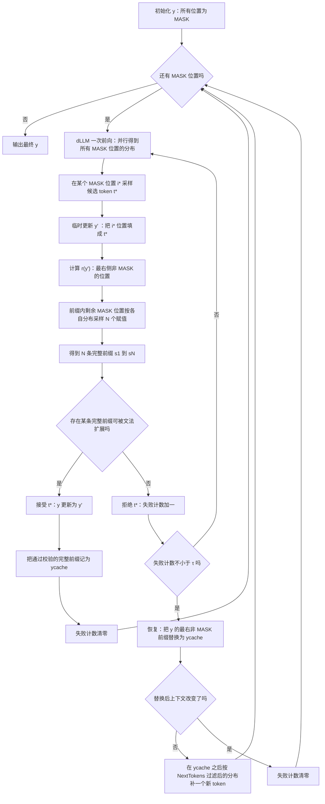

# Lookahead-Then-Verify：面向扩散大语言模型的、在上下文无关文法下可靠的约束解码（Lookahead-Then-Verify: Reliable Constrained Decoding for Diffusion LLMs under Context-Free Grammars）

> 说明：本文档是基于原论文的详细中文总结式翻译，重点保留研究动机、方法细节、实验与结论，并补充大量背景解释，方便零基础读者读懂。

## 论文信息

- 英文标题：Lookahead-Then-Verify: Reliable Constrained Decoding for Diffusion LLMs under Context-Free Grammars
- 中文标题：先前瞻再验证：面向扩散大语言模型的、在上下文无关文法下可靠的约束解码
- 作者：Yitong Zhang（张奕彤，清华大学）、Yongmin Li（李永民，北京大学）、Yuetong Liu（刘悦彤，清华大学）、Jia Li（李嘉，清华大学）、Xiaoran Jia（贾晓然，北京理工大学）、Zherui Li（李哲睿，南洋理工大学）、Ge Li（李戈，北京大学）
  - 以上人名中文写法依据拼音推测，论文原文只给英文（原文抽取不清，推测为以上中文姓氏写法）。
- 机构：清华大学（Tsinghua University，College of AI）、北京大学（Peking University，School of Computer Science / Key Lab of High Confidence Software Technology）、北京理工大学（Beijing Institute of Technology）、南洋理工大学（Nanyang Technological University，新加坡）
- 来源与年份：Proc. ACM Softw. Eng.（Proceedings of the ACM on Software Engineering），Vol. 3, No. ISSTA, Article ISSTA055，2026 年 10 月，共 23 页；DOI: https://doi.org/10.1145/3832146
  - 论文页脚同时给出预印本版本信息：arXiv:2602.00612v3 [cs.CL]，2026 年 8 月 24 日
  - ACM 投稿/接收时间：Received 2026-01-30；accepted 2026-06-25
- 论文自带的关键词：Constrained Decoding（约束解码）、Diffusion Large Language Model（扩散大语言模型）、Trustworthy AI（可信 AI）
- CCS 分类：Natural language processing（自然语言处理）、Syntax（语法）、Formal languages and automata theory（形式语言与自动机理论）
- 开源代码：https://github.com/THU-Agent/LAVE
- 方法名：LAVE。论文全文没有写出这个缩写的完整展开形式（原文未标明），从标题与正文推断应为 LookAhead-then-VErify 的缩写（原文未标明，这是推测）。
- 资助信息（摘要式记录，便于读者了解背景）：清华大学—科力尔电气（浙江）有限公司具身多模态人工智能联合研究中心（JCEMAI）、北京市自然科学基金（4264107、QY24136）、国家自然科学基金（62192733、62192730、62192731）、国家重点研发计划（2023YFB4503801）、北京市重大科技项目（Z251100008425005）。

## 1. 一句话总结

扩散大语言模型（dLLM）可以一次性给所有待填位置预测分布，LAVE 利用这一点，在模型每提出一个新 token 时，先把当前"带空洞的残缺前缀"补全成若干条完整前缀，再用文法解析器检查这些完整前缀里是否至少有一条还能继续扩展成合法句子；只要有一条能扩展就接受该 token，否则拒绝并重新采样，从而让扩散模型的约束解码从"看起来合法"升级为"每一步都保证后面还接得下去"。

## 2. 前置知识补课（读不懂这节就先读这节）

这一节假设读者没有接触过扩散语言模型，也没有接触过语法约束解码。读完之后，第 5 节的方法部分就只是把这里的概念组合起来。

### 2.1 自回归模型：一个字一个字往后写

大家熟悉的大语言模型（例如 GPT 系列、LLaMA 系列、Qwen 系列）绝大多数是**自回归语言模型（Autoregressive LLM，AR LLM）**。它的工作方式像人在纸上写字：已经写了"今天天气"，就猜下一个字，"真"，再猜下一个字，"好"。每一步只对**下一个位置**产生一个概率分布，选定一个 token 之后把它接到末尾，再走下一步。

关键词是**从左到右**、**一次一个 token**、**中间状态永远是完整前缀**。"完整前缀"指已经写下的部分里没有任何未定的位置。

### 2.2 扩散语言模型：一篇同时开写的完形填空

**扩散大语言模型（diffusion Large Language Model，dLLM）** 换了一套流程。它引入一个特殊的 `[MASK]` token，一开始把整条输出全部设成 `[MASK]`，然后用若干轮"去噪"把 `[MASK]` 逐步换成真实 token，直到没有 `[MASK]` 为止。

论文给出的形式化描述是这样的：模型 $f$ 初始化 $y_0 = ([MASK])_{i=1}^{L}$，其中 $L$ 是最大生成长度；给定提示词（prompt）$\mathbf{p}$，模型做至多 $T$ 个去噪步，得到最终序列 $y_T = (y_i^T)_{i=1}^{L}$，其中不再含 `[MASK]`。在第 $t$ 步，模型做一次前向计算，对**所有仍是 `[MASK]` 的位置**并行预测分布 $P_i(\cdot \mid \mathbf{p} \oplus y^{t-1})$，然后按这些分布把其中一小部分位置解码成非 `[MASK]` 的 token。

读者可以把这两种模型对比成两种做作业的方式（类比仅用于帮助理解）：

| 对比项 | 自回归模型（AR LLM） | 扩散语言模型（dLLM） |
| --- | --- | --- |
| 类比 | 逐字往后写作文 | 一整篇完形填空，先填几个空再回填别的 |
| 一步前向预测几个位置 | 1 个（下一个位置） | 所有 `[MASK]` 位置（并行） |
| 生成顺序 | 严格从左到右 | 不固定，右边的位置可能比左边先填好 |
| 中间状态 | 一定是完整前缀 | 常常是"带空洞的残缺前缀" |
| 效率来源 | 无法并行出 token | 并行去噪，步数少时可以一步出多个 token |

论文图 1 用同一个表达式 `return a > b ? a : b` 做对照：自回归模型在 Step T、T+1、T+2 分别是 `return`、`return >`（原文图中逐步拼出 token 序列）、`return > b`，每一步都是完整前缀；扩散模型在 Step T 是 `return > b ? a a : b`（原文图中有若干位置已经是真实 token），Step T+1 变成 `return > b ? a [MASK] : b`，Step T+2 变成 `return [MASK] b ? a [MASK] : b`。可以看到中间状态里既有已生成的 token，也有大量 `[MASK]`，并且右边可能比左边先完成。

补充两个工程上的细节，方便读者理解后面实验里出现的数字：

- **半自回归（semi-autoregressive）**：把整条输出切成若干块，块内并行去噪、块间按顺序推进。论文的实验统一采用这种策略，块大小（block size）设为 32。
- **去噪步数 $T$**：$T$ 越大，质量一般越好，但耗时越高。论文主实验取 $T = 128$，最大生成长度 $L = 256$。

### 2.3 为什么"定序生成"的约束解码在 dLLM 上会失效

**约束解码（constrained decoding）** 的目标很朴素：让模型吐出来的东西一定符合某种语法。传统做法依赖一个**文法解析器（grammar parser）**，解析器手里有一个"期望栈"，它能回答一个问题：*给定我已经读到的完整前缀，下一个 token 允许是哪些？* 不允许的就直接把概率置零（这一步叫 mask，遮蔽），模型只能在合法的候选里采样。

问题在于，现有解析器基本都是为**完整前缀**设计的。自回归模型每一步的中间状态恰好就是完整前缀，所以两者天然契合。扩散模型的中间状态里带着一堆 `[MASK]`，解析器读到 `return ( [MASK] [MASK]` 这种输入会直接不知道该干什么。

论文把这条困难说得更具体：dLLM 常常产生**残缺前缀（incomplete prefix）**，也就是"前缀里还夹着若干没生成的 token（`[MASK]`）"，这让现有的约束解码技术**不适用**。所以核心挑战变成一句话：*怎么让约束解码在这种带洞的前缀上也能工作？*

### 2.4 上下文无关文法（CFG）与词法/语法分析

**上下文无关文法（Context-Free Grammar，CFG）** 是描述"哪些字符串是合法的"的一套规则。它由四样东西组成：

- 终结符（terminal）：真正出现在输出里的符号，例如 `a`、`b`、`+`、`;`、`if`；
- 非终结符（non-terminal）：抽象的语法类别，例如"表达式""语句"；
- 产生式（production）：形如 `左部 → 右部` 的重写规则；
- 开始符号（start symbol）：整条句子要从哪个非终结符开始推导。

"上下文无关"的意思是：一条产生式能不能用，只取决于当前这个非终结符，跟它左右两边出现了什么无关。C++、Java、Go、JSON、SMILES 的语法都可以用 CFG 描述（注意 JSON 的语法由每个问题各自的 JSON Schema 自动转成 CFG，见第 6 节）。

解析器读完一段输入后能给出两种判断，这两种判断是本文的地基：

- **是否可接受**：这段输入本身是不是一个完整合法句子；
- **是否可扩展（IsExtendable）**：这段输入虽然还没完，但后面还有没有可能接成合法句子。

论文明确指出 `IsExtendable(·)` 是大多数文法解析器（例如 Earley 解析器、LR 解析器）都提供的能力。本文两个需要解析器的组件（FS-CD 基线和 LAVE）都采用 **Earley 算法**，因为它能处理任意 CFG。

### 2.5 手工迷你文法：把"栈的变化"演一遍

为了让"栈"这个抽象概念落地，我们用一个小到能手工算完的文法（类比仅用于帮助理解，真实的 C++ 文法比这大上万倍）：

```text
S  →  T '+' T
T  →  'a' | 'b'
```

它能描述的合法句子只有三种：`a + a`、`a + b`、`b + a`、`b + b`（严格说四种，取决于左右两侧各选 `a` 还是 `b`）。

解析时用一个栈记录"我接下来还期待看到什么"，栈的左端是栈顶。约定：读到终结符就跟栈顶比对，相同就弹出；读到非终结符就选一条产生式把右部压进栈。

| 步骤 | 栈（左端为栈顶） | 剩余输入 | 动作 |
| --- | --- | --- | --- |
| 1 | `S` | `a + a` | 拿栈顶 `S`，用 `S → T + T` 展开，右部逆序压栈 |
| 2 | `T` `+` `T` | `a + a` | 拿栈顶 `T`，用 `T → a` 展开 |
| 3 | `a` `+` `T` | `a + a` | 栈顶是终结符 `a`，与输入首字符匹配，弹出并读走 |
| 4 | `+` `T` | `+ a` | 栈顶 `+` 与输入匹配，弹出并读走 |
| 5 | `T` | `a` | 拿栈顶 `T`，用 `T → a` 展开 |
| 6 | `a` | `a` | 栈顶 `a` 与输入匹配，弹出并读走 |
| 7 | （空） | （空） | 输入读完且栈空，接受 |

反过来，假设已经读到 `a +`，此时栈是 `T`。如果模型想接着吐 `+`，栈顶是 `T`，而 `T` 的两个产生式都以 `a` 或 `b` 开头，没有一条能接 `+`，于是 `+` 被判定非法。

### 2.6 约束解码里的 mask：把不合法的 token 概率清零

有了栈，就能算 mask 了。规则是：**看栈顶，列出所有能推动解析前进的 token，其它的全部禁止。** 在上面第 5 步（栈顶为 `T`）时，允许的集合是 `{a, b}`，词表里其余的几万个 token 全部被 mask 掉。模型只能在这两个里面采样，于是采样结果天然合法。这就是"哪些 token 合法"的 mask 机制。

对自回归模型，这套机制是"在线"的：每生成一个 token，栈就前进一步，mask 跟着更新一次。对扩散模型，栈本身没法定义，因为输入里混着 `[MASK]`。本文的第 3 节就是围绕"怎么绕开这个矛盾"展开的。

### 2.7 投机解码的直觉：先草拟几个字，再回头检查

**投机解码（speculative decoding）** 是另一个有用的类比来源。它的做法是：让一个便宜的小模型一口气草拟好几个 token，再让真正的大模型**并行**核对这几步是否都成立，一次性接受多个 token，从而省时间。核心思想是"批量草拟 + 批量校验"，其中校验比逐个生成便宜得多。

LAVE 借用的正是这个形态，只是把"草拟"换成了"扩散模型对剩余空位的并行填补"，把"校验"换成了"文法解析器的可扩展性检查"。论文自己的说法是：当模型为一个被遮蔽的位置提出一个 token 时，LAVE 就可以自然地做前瞻（lookahead）——在当前残缺前缀的其余 `[MASK]` 位置上采样 token，把前缀变成一批完整前缀，交给解析器判断。这种"先草拟再检查"的直观，是理解第 5 节的关键（类比仅用于帮助理解）。

### 2.8 把零件拼起来：LAVE 的直觉

把 2.2 到 2.7 的零件装到一起，LAVE 的直觉只有两句话：

1. **前瞻（Lookahead）**：模型提出的 token 到底行不行，先别急着定论。利用"一次前向就能拿到所有位置分布"这个扩散模型独有的能力，把剩下几个空位按概率填满，得到若干条完整的候选前缀。
2. **验证（Verify）**：把这些完整前缀丢给解析器，问一句"还能往后接吗"。只要有一条能接，说明当前这个 token 没有把路堵死，可以接受；一条都接不上，就拒绝，让模型重新提一个。

一句话概括它比旧方法强在哪：旧方法只保证"现在这一步看着没毛病"，LAVE 保证"现在这一步之后一定还有活路"。

## 3. 研究背景：这篇论文在解决什么问题

### 3.1 领域现状（生活化比喻）

扩散语言模型最近在学术界和工业界都拿到大量关注，原因是它在理论上有很高的生成效率潜力。早期开源模型如 LLaDA、Dream 已经能跟 LLaMA3-8B 比一比；专用模型如 Dream-Coder、DiffuCoder 在代码生成上能达到 Qwen2.5-Coder-7B 的水平；Mercury Coder、Gemini Diffusion 的速度优势更是明显。同时，业界越来越多地让模型去生成**形式语言（formal language）**——由 CFG 定义、必须严格符合语法的东西，例如源代码、JSON、化学表达式（SMILES）。

但是概率模型终究会犯错。论文给了一个让人有直观感受的预实验：在 HumanEval-CPP 上，即便最好的扩散模型也有很高的语法错误率，其中 **Dream-v0-Instruct-7B 的语法错误率高达 23.8%**。生成出来的代码语法不通，后面就没有任何"功能是否正确"可言了。

打个比方（类比仅用于帮助理解）：让 dLLM 写代码，像是让一位思路很快但写字潦草的作家赶稿。他的内容可能很有想法，可括号没配平、分号漏了，读者连句子都读不通。

### 3.2 扩散 LLM 上做约束解码为什么困难（论文给出的具体失败模式与反例）

论文把困难拆成两层，论文原文用 ❶❷ 之外的编号来描述，这里转述为两条主线。

**第一条主线：绝大多数现有约束解码方法根本用不了。** 现有方法依赖从左到右的生成顺序和完整前缀，扩散模型的生成范式天生是非自回归的，因此这些方法**不能直接应用**。论文也提到，最近有工作开始尝试为扩散模型定制约束解码，例如 DINGO 用动态规划的译码过程让扩散模型输出符合文法，但它只能处理**正则文法（regular grammar）**，而真实场景通常需要表达能力更强的 CFG。另一条路子是强行让扩散模型按严格从左到右的顺序生成，好把自回归那套方法搬过来——论文把这个自造基线叫 FS-CD，它的后果在第 6 节会看到：输出质量反而下降、大量重复。

**第二条主线：为扩散模型定制的方法不"可靠"。** 与本文最接近的工作是 Mündler 等人的方法（论文编号 [29]，本文称其为 **IG-CD**，Intersection-Guided Constrained Decoding，交集引导的约束解码）。它用经典的拒绝采样来施加文法约束，核心想法是把"新提出的 token 是否合法"化归为一个语言交集问题。

论文的例子（C 语言）：当前中间输出是 `for ( [MASK] [MASK]`。如果模型为第二个被遮蔽的位置提出 token `)`，IG-CD 会构造一个正则语言，用来接受所有匹配模式 `for ( Σ1 ) Σ*` 的字符串，其中 Σ 表示词表；然后把这个正则语言跟目标上下文无关语言求交集，**交集非空就接受**。

为了让计算可行，IG-CD 必须忽略被遮蔽区间的实际长度限制，假设每个遮蔽区间可以被任意多个 token 填充，于是上面那个正则语言在实际实现中被**过近似（over-approximate）**成 `for ( Σ* ) Σ*`。论文指出，正是这个过近似引入了**约束不可靠（constraint unreliability）**：它可能接受某些 token，让中间输出再也没法补成合法序列。

回到那个例子：括号之间**只剩一个**被遮蔽的位置，而一个语法合法的 `for` 语句需要**至少两个分号**，通常对应两个 token。即使有这个硬性要求，过近似仍然允许接受 `)`，于是这份中间输出永远补不成合法程序了。

论文的关键反例具体到一句话：**"接受了一个 token，结果输出再也补不完整"**。这就是本文要消灭的失败模式。

论文还给出了"约束可靠性"的正式定义（这是本文全篇的核心概念）：

- **可靠约束（Reliable Constraint）**：在每一个解码步，中间输出都保持**可扩展（extendable）**，也就是说它仍然能被补完成一个目标语言里的合法句子。
- **不可靠约束（Unreliable Constraint）**：至少存在一个解码步，中间输出不可扩展，也就是说它再也没法被补完成任何合法句子。

论文强调，既然约束解码的目的就是提升 LLM 输出的可靠性，那么"施加可靠约束"就是实际部署的基本要求。文中有一个脚注补充：跟大多数先前的自回归约束解码工作一致，这里的可靠性定义**没有把最大生成长度考虑进去**（这个脚注在后面分析实验残余错误时很关键，见第 9 节）。

### 3.3 本文切入的角度

论文抓到的那根线头是：**dLLM 在一次前向里就能给出所有位置的分布**。这既是它跟自回归模型最大的不同，也正好是解决"带洞前缀无法验证"的钥匙——既然候选 token 只是把某个洞填上了，那就把**其余的洞也按模型自己的分布草填一下**，于是残缺前缀就变成完整前缀，解析器就能干活了。

论文把这条路总结成一个词：**lookahead-then-verify（先前瞻再验证）**。它同时解决了两件难事：

- ❶ 洞可能很多、词表可能很大，理论上要穷举指数多个补全方案，算不动。本文第 3.2.2 节的预实验显示，**只采样很少几条完整前缀就足以判断**，于是开销被压到可忽略。
- ❷ 即使验证很快，反复"提议—被拒"也可能卡死在某些困难上下文里。本文第 3.3 节加了一个轻量的**恢复机制**（Cache-Enhanced Recovery），主动调整当前上下文让模型脱困，同时不破坏约束可靠性。

## 4. 研究意义与目的（为什么重要、对谁有用）

- **对代码生成（源代码）**：代码是典型的 CFG 语言。论文的 CPP-Bench、JAVA-Bench、GO-Bench 各含 164 道题，来自 HumanEval 系列的多语言版本。语法错误率从两位数的百分比降到接近零，意味着后续的编译、测试、自动修复环节都能省下大量无效尝试。
- **对 JSON 生成与信息抽取/工具调用**：JSON-Bench（JSON-Mode-Eval-Extended）含 272 道题，每题带一个 JSON Schema，用来考察模型从自然语言里抽取结构化信息的能力。JSON 被广泛用于信息抽取和 agent 的函数调用，格式一旦破坏，下游程序直接报错。
- **对化学式生成（科学应用）**：SMILES-Bench 含 167 道题，要求从自然语言分子描述生成 SMILES 字符串。SMILES 是化学信息学的标准表示，语法错误等于分子不存在。
- **对可信 AI**：作者把 "Trustworthy AI" 列为关键词。约束解码在部署里承担"守门人"的角色，如果这个守门人本身不可靠（放了会导致死路的 token 进来），整个可信性叙事就站不住。本文的目标是把守门人从"事后检查"变成"保证留有后路"。

## 5. 方法详解（本文核心）

### 5.1 问题形式化（关键公式与逐符号解释）

**符号约定。** 让 $\Sigma$ 表示词表（所有可能 token 的集合），$L$ 表示最大生成长度。带洞的输出用 $y \in (\Sigma \cup \{[MASK]\})^{L}$ 表示，也就是每个位置要么是一个真实 token，要么是 `[MASK]`。

**公式 (1)：最右侧非 `[MASK]` 位置的下标**

$$r(y) = \max\{\, i \mid y_i \neq [MASK] \,\}$$

- $y_i$：输出序列第 $i$ 个位置上的东西；
- $r(y)$：最靠右的、已经填了真实 token 的位置下标；
- 论文补充：如果所有位置都是 `[MASK]`，就约定 $r(y) = 0$。

**直觉**：扩散模型的生成是乱序的，右边可能先填好。$r(y)$ 就是"模型已经能够确定的边界"。只有这个边界以内的部分，才值得去检查；边界以外的位置还是全洞，暂时没有信息可用。

**公式 (2)：前缀内的被遮蔽位置集合**

定义前缀 $y_p = y_{1:r(y)}$（从第 1 个位置到第 $r(y)$ 个位置），然后

$$M(y_p) = \{\, i \mid 1 \le i < r(y),\; y^p_i = [MASK] \,\}$$

- $y_p$：当前"带洞的前缀"，论文称它通常是一个 incomplete prefix；
- $M(y_p)$：这个前缀里还没填的位置集合（因为 $r(y)$ 本身是非 `[MASK]` 位置，所以条件是严格小于 $r(y)$）；
- $|M(y_p)|$：还剩几个洞要草填。

**公式 (3)：可接受性的真正定义**

一个被提出的 token 可以**可靠地接受**，当且仅当"把剩下的洞全部填上"这件事**存在至少一种填法**，使得得到的完整前缀是合法前缀：

$$\exists\, z \in \Sigma^{|M(y_p)|} \quad \text{s.t.} \quad \texttt{IsExtendable}\big(\Phi(y_p, z)\big) = \texttt{true}$$

- $z$：一个赋值向量，长度为 $|M(y_p)|$，第 $k$ 个分量是给第 $k$ 个洞填的 token；
- $\Sigma^{|M(y_p)|}$：所有可能赋值的集合（大小是 $|\Sigma|$ 的 $|M(y_p)|$ 次方，这正是"指数级"的来源）；
- $\Phi(y_p, z)$：填充函数，把 $y_p$ 里的洞按 $z$ 填满，得到一个不含任何 `[MASK]` 的完整前缀；
- `IsExtendable(·)`：文法解析器提供的标准能力，判断一个完整前缀能否继续扩展成合法句子。

**这个定义为什么就是"可靠性"**：公式 (3) 说的是"存在一条活路"。只要它成立，当前输出就保住了补完成合法句子的可能性，这就是第 3.2 节里 Reliable Constraint 的形式化版本。反过来，如果对**所有** $z$ 都不成立，说明这个 token 已经把路全部堵死，属于不可靠，必须拒绝。

**直接照做是不可行的**：$|\Sigma^{|M(y_p)|}|$ 是天文数字。这正是需要"采样少量完整前缀"的原因（第 5.3、5.4 节）。

### 5.2 总体思路：Lookahead 与 Verify 分别做什么（讲清直觉）

论文把整个过程说成"迭代式的提议与验证（iterative proposal and verification）"。三个角色的分工是：

- **提议方（dLLM 本身）**：按它原生的解码策略，为某个被遮蔽的位置提出一个新 token。注意这里强调的是"原生策略"——论文不改变扩散模型自己的采样与去噪行为，只对结果做接受或拒绝。
- **前瞻方（Lookahead-Based Verification）**：拿到更新后的输出，找出最右非 `[MASK]` 位置形成前缀，把前缀里剩下的洞**按模型自己预测的边缘分布**采样 $N$ 组赋值，得到 $N$ 条完整前缀。
- **验证方（文法解析器）**：对每条完整前缀调用 `IsExtendable`，只要有一条为真就放行。

论文图 2 用一页图讲清了这三步。图中当前的残缺前缀形如 `return a [MASK] b ? [MASK] : [MASK]`（原文图中给出 `return`、`a`、`[MASK]`、`b`、`?`、`[MASK]`、`:`、`[MASK]` 这一串）；第 1 步模型为一个被遮蔽的位置提出 token `b`，得到 `return a [MASK] b ? [MASK] : b`；第 2 步做前瞻，用候选集 `{0, a, :, >, ?, <, ==}` 之类的取值把剩余空位填满，得到一组完整前缀，例如 `return a ? b ? a : b`、`return a > b ? : : b`、`return a < b ? a : b`、`return a > b ? b : b`、`return a < b ? : : b`；第 3 步把这些完整前缀交给文法解析器逐条检查（原文图中是文法解析器模块接收"一组完整前缀"）。图中文字明确写着：只要**至少一条**前瞻完整前缀在目标文法下可扩展，提出的 token 就被接受，否则被拒绝。

需要说清楚的一点：前瞻得到的完整前缀**不要求语法正确**。它的作用只是"当好证人"——用来证明"这条路没被堵死"。绝大多数草拟出来的字符串是语法错误的，这完全正常，它们的存在意义是暴露"有可能走到哪里去"。

### 5.3 Lookahead 机制详解（算法与逐步讲解）

**先看预实验（第 3.2.2 节），它决定了整篇文章能不能成立。**

- 数据集：HumanEval-CPP。
- 造样本的方式：对每条测试实例，从参考解里随机挑一个前缀，用它给输出做预填充，形成完整前缀；再把其中 token 以 80% 的概率保留、否则替换成 `[MASK]`，得到残缺前缀。论文特别说明，这样得到的残缺前缀**保证是可扩展的**（因为它是从正确的参考解里挖洞挖出来的）。
- 然后做一次前向，拿到每个遮蔽位置的预测分布，从这些分布里采 $N$ 条不同的完整前缀，检查其中有没有任何一条能在目标 CFG 下扩展成合法句子。
- 结论（图 3）：**只要采很少几条就够用**。具体数字：
  - Dream-v0-Instruct-7B：$N=1$ 时接受率 90.1%，$N=5$ 时 96.6%，$N=10$ 时 **98.1%**，$N=100$ 时 98.8%，$N=1000$ 时 99.1%；
  - LLaDA-8B-Instruct：$N=1$ 时 87.1%，$N=5$ 时 94.6%，$N=10$ 时 **97.3%**，$N=100$ 时 98.5%，$N=1000$ 时 98.9%。
- 读法：$N$ 从 1 涨到 10，接受率就跳了大约 8 到 10 个百分点；从 10 涨到 1000，只再多 1 个百分点左右。这说明"多采几条"的边际收益迅速衰减，作者据此把 $N$ 定为 10。

**再看前瞻的具体公式（第 3.2.3 节）。**

设 $P_j(\cdot)$ 表示每个遮蔽位置 $j \in M(y_p)$ 上的预测 token 分布。前瞻要采样 $N$ 个不同的赋值 $\{z^{(1)}, \dots, z^{(N)}\}$，每个赋值从下面的联合分布里抽出：

$$P(z) = \prod_{j \in M(y_p)} P_j(z_j) \tag{4}$$

- $P(z)$：整个赋值的概率；
- $\prod_{j \in M(y_p)}$：对所有剩余空位求乘积；
- $P_j(z_j)$：第 $j$ 个位置被填成 $z_j$ 的概率；
- 逐符号解释的关键点：$P_j$ 是模型给出的**边缘分布**（marginal distribution），公式 (4) 把各位置独立相乘，也就是用"边缘分布之积"当作联合分布的一个近似。这是扩散模型"一次前向给所有位置分布"的直接产物——因为这些分布是并行算出来的，模型并没有给出一个真正的联合分布，公式 (4) 是工程上可用的替代方案。

**公式 (5)：把赋值填成完整前缀**

$$s^{(n)} = \Phi(y_p, z^{(n)}), \quad n \in \{1, \dots, N\} \tag{5}$$

- $s^{(n)}$：第 $n$ 条完整前缀，已经不再含 `[MASK]`；
- $\Phi$ 与公式 (3) 里的填充函数是同一个。

**算法 1（LAVE）的逐步中文讲解。** 论文给出如下伪代码，输入是：扩散模型 $f$、上下文无关文法 $G$、提示词 $\mathbf{p}$、前瞻规模 $N$、尝试预算 $\tau$。

- 第 1 行：把输出 $y$ 全部初始化成 `[MASK]`。
- 第 2 行：连续失败计数器 $c_{\text{fail}} \leftarrow 0$。
- 第 3 行：缓存 $y_{\text{cache}} \leftarrow \epsilon$（空串）。
- 第 4 行：进入主循环——只要还有 `[MASK]` 位置就继续。
- 第 5 行：用 $f$ 为某个被遮蔽的位置 $i^*$ **提出**一个候选 token $t^*$。
- 第 6 行：造一个临时输出 $y'$，内容与 $y$ 相同，只是把 $y'_{i^*}$ 改成 $t^*$。
- 第 7 行：调用 Lookahead-Based Verification 判断 $y'$（第 3.2 节的核心）。
- 第 8 行：验证通过 → 把 $y$ 更新为 $y'$，也就是**接受**这个 token。
- 第 9 行：用一个通过验证的完整前缀去更新 $y_{\text{cache}}$。
- 第 10 行：把 $c_{\text{fail}}$ 清零。
- 第 11–13 行：验证不通过 → $c_{\text{fail}} \leftarrow c_{\text{fail}} + 1$，也就是**拒绝**，模型需要另提一个 token。
- 第 14–17 行：当 $c_{\text{fail}} \ge \tau$ 时，对 $y$ 施加 Cache-Enhanced Recovery（第 3.3 节），再把 $c_{\text{fail}}$ 清零。
- 第 18–19 行：循环结束时输出不含 `[MASK]` 的最终结果 $y$。

一句话读法：**提出 → 前瞻验证 → 接受或拒绝 → 卡太久就恢复**。

### 5.4 Verify 机制详解（如何用解析器检查候选，如何回退或拒绝）

**接受判据（公式 6）。** 验证阶段把每条完整前缀拿去并行判断是否可扩展，提出的 token 被接受，当且仅当

$$\exists\, n \in \{1, \dots, N\} \quad \text{s.t.} \quad \texttt{IsExtendable}(s^{(n)}) = \texttt{true} \tag{6}$$

- $n$：第几条前瞻样本；
- 只要一条为真就整体为真。

论文把这个通过检查的前缀称为**构造性见证（constructive witness）**：它本身就是一个"这条路还能走下去"的实证，因此约束的可靠性被自然地保住了。这里的"见证"是数学上"存在性证明"的说法——要证明"存在一条活路"，最干脆的办法就是把那条路直接摆出来。

**拒绝与回退。** 如果 $N$ 次前瞻都没找到可扩展的完整前缀，就拒绝该 token，**从模型原本的预测分布里重新采一个**候选。这里有一个容易被忽略的设计取向：论文的做法是反复"采样—检验"，直到采到一个经得起检验的 token，或者触发恢复机制；它没有去修改模型的概率分布做 mask，因为那样会破坏扩散模型原生的去噪行为。

**缓存与恢复（第 3.3 节，Cache-Enhanced Recovery）。** 恢复机制用的材料是验证过程的"副产品"。每当一条完整前缀 $s^{(n)}$ 通过验证，它同时满足两个条件：语法上可扩展、概率上被模型偏爱。于是论文维护一个全局变量 $y_{\text{cache}}$，每次验证成功就更新：

$$y_{\text{cache}} \leftarrow s^{(n)}, \quad \text{if } \texttt{IsExtendable}(s^{(n)}) = \texttt{true} \tag{7}$$

- $y_{\text{cache}}$：最近一次成功验证留下的"好前缀存档"。

推理过程中监控连续失败次数，一旦达到尝试预算 $\tau$，就判断模型卡在困难上下文里了，于是把当前输出的前缀替换成缓存：

$$y_{1:r(y)} \leftarrow y_{\text{cache}} \tag{8}$$

- $y_{1:r(y)}$：当前输出里"有信息的那一段"（到最右非 `[MASK]` 为止）。

**公式 (8) 的边界情况。** 如果 $y_{1:r(y)}$ 里已经没有剩余的 `[MASK]`（也就是 $y_{1:r(y)}$ 与 $y_{\text{cache}}$ 完全相同），那么单纯替换并不能改变上下文，卡死状态依旧。为了保证上下文真的被改动，论文的做法是**在当前前缀之后再生成一个额外 token**。具体地，让 $V = \texttt{NextTokens}(y_{\text{cache}})$ 表示给定这个完整前缀后所有合法的后继 token 集合（论文指出，现有约束解码工作常用的许多解析器都能高效算出这个集合，且集合里的 token 一定保持前缀的语法有效性），然后把下一个位置的概率分布调整为：

$$\hat{P}_{r(y)+1}(t) \;\propto\; P_{r(y)+1}(t)\, \mathbb{I}[t \in V] \tag{9}$$

- $\hat{P}_{r(y)+1}(t)$：调整后、用于采样的分布；
- $P_{r(y)+1}(t)$：模型原始分布；
- $\mathbb{I}[t \in V]$：指示函数，$t$ 属于合法后继集合时取 1，否则取 0；
- $\propto$：按比例归一化（把被保留项的概率重新归一到 1）。

**这一步的效果**：只在合法后继里采样，所以这一步不可能破坏语法；同时从 $y_{\text{cache}}$ 之后前进一格，上下文确实变了，卡死被打破。之后推理继续走标准的"提议—验证"流程，扩散模型的非自回归生成行为和后续的约束可靠性都保持不变。

### 5.5 与采样/去噪流程的结合（整体推理流程）

把第 5.3、5.4 节的步骤串成一张流程图，可以看得更清楚：



图里的三条回路值得单独指出：**接受回路**（J→K→L→B）保持原始生成节奏；**重提回路**（M→N→C）在不改变上下文的前提下反复尝试；**恢复回路**（O→P→Q→B）在某一步主动改写上下文来脱困。三者共享同一个文法解析器，因此"可靠性"这条不变量在任何一条回路上都不会被破坏。

### 5.6 正确性保证与边界情况（论文给出的形式化程度）

论文没有给出成体系的形式化定理（例如"每条被接受的 token 都满足公式 (3)"这类命题的证明），它走的是**定义 + 构造性论证**的路线，包含四个要点：

1. **可靠性有形式化定义**（第 3.2 节）：可靠约束 = 每一步中间输出都可扩展；不可靠约束 = 存在某一步不可扩展。
2. **接受侧有构造性见证**：公式 (6) 里那条 `IsExtendable` 为真的完整前缀，就是"输出仍可扩展"的直接证据。因为前缀是通过填满本前缀内的所有 `[MASK]` 得到的，所以它证明了这一组赋值的确存在，公式 (3) 的存在性量化被满足。
3. **拒绝侧没有对等保证**：论文在"效度威胁"里明确承认（第 6.5 节 ❷），由于 dLLM 的非自回归生成机制，**很难同时保证"所有被接受的 token 都合法"和"所有被拒绝的 token 都不合法"**。因此，LAVE 有时会拒绝掉本来还能通向合法完成的 token。作者给出的立场是：约束解码的首要目标是提升输出可靠性，在这个视角下"保证被接受的都合法"比"不放过任何潜在合法 token"更重要；第 3.2.2 节的经验结果（少量前瞻样本就足够找到可扩展候选）说明拒绝有效 token 的概率不高；第 5.1、第 5.2 节的实验也显示语法正确率和功能正确率都在上升，因此这种误拒的实际影响可以忽略。这是**可靠性优先于完备性（soundness 优先于 completeness）**的取舍，论文把它写得很直白。
4. **可靠性定义明确排除了最大生成长度**（脚注 1）：定义沿用先前自回归约束解码工作的惯例，不考虑 $L$ 的限制。这个边界在实验里真的有后果：论文第 6.1 节解释了残余语法错误的来源——模型倾向于**重复生成**（例如反复吐空白或换行），一直撞到最大生成长度为止；作者核查了所有非法输出，发现**每一条的生成 token 数都恰好等于最大生成长度**。换句话说，LAVE 保证的是"语法上还能接下去"，但没保证"在 256 个 token 之内一定能接完"，而 Java 程序偏长，偶发地就撞上了 $L = 256$ 这堵墙（第 5.1 节也把 JAVA-Bench 难以推到接近 100% 归因于此）。好消息是，论文指出已有大量针对重复问题的方法与 LAVE **正交**，可以叠加使用。

### 5.7 复杂度与开销分析

论文第 3.4 节的推导很直接：

- 由算法 1，每个解码步最多允许 $\tau$ 次失败提议；
- 每次提议最多需要 $N$ 次前瞻验证；
- 用 Earley 解析器验证长度为 $\ell$ 的前缀，对一般 CFG 的时间是 $O(\ell^3)$；
- 因此**每生成一个被接受的 token**，额外开销上界为 $O(\tau N \ell^3)$；
- 对实践中常见的**确定性 CFG**，这个开销降为 $O(\tau N \ell)$。

两处面积上的细节也值得记住：论文说验证阶段可以**并行**处理每条完整前缀（第 3.2.3 节"we apply grammar parsers to each complete prefix to determine whether it is extendable in parallel"），这解释了为什么 $N = 10$ 的成本在线性可接受范围内；另外，前瞻采样本身用的是一次前向已经算好的分布，不需要额外前向，所以"并行预测所有位置"这个能力既是方法的基础，也是开销可控的原因。

## 6. 实验设置与结果

论文把实验组织成五个研究问题：

- RQ1：相比基线，LAVE 在多大程度上保证 dLLM 输出的**语法正确性**？
- RQ2：LAVE 在多大程度上提升 dLLM 输出的**功能正确性**？
- RQ3：LAVE 引入多大的**运行时开销**？
- RQ4：LAVE 的**每个组件**对整体性能贡献多少？
- RQ5：**超参数**如何影响 LAVE 的性能？

### 6.1 模型与数据集（列出具体 dLLM 名称与规模、文法与任务）

**四个扩散语言模型：**

| 简称 | 全名与规模 | 发布方 | 论文给出的特点 |
| --- | --- | --- | --- |
| LLaDA-8B | LLaDA-8B-Instruct，80 亿参数 | 中国人民大学研究者 | 早期开源扩散大语言模型，完全从零训练 |
| LLaDA-1.5 | LLaDA-1.5 | 中国人民大学研究者 | 在 LLaDA-8B-Instruct 基础上训练时引入 Variance Reduced Preference Optimization（VRPO，方差缩减偏好优化），在包括代码在内的广泛任务上更强 |
| Dream-7B | Dream-v0-Instruct-7B，70 亿参数 | 香港大学研究者 | 从一个自回归语言模型初始化而来，整体能力较强 |
| DiffuC-7B | DiffuCoder-7B-cpGRPO，70 亿参数 | 苹果公司与香港大学研究者 | 在 21K 代码样例上用 coupled-GRPO 做后训练，代码生成性能大幅提升 |

作为对照，第 6.2 节的 AR 对比实验中还用到了 Llama-3-8B-Instruct（记为 LLaMA-8B）与 Qwen2.5-7B-Instruct（记为 Qwen-7B）。

**五个基准（benchmark）与对应的文法：**

| 基准 | 名称与题目数 | 任务 | 文法来源 |
| --- | --- | --- | --- |
| CPP-Bench | HumanEval-CPP，164 题 | 按自然语言描述生成 C++ 代码，附测试用例 | 按 C++ 标准语法构造 |
| JAVA-Bench | HumanEval-Java，164 题 | 生成 Java 代码 | 按 Java 标准语法构造 |
| GO-Bench | HumanEval-Go，164 题 | 生成 Go 代码 | 按 Go 标准语法构造 |
| JSON-Bench | JSON-Mode-Eval-Extended，272 题 | 从自然语言片段抽取信息，输出符合 JSON Schema 的 JSON | 每题按它自己的 JSON Schema 自动构造文法 |
| SMILES-Bench | SMILES-Eval，167 题 | 从自然语言分子描述生成 SMILES 化学分子表示 | 按 SMILES 标准语法构造 |

**实现细节（这些数字影响后面所有结论的解读）：**

- 所有方法共享一个常见优化：一旦 dLLM 生成 `[EOS]`，后续所有位置都设为 `[EOS]`，以加速推理。
- 所有实验采用半自回归策略，块大小 32。
- 每次实验至少跑 **4 次独立运行**，报告指标平均值。
- FS-CD 与 LAVE 都用 **Earley 算法**实现文法解析器，以处理任意 CFG。
- 硬件：8 张 NVIDIA A100 GPU（每张 40 GB 显存）、2 颗 Intel Xeon Gold 6348 CPU（每路 28 核，共 56 物理核）。
- dLLM 超参数：最大生成长度 $L = 256$；去噪步数 $T = 128$；温度固定 0.2。
- LAVE 超参数：前瞻规模 $N = 10$，尝试预算 $\tau = 5$。

### 6.2 基线方法（每个基线一句话说明）

论文对比三个基线：

- **NO-CD**：不加任何约束的生成设置，代表"模型原生水平"。所有改进都以它为参照原点。
- **IG-CD（Intersection-Guided Constrained Decoding）**：把"新 token 是否合法"化归为正则语言与上下文无关语言求交集的约束解码方法（论文编号 [29]，即与本文最接近的 dLLM 定制方法，也是本文批评"不可靠"的对象）。
- **FS-CD（Forced-Sequential Constrained Decoding）**：论文自己设计的朴素基线，强制 dLLM 按严格从左到右的顺序生成，这样就能直接套用原本为自回归模型开发的约束解码技术（论文编号 [28]，即 LLGuidance）。

IG-CD 有一个实验上的硬限制：它在 GO-Bench 与 JAVA-Bench 上**无法评估**，因为原论文既没有提供 IG-CD 兼容的 Go/Java 文法，也没有公开它使用的文法构造规则，导致作者无法忠实复现。因此表 1 和表 2 里这两列对 IG-CD 记为 `–`。

在 AR 对比实验（表 6）中，自回归模型的约束解码用的是 **LLGuidance**；为公平起见，扩散模型被配置成**每步只解码一个 token**（这是与主实验不同的设置，主实验用的是块大小 32）。

### 6.3 评价指标（写清计算方式）

三个指标：

- **syntactic@k**：在 $k$ 个生成输出中，**至少有一个**满足给定 CFG 语法约束的题目比例。$k \in \{1, 5, 10\}$。它衡量"给模型 $k$ 次机会，能不能至少写对一次语法"。
- **functional@k**：在 $k$ 个生成输出中，**至少有一个**功能行为正确的题目比例。对 CPP-Bench、GO-Bench、JAVA-Bench，功能正确性通过**运行题目自带的测试用例**判定；对其它基准，用与标准答案**精确匹配（exact matching）**判定。论文强调，一般情况下语法正确性是功能正确性的前提。
- **平均推理时间（average inference time）**：每次生成的平均解码时间，用来衡量不同约束解码方法引入的开销。

### 6.4 主实验结果（表格重绘 + 逐条解读数字）

**表 1：syntactic@k（%）。** 加粗代表该模型、该基准、该 $k$ 下的最优结果。

| 模型 | 方法 | JSON k=1 / 5 / 10 | CPP k=1 / 5 / 10 | JAVA k=1 / 5 / 10 | GO k=1 / 5 / 10 | SMILES k=1 / 5 / 10 |
| --- | --- | --- | --- | --- | --- | --- |
| LLaDA-8B | NO-CD | 85.4 / 90.1 / 96.4 | 74.2 / 94.1 / 95.6 | 72.0 / 86.6 / 89.6 | 72.0 / 86.1 / 87.5 | 66.0 / 75.9 / 78.9 |
| LLaDA-8B | FS-CD | 94.9 / 96.4 / 96.4 | 66.3 / 66.7 / 66.7 | 78.7 / 79.4 / 79.4 | 81.7 / 82.2 / 82.3 | 75.7 / 75.9 / 76.1 |
| LLaDA-8B | IG-CD | 94.8 / 95.7 / 96.7 | 86.1 / 96.7 / 98.1 | – | – | 94.3 / 98.7 / 99.2 |
| LLaDA-8B | **LAVE** | **99.5 / 99.6 / 99.6** | **90.9 / 99.3 / 99.4** | **92.1 / 94.5 / 95.1** | **91.5 / 97.7 / 99.4** | **98.7 / 100.0 / 100.0** |
| LLaDA-1.5 | NO-CD | 86.0 / 87.7 / 87.9 | 78.2 / 92.0 / 94.8 | 78.1 / 87.2 / 90.9 | 55.5 / 71.3 / 76.8 | 62.3 / 77.7 / 83.1 |
| LLaDA-1.5 | FS-CD | 96.0 / 97.7 / 98.1 | 73.8 / 74.2 / 74.2 | 78.1 / 78.1 / 78.1 | 77.4 / 82.3 / 83.5 | 78.3 / 78.5 / 78.5 |
| LLaDA-1.5 | IG-CD | 94.0 / 95.4 / 96.2 | 89.5 / 97.3 / 98.8 | – | – | 93.7 / 97.0 / 97.6 |
| LLaDA-1.5 | **LAVE** | **99.7 / 99.8 / 99.8** | **91.3 / 98.8 / 98.8** | **91.5 / 94.5 / 95.1** | **89.6 / 94.5 / 97.0** | **96.6 / 100.0 / 100.0** |
| Dream-7B | NO-CD | 86.8 / 89.3 / 89.3 | 76.2 / 79.2 / 81.1 | 69.5 / 70.1 / 70.1 | 64.6 / 70.7 / 72.0 | 74.0 / 76.2 / 76.8 |
| Dream-7B | FS-CD | 96.8 / 98.2 / 98.2 | 83.1 / 84.4 / 84.4 | 84.8 / 85.1 / 85.1 | 78.4 / 78.7 / 78.7 | 93.1 / 93.8 / 93.8 |
| Dream-7B | IG-CD | 94.9 / 95.5 / 95.6 | 87.6 / 90.4 / 90.9 | – | – | 95.1 / 96.7 / 97.4 |
| Dream-7B | **LAVE** | **99.0 / 99.6 / 99.7** | **96.0 / 99.4 / 99.4** | **90.9 / 93.3 / 94.5** | **89.3 / 96.3 / 98.2** | **99.4 / 100.0 / 100.0** |
| DiffuC-7B | NO-CD | 89.9 / 90.4 / 90.4 | 79.9 / 80.5 / 81.7 | 82.3 / 82.9 / 83.5 | 78.7 / 79.3 / 79.9 | 70.1 / 71.3 / 71.3 |
| DiffuC-7B | FS-CD | 96.9 / 98.1 / 98.1 | 93.8 / 94.0 / 94.3 | 91.5 / 91.5 / 91.5 | 92.1 / 92.5 / 92.7 | 96.0 / 96.3 / 96.3 |
| DiffuC-7B | IG-CD | 92.1 / 92.7 / 92.7 | 93.8 / 95.1 / 95.3 | – | – | 96.4 / 96.6 / 96.7 |
| DiffuC-7B | **LAVE** | **99.6 / 100.0 / 100.0** | **97.0 / 99.6 / 100.0** | **93.3 / 95.5 / 95.7** | **96.5 / 99.1 / 99.4** | **98.8 / 99.3 / 99.4** |

**逐条解读：**

1. **LAVE 在表 1 的每一个格子都是最优。** 20 组（4 模型 × 5 基准）里没有例外，包括 JAVA-Bench 和 GO-Bench 上 IG-CD 缺席的那两组，LAVE 也明显高于 FS-CD 和 NO-CD。
2. **相对无约束（NO-CD）的提升幅度有多大。** 举例：SMILES-Bench + LLaDA-8B，语法正确率从 66.0% 升到 98.7%（k=1）、75.9% 升到 100.0%（k=5）、78.9% 升到 100.0%（k=10）。CPP-Bench + DiffuC-7B，从 79.9% 升到 97.0%（k=1）、80.5% 升到 99.6%（k=5）、81.7% 升到 100.0%（k=10）。GO-Bench 这类资源较低的场景也一样：LLaDA-8B 的 syntactic@10 从 87.5% 升到 99.4%，Dream-7B 从 72.0% 升到 98.2%。
3. **相对的基线领先幅度。** JSON-Bench + LLaDA-8B：LAVE 的 syntactic@1 比最好基线 FS-CD 高 **4.6%**（99.5% 对 94.9%）。CPP-Bench + Dream-7B：LAVE 的 syntactic@1 比最好基线 IG-CD 高 **8.4%**（96.0% 对 87.6%）。
4. **LAVE 从 $k$ 增大中获益更多。** CPP-Bench + LLaDA-1.5：$k$ 从 1 涨到 10 时，LAVE 从 91.3% 涨到 98.8%，而 FS-CD 只从 73.8% 微涨到 74.2%。JAVA-Bench + DiffuC-7B 更极端：FS-CD 从 91.5% 到 91.5% 完全没有提升，LAVE 则单调上升（93.3% → 95.7%）。论文的解释是 LAVE 保留了 dLLM 的非自回归生成机制，推理时有更大的灵活性和多样性——也就是说，多采几次真的能采到不同的、更好的结果，而 FS-CD 每次都被强行按同一条从左到右的路走，多次采样几乎等于重复同一遍。
5. **唯一的例外是 JAVA-Bench。** LAVE 在 JAVA-Bench 上提升仍然显著（例如 DiffuC-7B 从 82.3% 到 93.3%，k=1），但没能推到接近 100%。作者检查代表性样例后归因于：Java 程序通常更啰嗦，最大生成长度 256 有时不够用，**这是长度上限的问题，而非方法本身的弱点**。
6. **统计稳定性。** 因为 dLLM 推理带随机性，作者重复实验并检查所有指标的方差，RQ1 的**最大方差只有 1.52%**，说明随机性对结论影响可忽略。

**表 2：functional@k（%）。** 括号里是相对 NO-CD 的绝对差值（百分点）。

| 模型 | 方法 | JSON k=1 / 5 / 10 | CPP k=1 / 5 / 10 | JAVA k=1 / 5 / 10 | GO k=1 / 5 / 10 |
| --- | --- | --- | --- | --- | --- |
| LLaDA-8B | NO-CD | 46.9 / 49.2 / 49.6 | 16.3 / 23.1 / 24.9 | 14.0 / 18.3 / 21.3 | 12.8 / 18.3 / 19.5 |
| LLaDA-8B | FS-CD | 52.9 +6.0 / 53.3 +4.1 / 53.5 +3.9 | 15.7 −0.6 / 16.0 −7.1 / 16.2 −8.7 | 15.1 +1.1 / 15.2 −3.1 / 15.2 −6.1 | 11.6 −1.2 / 13.0 −5.3 / 13.4 −7.9 |
| LLaDA-8B | IG-CD | 52.1 +5.2 / 53.3 +4.1 / 53.7 +4.1 | 17.8 +1.5 / 23.7 +0.6 / 25.6 +0.7 | – | – |
| LLaDA-8B | **LAVE** | **55.0 +8.1 / 56.3 +7.1 / 56.4 +6.8** | **19.5 +3.2 / 25.9 +2.8 / 26.7 +1.8** | **18.3 +4.3 / 22.0 +3.7 / 24.4 +3.1** | **17.7 +4.9 / 21.3 +3.0 / 22.6 +3.1** |
| LLaDA-1.5 | NO-CD | 45.5 / 46.5 / 46.7 | 17.2 / 22.0 / 25.9 | 18.3 / 21.3 / 22.6 | 15.2 / 16.5 / 17.7 |
| LLaDA-1.5 | FS-CD | 53.1 +7.6 / 53.6 +7.1 / 53.6 +6.9 | 15.9 −1.3 / 16.5 −5.5 / 16.5 −9.4 | 15.2 −3.1 / 15.2 −6.1 / 15.2 −7.4 | 15.7 +0.5 / 15.9 −0.6 / 15.9 −1.8 |
| LLaDA-1.5 | IG-CD | 50.6 +5.1 / 52.2 +5.8 / 52.5 +5.8 | 18.3 +1.1 / 23.1 +1.1 / 27.1 +1.2 | – | – |
| LLaDA-1.5 | **LAVE** | **54.1 +8.6 / 54.7 +8.2 / 54.7 +8.0** | **19.1 +1.9 / 24.9 +2.9 / 28.8 +2.9** | **20.7 +2.4 / 23.2 +1.9 / 24.4 +1.8** | **18.3 +3.1 / 19.1 +2.6 / 19.5 +1.8** |
| Dream-7B | NO-CD | 49.8 / 50.7 / 50.7 | 25.6 / 26.8 / 28.1 | 24.4 / 25.6 / 25.6 | 24.4 / 26.8 / 26.8 |
| Dream-7B | FS-CD | 52.9 +3.1 / 53.2 +2.5 / 53.2 +2.5 | 26.5 +0.9 / 27.1 +0.3 / 27.5 −0.6 | 25.0 +0.6 / 25.0 −0.6 / 25.0 −0.6 | 27.9 +3.5 / 28.0 +1.2 / 28.0 +1.2 |
| Dream-7B | IG-CD | 51.5 +1.7 / 53.5 +2.8 / 53.9 +3.2 | 29.1 +3.5 / 30.8 +4.0 / 31.1 +3.0 | – | – |
| Dream-7B | **LAVE** | **54.4 +4.6 / 55.1 +4.4 / 55.5 +4.8** | **33.5 +7.9 / 39.5 +12.7 / 41.4 +13.3** | **28.1 +3.7 / 29.3 +3.7 / 30.5 +4.9** | **30.8 +6.4 / 32.3 +5.5 / 33.1 +6.3** |
| DiffuC-7B | NO-CD | 52.0 / 53.3 / 53.7 | 37.2 / 37.8 / 37.8 | 29.3 / 30.5 / 30.5 | 22.0 / 22.6 / 23.3 |
| DiffuC-7B | FS-CD | 53.7 +1.7 / 54.1 +0.8 / 54.1 +0.4 | 35.2 −2.0 / 35.8 −2.0 / 35.9 −1.9 | 29.3 +0.0 / 29.7 −0.8 / 29.9 −0.6 | 23.2 +1.2 / 23.2 +0.6 / 23.2 −0.1 |
| DiffuC-7B | IG-CD | 53.0 +1.0 / 55.3 +2.0 / 55.3 +1.6 | 38.1 +0.9 / 38.3 +0.5 / 38.5 +0.7 | – | – |
| DiffuC-7B | **LAVE** | **55.2 +3.2 / 56.6 +3.3 / 56.7 +3.0** | **38.1 +0.9 / 38.5 +0.7 / 38.5 +0.7** | **32.2 +2.9 / 32.9 +2.4 / 32.9 +2.4** | **24.4 +2.2 / 25.8 +3.2 / 26.2 +2.9** |

**逐条解读：**

1. **LAVE 的差值全是正数。** 表 2 中 LAVE 的 48 个（4 模型 × 4 基准 × 3 个 $k$）差值全部为正，没有任何一次让功能正确性下降。
2. **其它约束解码基线会伤害功能正确性。** CPP-Bench + LLaDA-8B：FS-CD 的 functional@1 降了 **0.6%**，LAVE 升了 **3.2%**。JAVA-Bench 的 functional@10：FS-CD 降了 **6.1%**，LAVE 升了 **3.1%**。DiffuC-7B 在 CPP-Bench 上，FS-CD 的 functional@1/5/10 分别降 2.0%、2.0%、1.9%。这说明"强行按语法走"并不自动带来功能收益，有时反而更差。
3. **LAVE 相对其它 CFG 约束解码方法的优势更大。** Dream-7B + CPP-Bench：LAVE 把 functional@1/5/10 从无约束的 25.6%、26.8%、28.1% 提到 **33.5%、39.5%、41.4%**；最好的基线只到 29.1%、30.8%、31.1%。也就是说 $k=10$ 时 LAVE 比最好基线高 **10.3 个百分点**。
4. **推理需求越低的任务，LAVE 的功能收益越大。** 论文的观察是：JSON-Bench 侧重结构化信息抽取，通常不需要复杂逻辑推理；CPP-Bench 依赖推理能力更强。因此 JSON-Bench 上的功能增益比 CPP-Bench 更大。例如 LLaDA-8B：JSON-Bench 上功能正确性提升 **8.1%**，CPP-Bench 上只提升 **3.2%**。论文的解释是，在推理需求有限的任务里，功能正确性更依赖语法有效性，语法上的改善就能更直接地转化为功能收益。
5. **统计稳定性。** 同样重复实验，**最大标准差只有 0.98%**。
6. **SMILES-Bench 被排除在 RQ2 之外**，原因很实在：所有模型在这个基准上的功能正确率都是 **0%**，没法做有意义的比较。所以化学式这一栏只出现在语法正确率（表 1）里。

**表 3：平均推理时间（秒）。** 论文说该表最后一行给出以 NO-CD 为基准归一化的相对时间。IG-CD 在 JAVA/GO 上无法评估，因此这两列没有它的值；最后一行的"平均"是各基准上四个模型的列平均值（论文只说明最后一行是相对时间，没有解释 Average 行如何聚合。原文抽取不清，推测为按基准对四个模型取平均，我已用数字逐个验证过：例如 JSON 列的 NO-CD 平均 (9.48+9.71+8.62+8.15)/4 = 8.99、FS-CD 平均 (13.29+14.74+15.74+15.39)/4 = 14.79 都与表中数字吻合，故这一推测可信）。

| 模型 | 基准 | NO-CD | FS-CD | IG-CD | LAVE |
| --- | --- | ---: | ---: | ---: | ---: |
| LLaDA-8B | JSON | 9.48 | 13.29 | 10.34 | 8.22 |
| LLaDA-8B | CPP | 8.55 | 16.68 | 9.66 | 9.30 |
| LLaDA-8B | JAVA | 8.03 | 8.74 | – | 8.56 |
| LLaDA-8B | GO | 8.09 | 10.19 | – | 8.32 |
| LLaDA-8B | SMILES | 8.49 | 7.68 | 8.76 | 3.02 |
| LLaDA-1.5 | JSON | 9.71 | 14.74 | 10.82 | 9.91 |
| LLaDA-1.5 | CPP | 8.56 | 11.88 | 12.17 | 12.02 |
| LLaDA-1.5 | JAVA | 8.16 | 10.29 | – | 9.22 |
| LLaDA-1.5 | GO | 8.23 | 8.28 | – | 9.08 |
| LLaDA-1.5 | SMILES | 8.77 | 2.16 | 8.21 | 2.97 |
| Dream-7B | JSON | 8.62 | 15.74 | 8.25 | 9.73 |
| Dream-7B | CPP | 7.46 | 7.17 | 7.95 | 7.26 |
| Dream-7B | JAVA | 7.37 | 6.30 | – | 6.41 |
| Dream-7B | GO | 7.05 | 10.01 | – | 7.67 |
| Dream-7B | SMILES | 7.07 | 8.99 | 19.64 | 2.24 |
| DiffuC-7B | JSON | 8.15 | 15.39 | 9.78 | 9.22 |
| DiffuC-7B | CPP | 7.45 | 14.78 | 8.47 | 12.27 |
| DiffuC-7B | JAVA | 7.38 | 6.81 | – | 7.52 |
| DiffuC-7B | GO | 7.03 | 7.11 | – | 7.40 |
| DiffuC-7B | SMILES | 6.86 | 11.15 | 6.74 | 4.41 |
| **四模型平均** | **JSON** | **8.99** | **14.79** | **9.80** | **9.27** |
| **四模型平均** | **CPP** | **8.01** | **12.63** | **9.56** | **10.21** |
| **四模型平均** | **JAVA** | **7.74** | **8.04** | – | **7.93** |
| **四模型平均** | **GO** | **7.60** | **8.90** | – | **8.12** |
| **四模型平均** | **SMILES** | **7.80** | **7.50** | **10.84** | **3.16** |
| **相对 NO-CD** | **JSON** | ×1.00 | ×1.65 | ×1.09 | ×1.03 |
| **相对 NO-CD** | **CPP** | ×1.00 | ×1.58 | ×1.19 | ×1.27 |
| **相对 NO-CD** | **JAVA** | ×1.00 | ×1.04 | – | ×1.02 |
| **相对 NO-CD** | **GO** | ×1.00 | ×1.17 | – | ×1.07 |
| **相对 NO-CD** | **SMILES** | ×1.00 | ×0.96 | ×1.39 | ×0.41 |

**逐条解读：**

1. **多数场景下 LAVE 的开销可以忽略。** LLaDA-1.5 + JSON-Bench：平均推理时间从 9.71 秒变成 9.91 秒，**只涨 2%**（论文原文即举此例）。LLaDA-8B + CPP-Bench：C++ 文法比 JSON、SMILES 复杂得多，时间从 8.55 秒涨到 9.30 秒，**涨 9%**。
2. **有些场景 LAVE 比不约束还快。** DiffuC-7B + SMILES-Bench：LAVE 是 4.41 秒，无约束是 6.86 秒，快了不少；归一化后 SMILES 列 LAVE 是 **×0.41**。论文的解释是：不约束时模型经常生成语法上无效的内容（例如多出来的自然语言解释），token 数更多，推理时间反而被拖长。这条解释很朴素也很有意思——**约束会缩短输出**。
3. **LAVE 并非所有场景都最快。** CPP 列的归一化是 LAVE ×1.27、IG-CD ×1.19、FS-CD ×1.58，LAVE 比 IG-CD 稍慢一点（10.21 秒对 9.56 秒）。所以论文的措辞是"在大多数基准和模型上开销可忽略"，没有说"处处最快"。这里能看出一个隐含张力：LAVE 的可靠性是靠额外验证换来的，文法越复杂、$N$ 越大，这笔账越明显。
4. **基线里最贵的是 FS-CD。** JSON 列 ×1.65、CPP 列 ×1.58，说明强行定序不仅伤质量，还伤速度。SMILES 列 FS-CD 是 ×0.96，但要结合表 1 看——它在 SMILES 上的语法正确率只有 71.3% 到 78.9%（k=1 到 k=10），省时间是因为它没把事情做好。

**表 6：与自回归模型的对比（syntactic@k 与 functional@k）。** 这里有一个重要的设置差异：为了让对比公平，扩散模型被配置成**每步只解码一个 token**，与 AR 模型一样。

| 模型 | 方法 | JSON syntactic@1/5/10 | JSON functional@1/5/10 | CPP syntactic@1/5/10 | CPP functional@1/5/10 |
| --- | --- | --- | --- | --- | --- |
| LLaDA-8B | w/o CD | 91.2 / 91.2 / 91.2 | 50.0 / 50.7 / 51.1 | 98.2 / 98.8 / 98.8 | 26.2 / 29.3 / 31.7 |
| LLaDA-8B | w/ CD | 99.6 / 99.9 / 100.0 | 54.0 / 54.8 / 55.2 | 99.4 / 100.0 / 100.0 | 26.8 / 30.5 / 32.3 |
| Dream-7B | w/o CD | 97.4 / 97.6 / 97.6 | 54.8 / 55.2 / 55.2 | 97.0 / 97.6 / 98.2 | 37.8 / 39.0 / 39.0 |
| Dream-7B | w/ CD | 100.0 / 100.0 / 100.0 | 54.8 / 56.3 / 57.0 | 98.8 / 99.4 / 99.4 | 39.0 / 39.9 / 40.2 |
| LLaMA-8B（AR） | w/o CD | 92.3 / 93.4 / 94.9 | 55.2 / 57.4 / 57.7 | 93.3 / 96.3 / 97.0 | 37.8 / 44.5 / 47.6 |
| LLaMA-8B（AR） | w/ CD | 99.6 / 99.6 / 99.6 | 56.3 / 57.4 / 57.7 | 94.2 / 96.6 / 97.0 | 38.4 / 45.1 / 48.2 |
| Qwen-7B（AR） | w/o CD | 98.2 / 98.9 / 98.9 | 57.4 / 59.6 / 60.7 | 93.3 / 97.6 / 97.6 | 60.4 / 68.9 / 69.5 |
| Qwen-7B（AR） | w/ CD | 100.0 / 100.0 / 100.0 | 57.9 / 59.6 / 60.7 | 98.6 / 98.8 / 98.8 | 60.4 / 69.5 / 70.7 |

**逐条解读：**

1. **语法上 dLLM 可以追平甚至超过受约束的 AR 模型。** CPP-Bench 上 LAVE 把 LLaDA-8B 的 syntactic@5 提到 **100.0%**，高于两个受约束的 AR 模型（LLaMA-8B 96.6%，Qwen-7B 98.8%）。JSON-Bench 上两个 dLLM 用 LAVE 后也都接近完美。
2. **功能上 dLLM 仍然落后。** 例如 CPP-Bench 的 functional@1：QLAVE 加持下 LLaDA-8B 是 26.8%，Dream-7B 是 39.0%，而 LLaMA-8B 是 38.4%、Qwen-7B 是 60.4%。论文的立场是：这主要反映当前 dLLM 与成熟 AR 模型之间的**基础能力差距**，而改善 dLLM 的基础能力与本文工作是**互补**关系。
3. **对同一模型，加约束仍然有正收益（扩散加 LAVE、AR 加 LLGuidance）。** 例如 LLaDA-8B 在 JSON-Bench 上从 91.2% 到 99.6%（k=1）；Dream-7B 从 97.4% 到 100.0%。功能上增益更小但方向一致（LLaDA-8B 在 CPP 上 26.2%→26.8%）。
4. **读表时的注意点**：这张表里 dLLM 是"每步一个 token"的设置，跟主实验（块大小 32、$T=128$）不是同一套配置，所以不能把表 6 的语法数字跟表 1 直接对比。例如同样 LLaDA-8B + CPP-Bench，表 1 里 LAVE 的 syntactic@1 是 90.9%，表 6 里是 99.4%。设置换了，数字就换了。

### 6.5 消融实验与关键发现

**表 4：消融实验。** Verification 指 Lookahead-Based Verification，Recovery 指 Cache-Enhanced Recovery，Syn./Func. 分别指 syntactic@1 与 functional@1，Time 是平均推理时间。

| 模型 | Verification | Recovery | JSON Syn.（差值） | JSON Func.（差值） | JSON Time | CPP Syn.（差值） | CPP Func.（差值） | CPP Time |
| --- | --- | --- | --- | --- | --- | --- | --- | --- |
| LLaDA-8B | ✗ | ✗ | 85.4（+0.0） | 46.9（+0.0） | 9.48 | 74.2（+0.0） | 16.3（+0.0） | 8.55 |
| LLaDA-8B | ✓ | ✗ | 95.8（+10.4） | 53.7（+6.8） | 8.09 | 86.6（+12.4） | 18.9（+2.6） | 8.71 |
| LLaDA-8B | ✓ | ✓ | 99.5（+14.1） | 55.0（+8.1） | 8.22 | 90.9（+16.7） | 19.5（+3.2） | 9.30 |
| Dream-7B | ✗ | ✗ | 86.8（+0.0） | 49.8（+0.0） | 8.62 | 76.2（+0.0） | 25.6（+0.0） | 7.46 |
| Dream-7B | ✓ | ✗ | 94.8（+8.0） | 51.8（+2.0） | 9.17 | 92.7（+16.5） | 32.3（+6.7） | 7.69 |
| Dream-7B | ✓ | ✓ | 99.0（+12.2） | 54.4（+4.6） | 9.73 | 96.0（+19.8） | 33.5（+7.9） | 7.26 |

- 消融只选了两个模型（LLaDA-8B、Dream-7B）和两个基准（JSON-Bench、CPP-Bench），论文说明原因是算力成本高。
- 因为 Cache-Enhanced Recovery 依赖 Lookahead-Based Verification（恢复机制要用验证产出的 $y_{\text{cache}}$），所以**只去掉验证、保留恢复**这种组合不存在。三种设置是：都保留（即 LAVE）、只保留验证、都不保留（即 NO-CD）。
- 在"只保留验证"这一设置下，一旦触发 Cache-Enhanced Recovery 的条件被满足，模型就切回**无约束生成**。

**关键发现：**

1. **验证组件贡献了大部分收益。** JSON-Bench + LLaDA-8B：只加验证，syntactic@1 涨 **10.4%**、functional@1 涨 **6.8%**。CPP-Bench + Dream-7B：只加验证，syntactic@1 涨 **16.5%**、functional@1 涨 **6.7%**。
2. **恢复组件再补一层，且几乎不额外花时间。** 在所有评估设置上，恢复都稳定地同时提升语法与功能正确率，对平均推理时间影响可忽略。JSON-Bench + Dream-7B 是最典型的例子：syntactic@1 提到 99.0%、functional@1 提到 54.4%，而**额外运行成本不到 0.6 秒**（9.17 秒到 9.73 秒）。
3. **两个组件的作用可以叠加**：CPP-Bench + Dream-7B 的 syntactic@1 涨幅从 +16.5%（只验证）扩到 +19.8%（验证 + 恢复）。

**RQ5：超参数敏感性与 denoising 步数（表 5 与图 5）。**

实验在 Dream-7B + JSON-Bench 上做。$N \in \{3, 5, 10, 20, 30, 40\}$，$\tau \in \{1, 3, 5, 10, 20, 30\}$，$T \in \{16, 32, 64, 128, 256\}$。

| 方法 | 指标 | T=16 | T=32 | T=64 | T=128 | T=256 |
| --- | --- | --- | --- | --- | --- | --- |
| NO-CD | syntactic@1（%） | 7.8 | 21.0 | 63.6 | 86.8 | 97.4 |
| NO-CD | functional@1（%） | 1.1 | 7.4 | 40.4 | 49.8 | 54.8 |
| NO-CD | 平均推理时间（秒） | 1.98 | 2.92 | 4.56 | 8.62 | 15.88 |
| LAVE | syntactic@1（%） | 76.3 | 91.7 | 97.2 | 99.0 | 100.0 |
| LAVE | functional@1（%） | 20.4 | 32.2 | 46.6 | 54.4 | 54.8 |
| LAVE | 平均推理时间（秒） | 3.21 | 3.76 | 5.48 | 9.73 | 16.02 |

- **论文说明实验设置中标灰的 $T = 128$ 是主实验取值**（原始表格用灰色背景标注，本文档无法复现底色，改用文字说明）。
- **$N$ 变大的效果**：语法与功能正确率一般都上升，因为更大的 $N$ 更可能找到至少一条合法完整的候选。有意思的是**平均推理时间先降后升**：一方面 $N$ 大意味着每步要验证更多完整前缀，时间上升；另一方面 $N$ 大意味着合法 token 更容易被接受，重新提议的次数减少，时间下降。两种效应互相拉扯。
- **$\tau$ 变大的效果**：三个指标都呈上升趋势。更大的尝试预算让模型有更多机会提到高置信度的 token，语法和功能都受益；代价是重新提议更多，时间变长。
- **整体鲁棒性**：$N$ 从 3 增到 40，平均推理时间稳定在 **10 秒左右**；$\tau$ 从 3 增到 30，syntactic@1 **始终高于 97%**。作者据此认为 LAVE 对新增超参数不敏感，不需要精细调参。
- **$T$ 的效果**：LAVE 在不同 $T$ 下都稳定提升语法与功能正确率。$T = 32$ 时（论文说明这相当于每次前向至少生成 8 个 token），LAVE 把 syntactic@1 从 21.0% 提到 **91.7%**、functional@1 从 7.4% 提到 **32.2%**；这个设置下运行开销从 2.92 秒涨到 3.76 秒。$T$ 从 16 增到 128 时，LAVE 的 syntactic@1 从 76.3% 升到 **99.0%**，functional@1 从 20.4% 升到 **54.4%**。论文把这条趋势归因于 dLLM 本身的性质（去噪步数越多效果越好、效率越低），并指出无约束基线呈现同样的模式，进一步支持这个解释。

### 6.6 案例分析（论文的正例与反例）

论文图 4 给出一个 CPP-Bench 的题目，在 Dream-7B 上对比四种方法，四种方法只有 LAVE 得到语法合法（Grammar: valid）的结果：

- **题目要求（翻译）**："写一个函数，接收两个正数 x 和 y 作为输入，返回闭区间 [x, y] 内最大的偶数；如果这个区间内没有偶数，函数应返回 -1。"
- **NO-CD 生成的代码**（论文标注 Grammar: invalid）：函数体内用 `for (int i = y; i; i--)` 加 `if (i % 2 == 0 && i >= x)` 去遍历，整体语法被判定为非法。抽取文本里这一段的缩进与花括号显示不完整，**（原文抽取不清，推测为循环与条件结构的花括号配对在该输出中出现了问题）**。
- **IG-CD 生成的代码**（Grammar: invalid）：正文写成 `int num = ; max(x, y) ;` 这样的形式，另有版本残留 `int num = max(x, [MASK]`（[MASK] 没被填完）。论文在正文中的分析是：IG-CD 的推理过程停在**只剩一个 `[MASK]` 位置**的状态；理论上要补完这段输出需要多个 token（例如一个变量名、一个右括号、一个分号），但只剩一个遮蔽位置，模型已经不可能生成语法正确的补全。作者把这个失败归因于 IG-CD 施加的**不可靠约束**——它允许模型进入一个再也无法有效延续的状态。这正是第 3.2 节里 `for ( [MASK] [MASK]` 那类反例在真实数据上的再现。
- **FS-CD 生成的代码**（Grammar: invalid）：严重重复，模型反复生成同一个 `if (max % 2 == 0)` 语句，直到输出撞到最大生成长度被迫终止（图 4 中后面跟着一串 `if (max %% 2 == 0)` 与 `if (max []`）。作者把它归因于 FS-CD 强制从左到右生成，破坏了 dLLM 内在的非自回归生成机制，让预测分布的质量退化。
- **LAVE 生成的代码**（Grammar: valid）：`int choose_num(int x, int y) { int num = max(x, y); return (num % 2 == 0) ? num : -1; }`（依据抽取文本重组，**原文抽取不清，推测为这一两句构成的函数体**），被判定语法合法。

这张案例图在组会上讲非常有效：**同一个题目、同一个模型、同一份提示词，区别只在于"用什么方式保证语法"，结果一个卡死、一个复读、一个正常。**

## 7. 结论（作者自己的总结，逐条）

论文第 7 节的结论可以拆成四条：

1. 论文提出 **LAVE**，一种面向新兴扩散大语言模型的约束解码方法。
2. LAVE 的立足点是这类模型独有的能力：**单次前向就能为所有位置预测 token 分布**。
3. 它解决的是现有约束解码方法的局限：施加**可靠的**文法约束，从而让中间输出始终保留"被扩展成合法句子"的可能性。
4. 在**代码生成、JSON 生成、化学表达式生成**三类任务上的实验结果表明，LAVE 能有效提升 dLLM 输出符合 CFG 的可靠性。

论文另外给出数据可用性声明（源码在 https://github.com/THU-Agent/LAVE）与致谢（见"论文信息"）。

## 8. 局限性 / 作者承认的问题

论文把这些内容放在第 6 节"Discussion"与 6.5 节"Threats to Validity"里，逐条摘录如下：

1. **残余语法错误来自重复生成，而非约束失效**（第 6.1 节）。作者核查了所有非法输出，发现**每一条的生成 token 数都恰好等于最大生成长度**。模型会反复生成某些内容（空白、换行等）直到撞上长度上限。解决重复问题的方法（论文引用 [9, 22, 50] 等）与 LAVE **正交**，可以组合使用。换言之，LAVE 对"说不完"这种情况无能为力。

2. **拒绝侧没有保证**（第 6.5 节 ❷，Reliability-Oriented Constraint Design）。由于 dLLM 的非自回归机制，很难同时做到"接受的全合法、拒绝的全不合法"。LAVE 有时会拒掉本来仍能通向合法完成的 token。作者的辩护是：约束解码的首要目标是提高可靠性，"保证接受的都合法"比"接受每一个可能合法的 token"更重要；预实验显示小规模前瞻通常足以在存在可扩展候选时把它找出来，从而降低误拒概率；实验上语法与功能正确率都在提升，说明误拒的实际影响可忽略。

3. **前瞻的有效性只是经验结论，没有形式保证**（第 6.3 节，Conditions for Efficient Lookahead）。"少量完整前缀样本就够用"依赖经验观察。作者明确承认这**不是形式化保证**：当模型太弱、文法太复杂、问题太难时，可能需要更大的 $N$。作者区分了两件事——这个条件用来论证 LAVE 的**实用性**，而 LAVE 的**可靠性设计**来自验证判据本身。换句话说，即使 $N$ 不够大、偶尔误拒，也不会产生"接受了一个导致死路的 token"这种不可靠。

4. **实验结论的可推广性是第一号效度威胁**（第 6.5 节 ❶）。作者的对策是选了覆盖代码生成、信息抽取、科学应用的五个代表性基准，并在四个广泛使用的 dLLM 上评估，以保证结论不是某种架构或训练数据分布的产物。

5. **超参数是第三号效度威胁**（第 6.5 节 ❸）。作者的对策是先凭直觉取合理值、观察到跨基准跨模型的一致提升，再做宽范围的敏感性分析，结果显示鲁棒性较强、不需要精确调参。

6. **IG-CD 无法在 GO/JAVA 上对比**（第 5.1 节）。因为原论文没有提供 IG-CD 兼容的 Go/Java 文法，也没有公开文法构造规则，作者无法忠实复现。这是实验覆盖率上的一个缺口，论文把它写在了明面上。

7. **dLLM 的功能正确性仍落后于成熟的 AR 模型**（第 6.2 节）。作者把它定位为模型基础能力的差距，并强调自己的方法与"提升 dLLM 基础能力"是互补关系，谈不上替代。

## 9. 我的批判性评价（明确标注这是解读者判断）

以下内容全部是本文档作者（解读方）的判断，不代表原论文观点。

### 9.1 优点

1. **问题定位精准，而且给出了可验证的失败模式。** 论文把"扩散模型的约束解码很难"这种笼统印象落到一个可检查的不变量上：*中间输出是否保持可扩展*。有了这个不变量，"可靠性"和"不可靠性"就有了形式定义，IG-CD 的 `for ( [MASK] [MASK]` 反例也变成了一个可以反复引用的判定样本。
2. **方法的最小改动性质。** 论文不修改扩散模型的概率分布（除了恢复机制里那一次按合法后继集合过滤的采样），只做"接受 / 拒绝 / 偶尔改上下文"。这使得标签"与既有去噪过程兼容"有实质内容，也解释了为什么它的质量收益能叠在语言建模能力之上，两者并不冲突。FS-CD 的反例（强制定序导致退化）从反面印证了这一点。
3. **预实验承担了关键论证任务。** 图 3 那组接受率曲线（$N=1$ 约 87%～90%，$N=10$ 约 97%～98%，$N$ 再涨几乎不动）是整篇文章的成本论证基础。作者正视了"这里其实要花钱"这一点：先用小实验测出边际收益的拐点，再据此定 $N = 10$。这种"先证明这条路值得走，再去设计"的写法对读者友好。
4. **消融设计与指标配对合理。** 语法必须先用语法指标证明，功能再单独证明；消融里"只去验证""验证与恢复都留"的组合受依赖关系限制，作者直接说明为什么第三种组合不存在，没有硬凑一张 2×2 表。
5. **对负面结果不遮掩。** JAVA-Bench 没能到 100%（归因于长度上限）、SMILES-Bench 全模型 functional 为 0%（因此被排除）、CPP 上 LAVE 的推理时间比 IG-CD 慢、IG-CD 在 GO/JAVA 无法对比、拒绝侧没有保证——这些都写在正文里，没有藏进附录。

### 9.2 可疑或薄弱之处（含"如果我是审稿人会问什么"）

1. **"接近 100%"与"残余错误来自长度上限"之间存在解释张力。** 论文脚注 1 明确说明可靠性的定义**不考虑最大生成长度**，第 6.1 节又说残余错误全部来自"撞到长度上限"。两者合起来看，LAVE 保证的是"语法上还有活路"，至于"在 $L$ 步内能走完"，它管不到。那么**审稿问题一**：在 $L = 256$ 的固定预算下，"可扩展"与"可完成"是不是同一件事？如果一条中间输出可扩展，但最少还需要 40 个 token 而剩余预算只有 10 个，LAVE 会怎么处理？论文没有讨论这种"预算感知的可扩展性"，而这恰好是 Java 场景里真实发生的失败。
2. **拒绝的代价没有量化。** 论文承认会误拒有效 token，并用"实验上指标都在涨"来支撑"影响可忽略"。**审稿问题二**：能否直接测量误拒率（例如拿参考解做 oracle，统计被拒 token 里有多少其实属于某条可完成路径）？如果能给出误拒率随 $N$ 变化的曲线，第 6.3 节的"实用性论证"会更硬。
3. **$O(\tau N \ell^3)$ 与"开销可忽略"之间的连接略显跳跃。** 理论上界是 $\ell^3$ 且 $\tau$、$N$ 都进了界，实验上平均时间只涨 2%～9%。这个差距的解释在论文里比较分散：验证可并行、$N=10$ 很小、树的实际深度有限。**审稿问题三**：能否给出"实际前瞻验证次数"与"平均被拒次数"的统计？有了这两个数，$O(\tau N \ell^3)$ 的悲观上界与实际开销之间的鸿沟就有量化解释，而不用靠读者自行推断。
4. **与 AR 的对比设置削弱了 dLLM 的卖点。** 表 6 为了公平把 dLLM 设成"每步一个 token"。这个选择可以理解，但它同时抹掉了 dLLM 唯一明确的优势（并行解码）。**审稿问题四**：能否补一组"dLLM 用块大小 32 + LAVE"对"AR 用 LLGuidance"的延迟-质量曲线？这直接关系到论文自己的"正确性—效率权衡"叙事（第 6.4 节）能否成立。
5. **图 6 的图例拼写不一致。** 抽取文本中图 6 的图例同时出现 `w/o LAVA / w/ LAVA` 与 `w/o LAVE / w/ LAVE` 两种写法（**原文抽取不清，也可能是我读到的文本层如此**）。这属于排版层面的小瑕疵，不影响结论，但如果有正式发表的版本，应当核对。
6. **作者名单与邮箱域名的错位。** 抽取文本里署名清华大学作者的联系邮箱是 `@buaa.edu.cn`（北京航空航天大学域名），署名北京理工大学的作者用的是 gmail。这可能只是稿件准备阶段的历史痕迹（**原文抽取不清，推测为稿件遗留的联系方式**），却会让人对稿件的最终校核环节产生疑问。内容层面的证据（机构、标识、DOI）都是完备的，所以我只把它记为流程层面的可疑点。
7. **与最接近工作（IG-CD）的比较，缺了"同一判据"的对照。** 论文把 IG-CD 的失败归因于过近似，这个论证很有说服力。**审稿问题五**：能不能实现一个"IG-CD + 显式长度约束"的变体，看看它是更接近 LAVE 还是仍然失败？这能把"是过近似导致失败"和"是设计哲学导致失败"这两个假设分开。
8. **SMILES 的功能正确率全为 0% 这件事本身值得单独讨论。** 四个模型在这 167 道化学题上无一题功能正确，说明这个基准可能超出了所有被测模型的能力范围。用它来支撑"LAVE 在科学领域适用"的结论时，能支撑的其实只有语法层面。论文确实只把它放进语法表，处理是谨慎的，但读摘要式结论时容易被误读为"科学应用上也有效"。

### 9.3 可复现性评估

**支持复现的因素：**

- 源码公开：https://github.com/THU-Agent/LAVE（论文在"Data Availability"里明确给出）；
- 四个模型都是公开模型（LLaDA-8B-Instruct、LLaDA-1.5、Dream-v0-Instruct-7B、DiffuCoder-7B-cpGRPO），基准也都有公开来源（HumanEval-X 家族、JSON-Mode-Eval、SMILES-Eval）；
- 关键超参数全部写明：$L = 256$、$T = 128$、温度 0.2、块大小 32、$N = 10$、$\tau = 5$；
- 解析器选型写明（Earley 算法），随机性处理写明（至少 4 次独立运行、报告平均值、报告方差或标准差）；
- 硬件写明（8 × A100 40GB、2 × Xeon Gold 6348）。

**妨碍完全复现的因素：**

- Go 与 Java 的 CFG 文法**没有在论文正文里给出**（论文只说"按标准语法构造"）。这两个文法规模很大，构造过程中的取舍会直接影响结果，尤其是 JAVA-Bench 那些卡在长度上限的案例；
- JSON-Bench 的文法是从每题 JSON Schema 自动转换的，转换器细节未见描述；
- CPP-Bench 的长度上限相关统计（有多少题触顶）没有给出；
- 硬件门槛高：8 张 A100 40GB 不是普通实验室能随手准备的配置，虽然方法本身（拒绝采样 + 解析器）理论上可以在单卡上跑小规模版本；
- IG-CD 在 GO/JAVA 上无法复现这件事，同时也意味着**读者无法自行补上这张对比表**，缺口只能靠原作者补齐。

**总体判断**：核心算法与其关键参数是可以复现的，`N` 和 `τ` 的语义也足够清楚；真正难以复现的是"文法构造"这一层工程细节，以及与之绑定的 JAVA-Bench 结论。按"缩小规模复现"的标准，这套方法是适合被复现的——尤其是考虑到它的核心组件（Earley 解析器 + 拒绝采样）在单机环境下就能验证机制是否成立。

## 10. 与本工作区其他约束解码论文的关系

同目录还有两篇约束解码方向的工作，都在 `d:\yaorz\research\tmp\pdftext\` 下有对应抽取文本。三篇放在一起看，恰好构成一条"约束解码三部曲"的线索。

**对照表（下列数字均取自各论文自身的摘要）：**

| 论文 | 生成范式 | 解决的核心痛点 | 关键技术 | 摘要中的代表性数字 |
| --- | --- | --- | --- | --- |
| AdapTrack: Constrained Decoding without Distorting LLM's Output Intent（arXiv:2510.17376v1，2025-10-20；作者 Yongmin Li、Jia Li、Ge Li、Zhi Jin，北京大学/清华大学） | 自回归 LLM | 约束解码会**扭曲模型的输出意图**，逼模型产出"满足约束但不符合开发意图因此错误"的代码 | 把回溯（backtracking）引入生成过程，并给出"AdapTrack 的分布与给定已生成 token 后的模型分布一致"的理论证明 | 合成 API 补全数据集最高提升 **360.87%**；自建真实 API 补全数据集最高提升 **38.93%**；HumanEval 最高 **7.84%**；MBPP 最高 **6.42%** |
| PSC: Efficient Grammar-Constrained Decoding via Parser Stack Classification（作者 Yongmin Li、Yihong Dong、Jia Li、Ge Li；2026 年 8 月，25 页） | 自回归 LLM | 现有 GCD 的在线开销随**词表大小**线性增长，拖慢吞吐 | 预处理阶段把所有词表 token 的接受条件合并成**解析器栈的单个分类器**，每步只查一次栈就能算出完整词表 mask，复杂度与词表规模无关 | 复杂编程语言文法上算 mask **快至 700 倍**；schema 兼容 JSON 上 **快至 30 倍**；端到端吞吐接近无约束解码；并提供预处理开销与盈亏平衡点分析 |
| LAVE（本文） | **扩散 LLM** | 现有方法不适用于非自回归生成；为 dLLM 定制的方法（IG-CD）因长度过近似而**不可靠**，会接受导致死路的 token | 利用 dLLM 并行位置分布做**前瞻**，把残缺前缀补成完整前缀交给解析器 **验证可扩展性**；再加缓存增强恢复 | 语法正确率在多数设置下接近 **100%**；CPP-Bench + Dream-7B 的 syntactic@1 比最好基线高 **8.4%**；推理时间平均只涨 2%～9%，SMILES 场景反而快至 NO-CD 的 **×0.41** |

**三者的差距在哪里（解读方判断）：**

1. **自回归 GCD 与扩散 GCD 的根本差距在于"验证对象"不同。** AdapTrack 与 PSC 都站在自回归这条地基上：中间状态永远是完整前缀，所以"下一个 token 合不合法"可以直接用栈/自动机判定，问题出在别的地方（AdapTrack 担心分布被扭曲，PSC 担心算得太慢）。LAVE 面对的是**中间状态本身不是完整句子**这件事，它必须先"造出"一个完整的东西才能开始验证。这一步"造"的动作，是扩散 GCD 独有的、也是它成本的主要来源。
2. **三篇论文各自解决一个不同层面的痛点。** AdapTrack 关心**语义忠实度**（约束不能改变模型想说什么）；PSC 关心**工程效率**（约束不能把吞吐拖死）；LAVE 关心**可靠性**（约束不能在中间态把路堵死）。这三件事之间并没有替代关系，反而可以组合：例如一套系统里用 PSC 加速 mask 计算、用 AdapTrack 的思想保住输出意图、用 LAVE 在前瞻验证时保证可扩展性。
3. **作者群高度重叠，说明这是一个团队在系统性地推进同一议程。** LAVE 的作者里有 Yongmin Li、Jia Li、Ge Li；AdapTrack 的作者是 Yongmin Li、Jia Li、Ge Li、Zhi Jin；PSC 的作者是 Yongmin Li、Yihong Dong、Jia Li、Ge Li。三篇共享同一条技术主线（把解析器/自动机理论接进大模型解码），也解释了为什么 LAVE 能直接复用"LLGuidance 用于 AR 基线""Earley 解析器""NextTokens 合法后继集合"等一系列现成组件——这条技术栈本来就是他们自己铺的。
4. **对读论文的实用建议**：如果要理解"约束解码到底在防什么"，从 AdapTrack 的"分布扭曲"入手最直观；如果要理解"约束解码贵在哪"，看 PSC 的栈分类；如果要理解"扩散模型为什么把前面两条经验都推翻了"，看 LAVE 第 3.2 节的那个 `for ( [MASK] [MASK]` 反例就够。

## 11. 一页速记卡（组会汇报用）

1. **问题**：扩散 LLM 走非自回归生成，中间状态是"带 `[MASK]` 的残缺前缀"，现有自回归那套约束解码直接失效；而为 dLLM 定制的 IG-CD 因为忽略遮蔽区间长度、做过近似，会接受把路堵死的 token，不可靠。
2. **核心概念**：把"可靠性"定义成"每一步的中间输出都保持可扩展（还能补成合法句子）"，接受 token 的前提是"存在至少一种补全方式让前缀仍可扩展"。
3. **方法直觉**：先前瞻再验证。dLLM 一次前向就能给出所有位置的分布，于是把前缀里剩下的空位按模型的边缘分布采样填满，得到 $N$ 条完整前缀，交给 Earley 解析器检查 `IsExtendable`；有一条能扩展就接受，否则拒绝重提。
4. **两个组件**：Lookahead-Based Verification（核心，负责可靠性）+ Cache-Enhanced Recovery（连续失败 $\tau$ 次后，把前缀换成验证成功时缓存的 `ycache`，必要时按合法后继集合过滤分布再补一个 token 来打破卡死）。
5. **超参数与成本**：$N = 10$、$\tau = 5$；理论开销 $O(\tau N \ell^3)$（一般 CFG）、$O(\tau N \ell)$（确定性 CFG）；实测平均推理时间多数场景只涨 2%～9%，SMILES 场景反而降低到 NO-CD 的 ×0.41。
6. **主结果**：4 个 dLLM × 5 个基准，语法正确率几乎全部最优且多数设置接近 100%；CPP-Bench + Dream-7B 的 syntactic@1 比最好基线高 8.4%；functional@k 的 48 个差值全部为正，而 FS-CD 在多个设置下反而下降（如 JAVA-Bench functional@10 −6.1%）。
7. **关键对比**：FS-CD 强制定序会让模型复读同一语句直到撞长度上限（图 4 里满屏 `if (max % 2 == 0)`）；IG-CD 会停在"只剩一个 `[MASK]` 但还需多个 token"的死局；只有 LAVE 输出语法合法。
8. **局限**：残余错误全部来自撞上最大生成长度（可靠性定义本身不考虑长度上限）；拒绝侧没有形式保证，可能误拒有效 token；少量前瞻就够用只是经验结论；dLLM 的功能正确性仍落后于成熟的 AR 模型。

## 12. 术语速查表

| 英文 | 中文 | 一句话解释 |
| --- | --- | --- |
| Diffusion Large Language Model (dLLM) | 扩散大语言模型 | 从全 `[MASK]` 出发、多轮去噪、可乱序并行填 token 的语言模型 |
| Autoregressive LLM (AR LLM) | 自回归大语言模型 | 严格从左到右、一步一个 token 的传统大模型 |
| Non-autoregressive | 非自回归 | 生成顺序不固定，右边位置可能先于左边完成 |
| Denoising step | 去噪步 | 每轮前向把一部分 `[MASK]` 位置填成真实 token |
| Semi-autoregressive | 半自回归 | 块内并行去噪、块间顺序推进的折中策略（本文块大小 32） |
| Constrained Decoding (CD) | 约束解码 | 在解码时禁止不合语法的 token，保证输出格式正确 |
| Grammar-Constrained Decoding (GCD) | 文法约束解码 | 用文法（含 CFG）作为约束的约束解码 |
| Context-Free Grammar (CFG) | 上下文无关文法 | 由终结符、非终结符、产生式、开始符号组成的语法规则系统 |
| Formal language | 形式语言 | 由严格语法规则定义的符号串集合，如代码、JSON、SMILES |
| Terminal / Non-terminal | 终结符 / 非终结符 | 真正出现在输出里的符号 / 抽象的语法类别 |
| Production rule | 产生式 | 形如 `左部 → 右部` 的重写规则 |
| Parser | 解析器 | 判断一段输入是否合语法、以及能否继续扩展的程序 |
| IsExtendable | 可扩展性检查 | 判断一个完整前缀能否继续接成合法句子 |
| Earley algorithm / Earley parser | Earley 算法 / Earley 解析器 | 能处理任意 CFG 的通用解析算法，本文 FS-CD 与 LAVE 都用它 |
| LR parser | LR 解析器 | 另一类高效文法解析器，提供 `IsExtendable` 等标准能力 |
| Prefix (complete / incomplete) | 前缀（完整 / 残缺） | 完整前缀无未生成位置；残缺前缀里混着 `[MASK]` |
| `[MASK]` token | 遮蔽标记 | 扩散模型用来表示"这个位置还没生成"的特殊 token |
| Lookahead | 前瞻 | 用模型分布把剩余空位草填出来，得到完整前缀 |
| Lookahead-Based Verification | 基于前瞻的验证 | 本文核心组件：用前瞻完整前缀配合解析器判断提议是否可靠 |
| Constructive witness | 构造性见证 | 一条通过 `IsExtendable` 的完整前缀，直接证明"路还通" |
| Cache-Enhanced Recovery | 缓存增强恢复 | 本文第二组件：卡死时用缓存的好前缀替换上下文以脱困 |
| Rejection sampling | 拒绝采样 | 反复采样直到命中满足条件的样本 |
| Over-approximation | 过近似 | 放松条件以降低计算量，代价是可能放进不该放的东西（IG-CD 的问题根源） |
| Speculative decoding | 投机解码 | 先草拟多个 token 再并行校验，用来加速生成 |
| Vocabulary (`Σ`) | 词表 | 模型可以输出的全部 token 集合 |
| Logits / probability distribution | 对数几率 / 概率分布 | 模型对每个候选 token 打的分 / 归一化后的概率 |
| Syntactic correctness | 语法正确性 | 输出是否符合给定文法 |
| Functional correctness | 功能正确性 | 输出是否真的能跑对（代码跑测试，其余精确匹配） |
| syntactic@k / functional@k | @k 语法 / 功能正确率 | $k$ 个输出里至少有一个合格所覆盖的题目比例 |
| Failure / rejection budget `τ` | 尝试预算 τ | 连续失败多少次后触发恢复机制，本文取 5 |
| Lookahead size `N` | 前瞻规模 N | 每次验证草拟多少条完整前缀，本文取 10 |
| Inference time | 推理时间 | 每次生成的平均解码耗时，用来衡量约束的额外开销 |
| Reliability of constraints | 约束可靠性 | 每一步的中间输出都保持可扩展，本文的核心不变量 |
| Trustworthy AI | 可信 AI | 论文关键词之一，指向生成系统的可靠与可控 |
