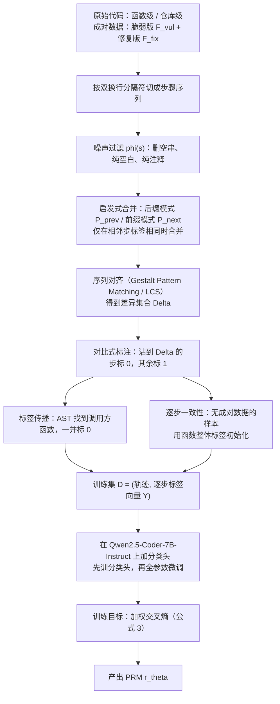
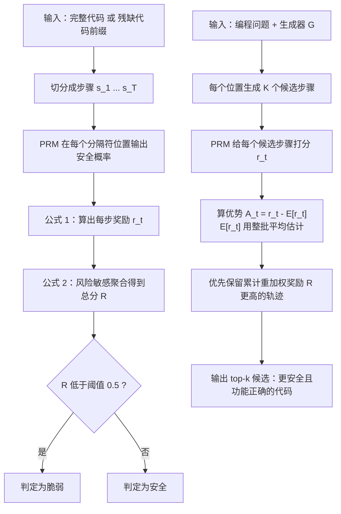

# SecCodePRM：面向代码安全的过程奖励模型（SecCodePRM: A Process Reward Model for Code Security）

> 说明：本文档是基于原论文的详细中文总结式翻译，重点保留研究动机、方法细节、实验与结论，并补充大量背景解释，方便零基础读者读懂。

## 论文信息

- 英文标题：SecCodePRM: A Process Reward Model for Code Security
- 中文译名：SecCodePRM：面向代码安全的过程奖励模型
- 作者：Weichen Yu（于伟辰，音译）¹、Ravi Mangal²、Yinyi Luo¹、Kai Hu¹、Jingxuan He³、Corina S. Pasareanu¹、Matt Fredrikson¹
- 机构：¹ Carnegie Mellon University（卡内基梅隆大学）；² Colorado State University（科罗拉多州立大学）；³ University of California, Berkeley（加州大学伯克利分校）
- 通讯作者：Weichen Yu，邮箱 wyu3@andrew.cmu.edu
- 来源与年份：arXiv 预印本，编号 arXiv:2602.10418v1，分类 [cs.CR]（密码学与安全），提交日期 2026 年 2 月 11 日；正文页脚标注 "Preprint. February 12, 2026."
- 页数：全文 20 页（正文第 1–8 页，参考文献第 9–11 页，附录第 12–20 页）
- 开源项目/数据集声明：论文摘要在结尾写有 "Code is available at SecCodePRM"，即声明代码已开放。抽取出的纯文本中该超链接地址丢失（原文抽取不清，推测为指向代码仓库的超链接），因此无法给出确切网址。实验所用的数据集（SVEN、PrimeVul、ReposVul、PreciseBugs、BigVul、CWEval、LiveCodeBench）在论文中均标注了引用来源，属于公开数据集。
- 名称不一致提醒：论文正文出现过三种写法——标题与摘要用 "SecCodePRM"，第 1 节正文用 "SecCoderPRM"，附录部分又出现 "SafeCodePRM"。本文档统一使用标题里的 SecCodePRM。

## 一句话总结

SecCodePRM 把"代码安全判断"从"读完整段程序再给一个结论"改成"边写边逐步打分"：用静态分析器和专家标注造出每一步的安全标签，训练一个能在每个代码步骤上输出安全分数的过程奖励模型（Process Reward Model），再用这套逐步分数分别做完整代码漏洞检测、残缺代码漏洞检测和安全代码生成。

## 读前必看：关键概念速成

| 英文术语 | 中文 | 大白话解释 | 在本文中的作用 |
| --- | --- | --- | --- |
| Process Reward Model (PRM) | 过程奖励模型 | 一个不只看最终答案、还会给中间每一步打分的"过程裁判"。数学推理里常用来判断某一步推得对不对。 | 本文的核心产物。它给代码的每个步骤输出一个安全分。 |
| Outcome-level supervision | 结果级监督 | 只看最终成品的对错来训练模型，中间过程不提供反馈。 | 论文批评的旧做法：现有漏洞检测器大多只有"整段代码是否脆弱"这一个标签。 |
| Vulnerability Detection (VD) | 漏洞检测 | 判断一段代码里有没有安全隐患。 | 本文三大应用之一，细分为完整代码 VD 与残缺代码 VD。 |
| Partial-code VD | 残缺代码漏洞检测 | 只给代码的前半截（前缀），就要判断它是否已经出现问题。 | 论文强调的"及时需求"，对应 IDE 里边写边提示、以及流式生成的场景。 |
| Code Trajectory | 代码轨迹 | 把一段生成过程看成按时间排列的一串步骤，记作 τ = (s₁, …, s_T)。 | 形式化对象，PRM 就是给轨迹里的每一步打分。 |
| Separator | 分隔符 | 用来把长代码切成小块的标志物，本文用连续两个换行 `\n\n`。 | 决定"一步"有多长，是切分步骤的依据。 |
| Static Analyzer（CodeQL / Joern） | 静态分析器 | 不运行程序、只读代码就能找出可疑模式的专业工具。 | 用来生成训练标签的来源之一（论文也点出其局限）。 |
| CWE | 通用弱点枚举 | 漏洞的官方编号体系，例如 CWE-22 是路径穿越，CWE-89 是 SQL 注入。 | 数据集按 CWE 类型组织，方便分类和对比。 |
| Logit margin | 对数几率差（分数差） | 模型给两个类别各算一个分数，两个分数相减，得到"更像安全"还是"更像危险"的一个带符号数值。 | 公式 (1) 用它把分类头的输出变成每一步的奖励 rₜ。 |
| Risk-sensitive aggregation | 风险敏感聚合 | 汇总很多步的分数时，故意放大最危险那几步的话语权。 | 公式 (2)，用于把逐步分数汇总成一个整体判断。 |
| Inference-time scaling | 推理期算力扩展 | 模型生成多个候选答案，再用一个评分器从中挑最好的，用算力换质量。 | 本文把 PRM 当评分器，用于安全代码生成（Best-of-N）。 |
| Advantage | 优势值 | 某一步的分数减去这批候选的平均分，得到相对好坏。 | 公式 Aₜ = rₜ − E[rₜ]，用于在候选之间做公平比较。 |
| Abstract Syntax Tree (AST) | 抽象语法树 | 把代码解析成树形结构，节点是函数、变量声明、返回语句等语法单位。 | 用于合并/切分步骤，以及找出"谁调用了出问题的函数"。 |
| Gestalt Pattern Matching / LCS | 格式塔模式匹配 / 最长公共子序列 | 比较两段文本有多相似、差在哪些位置的经典算法。 | 用来比较"有漏洞版本"与"修好版本"，定位真正出错的那几行。 |
| P-C / P-V / P-B / P-R | 成对指标四件套 | 把"有漏洞版本 + 修好版本"当成一对来考：全对、全判危险、全判无害、完全判反。 | PrimeVul 上的严格评测方式，P-C 越高越强。 |
| SR@k / safe@k / pass@k | 安全率 / 又安全又正确率 / 通过率 | 从 k 个候选中选出的结果满足要求的比例。 | 安全代码生成的三类评价指标。 |

## 摘要翻译（逐段翻译，每段后用一两句话点评该段在全文中的位置）

**原文第 1 段**
"大型语言模型正迅速成为现代软件开发流程的核心组件，但保证代码安全仍然充满挑战。"

点评：开篇第一句，作用是把读者拉到"LLM 写代码很普遍，但写出来的代码安不安全没人敢保证"这个大背景上。全文的动机从这里展开。

**原文第 2 段**
"现有的漏洞检测流水线要么依赖静态分析器，要么使用以粗粒度的程序级监督训练出来的 LLM/GNN 检测器。这两类方法通常都要求完整的上下文，只在生成结束时提供稀疏的反馈，而且随着代码变长性能可能下降，因此在交互式编程和流式生成中，它们都不适合做实时的、前缀级别（prefix-level）的评估。"

点评：这段是论文对现有做法的集中批评，给出了三个具体罪名：要求完整上下文、反馈稀疏（只在末尾给一次）、代码一长就退化。整篇论文的所有设计都在针对这三点。

**原文第 3 段**
"我们提出 SecCodePRM，一个面向安全的过程奖励模型，它沿着一条代码轨迹给出具有上下文感知、步骤级别的安全分数。为了训练该模型，我们从静态分析器和专家标注中导出步骤级的监督标签，让模型能够更精确地关注与跨过程（inter-procedural）漏洞相关的细粒度区域。"

点评：这里是方法的核心声明：标签来自静态分析器与专家，打分粒度是"步骤"，并且强调"跨过程漏洞"（漏洞的根源和触发点分布在不同的函数里）这一难点。

**原文第 4 段**
"SecCodePRM 有三种应用：完整代码漏洞检测（VD）、残缺代码 VD，以及安全代码生成（CG）。在 VD 中，SecCodePRM 使用风险敏感聚合，突出高风险步骤；在 CG 中，SecCodePRM 通过给候选续写排序、偏好累计奖励更高的轨迹，来支持推理期算力扩展。这一设计产生稠密、实时的反馈，并能扩展到长时程生成。"

点评：这一段交代了"一个模型三个用法"的卖点，并点出两处技术细节：风险敏感聚合（用于检测）与候选排序（用于生成）。

**原文第 5 段**
"在实验中，SecCodePRM 在三种设定下都超过了此前的方法，同时保持了代码的功能正确性，说明它提升了安全性却没有引入安全与效用之间的权衡。代码见 SecCodePRM。"

点评：最后落到结论与资源。两个关键词是"三种设定都赢"和"没有 safety–utility tradeoff（提升安全性无需以功能变差为代价）"，后者是全文最有分量的主张之一。

## 1. 研究背景：这篇论文在解决什么问题

### 1.1 领域现状（用生活化比喻讲清）

把大语言模型写代码想象成一个装修队施工：模型每"敲"一行代码，就相当于工人钉一块板子。现在的问题是，房子交付前的"验收"是一次性的——等全部装完，再请一位专业验房师（静态分析器）拿着完整图纸全面检查。

- 第一类做检查的人叫**静态分析器**（static analyzer），代表工具是 CodeQL、Joern。它们像一位严格的验房师，拿着既定的检查清单逐项核对，能发现"窗户没装护栏"这类固定问题，但必须拿到完整的房子才能判断结构是否安全，而且检查速度不快（论文引用 Mohsin et al., 2024 指出这类工具在大规模场景下耗时昂贵）。
- 第二类做检查的是**学出来的检测器**（LLM-based 或 GNN-based detector）。它们像一位看过大量验房案例的学徒：见过很多"合格房"和"问题房"的照片，于是学会了看图下判断。训练时只被告知"这套房子整体合不合格"，没有人告诉它"第 37 块板子是问题所在"。
- 第三类是**混合方案**，让大模型一边推理一边调用工具，相当于学徒每检查一处就打电话给验房师确认，准确率有提升，但流程长、速度慢。

论文要问的问题很朴素：真的必须等到房子装完才能发现问题吗？人类专家的做法给出了相反的回答。

**人类专家的实际做法**：论文用图 2（Figure 2）做了量化分析。研究者测量"从代码开头算起，要看掉多少比例的 token 才能定位全部漏洞代码（包括调用漏洞函数的那些调用方函数，即 caller functions 的传递闭包）"。结论是：专家只需要看大约 **40% 到 60%** 的代码 token 就能识别安全问题。具体来说，有经验的工程师在看到约 **40%** 的 token 时就能认出漏洞的"招牌特征"（例如未净化的用户输入与某个危险操作同时出现），到约 **60%** 的 token 时就能确认漏洞存在（例如看到敏感的 API 汇点 sink），而此时整段代码还没写完。

论文举的例子是 CWE-22 路径穿越（path traversal）：`destination = "%s/%s" % (path, directory)` 直接把外部输入拼进路径，这就是"招牌特征"；修好后的版本写成 `destination = "%s/%s" % (path, os.path.basename(directory))`，用 `basename` 把路径里的目录部分剥掉（净处理 sanitization），特征就消失了。（类比仅用于帮助理解：这就像看到有人把客人随手写的房间号直接当门锁密码，还没等他把钥匙配完，你已经知道要出事。）

**领域里另一个结构性问题**：数据。论文抽查了常用公开数据集，发现它们严重失衡（详见 1.2），而且平均每条样本的 token 数从函数级的几百个一路涨到仓库级的接近 2 万（论文原文为 "from hundreds to 20K"），代码越长，检测越难。

### 1.2 现有方法的具体缺陷（必须引用论文给出的具体论据/数字/例子）

论文给出的批评都带具体数字，逐条列出：

**缺陷一：静态分析工具在"代码不完整"时无能为力。** 论文指出 Static analysis tools 在只有部分代码的场景下表现挣扎，往往需要完整的程序上下文才能达到可接受的准确率，且规模一大就耗时（Mohsin et al., 2024）。论文的原话是："据我们所知，现有的漏洞检测方法学完全是在完整代码实现上训练和验证的。"（"existing vulnerability detection methodologies are trained and validated exclusively on full code implementations."）这造成当前能力与现代 LLM 辅助开发环境需求之间的关键空缺。

**缺陷二：监督信号太粗。** 许多 LLM/GNN 检测器是用程序级的二元标签（整段代码：脆弱 / 安全）在全量代码上训练的，这种监督"提供的压力有限，模型没有动力去关注细粒度的、跨函数/跨文件的脆弱区域"（原意为 coarse, program-level binary supervision 的批评）。

**缺陷三：代码一长就退化。** 论文指出这类方法的有效性会随着代码长度和上下文增长而下降。

**缺陷四：数据集严重失衡，且存在"长度作弊"的漏洞。** 这是论文第 4.1 节最硬的一组数字：

- 在样本级别，BigVul、PrimeVul（Unpaired 版）、ReposVul 严重偏向安全样本，脆弱样本比例**低于 10%**：BigVul 训练集为 8700 脆弱 / 150922 安全（脆弱占 **5.76%**）；PrimeVul Unpaired 训练集为 4862 / 170935（**2.77%**）；ReposVul 训练集为 785 / 11830（**6.63%**）。
- 即使在"脆弱样本"内部，真正脆弱的那几步也只占很小比例，步骤级别上大致落在 **7% 到 27%**：BigVul 训练集 25.43%、SVEN 训练集 24.20%、PrimeVul(Paired) 训练集 20.17%、PreciseBugs 训练集 12.98%、ReposVul 训练集 7.45%。
- 论文写成 "And the average vulnerable step in all steps go down to less than 1%."。对照表 11，只有 ReposVul 的全体脆弱步占比确实低于 1%（训练集 0.26%、测试集 0.29%），其余数据集的这一列在 1.15%–6.90% 之间。这句表述在数值上偏乐观。
- 论文还发现 BigVul 与 PrimeVul Unpaired 的脆弱样本与安全样本 token 数差异巨大：平均而言脆弱样本的 token 数可以到安全样本的 **3 倍**（原始数据：BigVul 训练集脆弱样本平均 720 token、安全样本 256 token，约 2.8 倍；PrimeVul Unpaired 训练集为 1508 与 342，约 4.4 倍）。这种差异会被大模型"钻空子"（论文用词为 hacked），模型可能只靠长度判断而不看真实的安全特征。**因此论文把这两个数据集从训练中剔除。**

**缺陷五：只有完整程序才能判断。** 论文把这种要求称为 "full-completion" 要求，并指出它带来两个后果：一是忽略了部分代码前缀中已经存在的强预测信号；二是造成训练时的计算瓶颈——在强化学习等场景里，"为了拿到一个奖励信号而生成完整 rollout"的成本随着代码从函数级走向仓库级越来越难以承受。

### 1.3 本文切入的角度

论文的切入点可以概括为三句话：

1. **判断时机前移**：从"全局程序验证"（global program verification）转向"部分检测"（partial detection），在生成过程中做更早的"反射式判断"（reflexive judgment）。
2. **粒度变细**：把奖励打在每一个代码步骤上，得到稠密（dense）、即时（immediate）的信号，从而大幅降低训练开销，同时与专家的安全分级判断（expert security triage）保持高度一致。
3. **一个模型三种用法**：完整代码 VD、残缺代码 VD、安全代码生成。检测用"风险敏感聚合"，生成用"推理期算力扩展 + 候选排序"。

论文还把自己与另外两条技术路线做了结构对比（图 3，Pipeline Comparison）：

| 路线 | 输入要求 | 结构 | 训练阶段数 | 速度 |
| --- | --- | --- | --- | --- |
| LLM + Graph（如 MSIVD、Yang et al. 2024） | 完整代码 | 微调 LLM + GNN 特征融合 + 分类器 | 需要 3 个独立训练阶段来融合 GNN 与 LLM 特征 | 未特别说明 |
| LLM + Tool Use（如 LLMxCPG） | 完整代码 | 微调 LLM 生成查询 → 调用 CodeQL/Joern → 反馈 → 再分类 | 多阶段、含外部工具 | 论文直呼 "Slow" |
| **SecCodePRM** | 完整代码或残缺代码 | 单个 LLM + 一个分类模块，端到端 | 1 个阶段 | 更快，适合做实时反馈甚至 RL 奖励 |

论文对第三点的原话是：图方法需要三个不同的训练阶段来融合 GNN 与 LLM 特征，而 SecCodePRM 被精简为一个单阶段训练过程。

## 2. 研究意义与目的（为什么重要、对谁有用、应用场景）

**为什么重要**

- LLM 已经成为写代码的主力工具，而生成的代码安全性经常不达标，容易引入可被利用的漏洞（论文引用 Wang et al., 2023a；Mohsin et al., 2024；Chong et al., 2024；Ramírez et al., 2024 等一批实证工作）。安全若不能保证，工具再高效也不敢用在高风险场景。
- 论文特别点名两类高风险领域：Web 应用（Dora et al., 2025）与自动驾驶系统（Nouri et al., 2025）。

**对谁有用**

- **IDE / 代码助手开发者**：可以在用户敲代码的过程中实时给安全提示，把检查时机提到文件写完之前。
- **做强化学习训练的研究者**：长时程生成里，完整 rollout 才能拿一个奖励的成本越来越高；逐步奖励可以显著降低单次反馈的代价。
- **做安全代码生成的产品**：可以在多个候选之间排序，优先给开发者展示更安全的那个。
- **安全审计人员**：逐步分数给出了"位置感"，比一个笼统的"有/无漏洞"更接近人工审查的工作方式。

**典型应用场景**

1. 交互式编程时的实时安全检查（对应残缺代码 VD）。
2. 流式生成过程中的前缀级评估（对应残缺代码 VD）。
3. 从函数级走向仓库级的长代码生成中的过程评估（对应长时程场景）。
4. Best-of-N 候选筛选（对应安全代码生成）。
5. 作为 RL 训练中的稠密奖励信号（论文在正文中明确提到这一用途，并把它作为降低 full-rollout 开销的理由）。

## 3. 方法详解（本文核心，篇幅最长）

### 3.1 问题形式化（关键公式要写出并逐个符号解释，能举例就举一个小数值例子）

论文在第 3.2 节把任务写成两个耦合的问题：

- **任务一：漏洞检测（VD）**。给定一条（可能不完整的）代码轨迹，判断它是否含有安全缺陷。
- **任务二：安全代码生成（CG）**。利用检测器作为评分器，在推理阶段引导生成器产出更安全的代码。

**基本对象**：一条轨迹 $\tau = (s_1, \dots, s_T)$ 由 $T$ 个推理步骤或代码步骤组成。

- $\tau$：整条轨迹（trajectory），可以理解成"从开头到当前为止写下的全部内容"。
- $s_t$：第 $t$ 个步骤（step），本文定义为被分隔符切出来的一个代码/自然语言块。
- $T$：这条轨迹一共有多少步。
- $\tau_{<t} = (s_1, \dots, s_{t-1})$：第 $t$ 步之前的前缀（prefix），也就是"在此之前已经写好的全部内容"。

**学习目标**：学一个过程奖励模型 $r_\theta$，给每一步 $s_t$ 打一个安全分。$\theta$ 是模型参数。注意打分是"带上下文的"，即第 $t$ 步的分数取决于 $s_t$ 本身与它前面的 $\tau_{<t}$，因此同一个代码片段放在不同上下文里可能得到不同分数。

**训练数据**：论文假设可以拿到一个数据集

$$D = \left\{ \left( \tau^{(i)},\ y^{(i)}_{1:T^{(i)}} \right) \right\}_{i=1}^{N}$$

- $N$：样本条数。
- $\tau^{(i)}$：第 $i$ 条轨迹。
- $y^{(i)}_{1:T^{(i)}}$：这条轨迹上每一步的监督标签序列，取值 0（脆弱）或 1（安全）。论文明确说这些标签来自静态分析工具（例如 CodeQL）或人类专家。

**与以往工作的关键差别**：论文强调"与先前要求完整项目编译的工作不同，我们的模型必须对实时生成中常见的部分代码上下文保持稳健（robust）"。这句是全文的方法论分水岭。

**公式 (1)：步骤级分数差（Step-level Margin Scoring）**

对第 $t$ 步，用安全类别（记为 $+$）与脆弱类别（记为 $-$）之间的分数差来定义奖励：

$$r_t = \mathrm{softmax}(h_t)^{(+)} - \mathrm{softmax}(h_t)^{(-)} \tag{1}$$

逐符号解释：

- $h_t \in \mathbb{R}^2$：模型在"第 $t$ 个分隔符位置"输出的分类头原始输出（两个数：对应安全类与脆弱类）。论文写模型输出一串安全概率 $h_1,\dots,h_T$，$h \in \mathbb{R}^2$，即每个分隔符位置都有一个二维输出。
- $\mathrm{softmax}(h_t)$：把这两个数变成和为 1 的两个概率。
- 上标 $(+)$ 与 $(-)$：分别取安全类与脆弱类的概率。
- $r_t \in [-1, 1]$：这一步的"安全信号"。取值为正表示模型认为这步安全，为负表示危险，接近 0 表示摇摆不定。

论文对该公式的直觉解释：$r_t$ 是一个局部的"安全信号"，如果 $r_t$ 从第 $t-1$ 步到第 $t$ 步出现**急剧下降**，通常意味着漏洞在这一步被引入。

**一个小数值例子（本文档自行计算，用于帮助理解）**：假设某一步模型输出的两个类别概率为"安全类 0.9、脆弱类 0.1"，则 $r_t = 0.9 - 0.1 = 0.8$；如果反过来是"安全类 0.2、脆弱类 0.8"，则 $r_t = 0.2 - 0.8 = -0.6$。可以理解为"安全分减去危险分"，正好落在 $[-1,1]$ 区间内。

**公式 (2)：用于检测的重加权聚合（Reweighted Aggregation）**

要把一条轨迹上所有步骤的分数汇总成一个整体判断，论文用带温度参数的加权求和，并且刻意放大"高风险"步骤的权重：

$$R = \sum_{i=1}^{T} w_i \cdot r_i, \qquad w_i = \frac{\exp(-r_i/\tau)}{\sum_{j=1}^{T} \exp(-r_j/\tau)} \tag{2}$$

逐符号解释：

- $R$：整条轨迹的聚合奖励/聚合分数。
- $w_i$：第 $i$ 步的权重，所有 $w_i$ 之和为 1。
- $\tau$：温度（temperature），控制"放大高风险步骤"的强度。温度越小，权重越集中在最危险的那几步。
- 关键在分子里的负号 $\exp(-r_i/\tau)$：$r_i$ 越低（越危险），$-\!r_i$ 越大，权重越大。这就是论文所说的"更低的奖励（更高的风险）获得指数级更高的权重"。

**一个小数值例子（本文档自行计算）**：设三步的分数为 $r = (0.8,\ -0.6,\ 0.5)$，取 $\tau = 0.5$。

- $\exp(-0.8/0.5) = \exp(-1.6) \approx 0.2019$
- $\exp(0.6/0.5) = \exp(1.2) \approx 3.3201$
- $\exp(-0.5/0.5) = \exp(-1.0) \approx 0.3679$
- 归一化后 $w \approx (0.0519,\ 0.8535,\ 0.0946)$
- $R \approx 0.0519 \times 0.8 + 0.8535 \times (-0.6) + 0.0946 \times 0.5 \approx -0.4233$

也就是说：三步里只有一步危险，但它拿到了 85% 的权重，把总分从"看起来还行"直接压成明显的负值。这正体现了"风险敏感"的设计意图：只要有一处严重问题，整体就该被判危险。

**公式 (3)：训练目标**

$$\mathcal{L}(\theta) = -\sum_{t=1}^{T} \log w_y P_\theta\!\left(y_t \mid s_t, \tau_{<t}\right) \tag{3}$$

逐符号解释：

- 这是一个标准的交叉熵损失（cross-entropy），$P_\theta(y_t \mid s_t, \tau_{<t})$ 是模型在给定当前步与前缀的情况下，预测真实标签 $y_t$ 的概率。
- $w_y$：类别权重，按真实标签取值，用于平衡占比过小的"脆弱"类，防止模型过于乐观（论文原话是 prevent the PRM from being overly optimistic）。数据集里脆弱步骤极少（前提到的 7%–27% 甚至更低），如果不加权，模型只要全预测"安全"就能拿到很高的准确率。
- 论文特别指出这样设计的意义：它可以保证奖励 $r_t$ 反映的内容不限于 $s_t$ 局部的语法，还包括它在已有变量定义与状态之下的语义安全性。

**公式 (4)：对比式标注规则（第 4 节，数据构造）**

用序列对齐找出"有漏洞版本 $F_{vul}$"与"修复版本 $F_{fix}$"之间的差异集合 $\Delta$（diffs），然后给 $F_{vul}$ 的每一步打标签：

$$y_t = \begin{cases} 0\ (\text{vulnerable}), & \text{若 } s_t \cap \Delta \neq \varnothing \\ 1\ (\text{secure}), & \text{其他情况} \end{cases} \tag{4}$$

逐符号解释：

- $\Delta$：两版代码的差异位置集合。
- $s_t \cap \Delta \neq \varnothing$：这一步"沾上了"被修改的位置，就标成脆弱（0）。没沾上的部分视为安全（1）。
- 对修复版本 $F_{fix}$，所有片段（包括新加入的补丁）都标为正标签（$y_t=1$），因为它们代表已经修好的安全状态。

论文对这个设计的目的说得很清楚：这种对比式做法让模型学会惩罚"导致漏洞的特定代码行"，同时放过那些两边都一样的样板代码。这一句是理解整个数据构造的关键——**如果不做对比，模型可能只会学到"凡是这段函数就危险"，学不到"凡是这一行就危险"这样的分辨力。**

### 3.2 总体框架（用 Mermaid `flowchart` 表示数据流/训练或推理流程）

数据构造与训练流程：



推理流程（两种用法）：



### 3.3 各模块逐步拆解（每个模块写清"输入→做什么→输出"，含论文算法/伪代码的中文逐步讲解）

**模块 1：代码步骤的定义（Code Steps）**

- 输入：一段完整代码（训练时）或正在生成的文本流（推理时）。
- 做什么：推理时，每一步之间用分隔符隔开，论文用 `\n\n`（连续两个换行）。每当生成出这个分隔符，PRM 就评估当前的部分轨迹，产生一个过程奖励。训练时，先用同样的分隔符切分整段代码，再做一步额外的数据清洗：解析代码的抽象语法树（AST），把某些步骤合并或拆开，让边界更好地对齐逻辑边界。
- 输出：一串步骤 $s_1, \dots, s_T$。
- 为什么要这么做：论文强调这样可以在"推理或生成过程中精确定位漏洞被引入的那一刻"。用生活化的说法，这相当于把一段施工过程切成若干个可检查的工序节点（类比仅用于帮助理解）。

**模块 2：上下文感知的代码安全（Context-Aware Code Safety）**

- 输入：完整轨迹 $\tau$。
- 做什么：训练时把完整的代码轨迹喂给模型，在每个步骤分隔符 token 上注入一个训练信号。模型最后一层是一个分类头，为每个分隔符位置输出一串安全概率 $h_1, \dots, h_T$。
- 输出：每个分隔符位置一个二维输出 $h_t \in \mathbb{R}^2$。
- 与以往分类器的差别（论文原话要点）：传统分类器要么孤立地分类一个代码片段，要么把整段代码当成一个整体分类；本模型则是在前缀 $\tau_{<t}$ 的上下文中评估每一步 $s_t$。这个差别正是"残缺代码 VD"能成立的技术前提。

**模块 3：步骤级分数差（公式 1）**

- 输入：分类头输出 $h_t$。
- 做什么：取安全类与脆弱类概率之差。
- 输出：$r_t \in [-1,1]$。
- 伪代码：

```text
对 t = 1 到 T：
    概率 = softmax(h_t)              # 得到 [p_安全, p_脆弱]
    r_t = 概率[安全] - 概率[脆弱]     # 落在 [-1, 1]
记录 r_1 ... r_T
```

**模块 4：风险敏感聚合（公式 2）**

- 输入：步骤奖励序列 $r_1,\dots,r_T$ 与温度 $\tau$。
- 做什么：按 $\exp(-r_i/\tau)$ 归一化得到权重，再加权求和。
- 输出：单个标量 $R$，作为整段代码是否脆弱的依据。
- 伪代码：

```text
输入：r[1..T]，温度 τ
s = 0
对 i = 1 到 T：s = s + exp(-r[i] / τ)
R = 0
对 i = 1 到 T：
    w[i] = exp(-r[i] / τ) / s
    R = R + w[i] * r[i]
输出：R
```

**模块 5：生成时的推理期算力扩展（Inference-Time Scaling for Generation）**

- 输入：生成器 $G$、当前时刻 $t$、候选步数 $K$。
- 做什么：在每一时刻让生成器产出 $K$ 个候选步骤，用 PRM 对它们打分排序。排序用"优势选择"（Advantage-based Selection），把某一步的优势定义为 $A_t = r_t - \mathbb{E}[r_t]$，其中期望 $\mathbb{E}[r_t]$ 用整批候选的平均值估计（这是一个相对量，衡量这一步比同批候选平均好多少）。搜索过程中优先选择能让累计重加权奖励 $R$ 最大的轨迹。
- 输出：被选中的候选续写，最终产出 top-k 结果。
- 论文给的直觉：这样可以让模型放弃通往不安全状态的轨迹，"把算力从不安全的路径转移到安全的路径上"。

**模块 6：数据构造流水线（第 4 节，共五步）**

论文的图 4 展示了从原始代码到逐步监督信号的完整流水线，核心思路是用"成对数据"（有漏洞的代码 vs 对应的安全补丁）来定位具体的脆弱片段。

*步骤 6.1 细粒度步骤切分（Granular Step Segmentation）*

- 输入：函数 $F$。
- 做什么：定义"一步"为由双换行 `\n\n` 分隔的逻辑代码块，把 $F$ 切成序列 $S = \{s_1, s_2, \dots, s_n\}$。
- 输出：步骤序列。
- 目的（论文原话意思）：让模型能给代码的特定片段分配奖励，从而让漏洞定位更可解释、更局部化。

*步骤 6.2 通过启发式模式做紧凑与结构化合并*

- 输入：原始切分结果（往往含噪声）。
- 做什么：两件事。
  1. 过滤函数 $\phi(s)$：删掉匹配"无操作"模式的步骤，包括空字符串、纯空白行、纯注释块（论文举例 `/**/`、`//`）。
  2. 基于前后缀模式的合并策略，定义两个边界启发式集合：
     - **后缀模式 $P_{prev}$**：逻辑上会终止一个块的语句，例如 `return 0;`、`break;`、`#endif`。若 $s_i \in P_{prev}$ 且 $\mathrm{Label}(s_i) = \mathrm{Label}(s_{i-1})$，就合并：$s_{i-1} \leftarrow s_{i-1} \oplus s_i$，其中 $\oplus$ 表示字符串拼接。通俗地说：把"结尾语句"黏回它前面的逻辑块，避免一个 `return` 孤零零地成为一步。
     - **前缀模式 $P_{next}$**：变量声明或头部定义（论文举例 `register ssize_t i;`），为下一行提供上下文。若 $s_i \in P_{next}$ 且 $\mathrm{Label}(s_i) = \mathrm{Label}(s_{i+1})$，就合并：$s_{i+1} \leftarrow s_i \oplus s_{i+1}$。
- 输出：合并后的语义更完整的代码块。
- 注意条件里的标签相等要求：只有两边标签一致时才合并，避免把"安全"和"脆弱"的边界糊掉。

*步骤 6.3 对比式标注（Contrastive Labeling via Sequence Alignment）*

- 输入：脆弱函数 $F_{vul}$ 与修复函数 $F_{fix}$。
- 做什么：用基于 Gestalt Pattern Matching（Giuliano et al., 1961）的序列对齐算法计算最长公共子序列（LCS），得到差异集合 $\Delta$，然后按公式 (4) 打标签。
- 输出：每个步骤一个 0/1 标签。
- 伪代码：

```text
输入：F_vul 的步骤序列，F_fix 的步骤序列
1. 用 Gestalt Pattern Matching 对齐两者，求最长公共子序列
2. 差异位置集合 Delta = 对齐后不匹配的位置
3. 对 F_vul 的每一步 s_t：
       若 s_t 与 Delta 有交集 -> y_t = 0（脆弱）
       否则                  -> y_t = 1（安全）
4. 对 F_fix 的所有步骤：y_t = 1（安全，含新增补丁）
输出：标签向量 Y
```

*步骤 6.4 标签传播与一致性（Label Propagation and Consistency）*

针对"只有序列级（整段代码级）标签"或"对齐结果含糊"的数据集，论文给了两条启发式补救策略：

1. **漏洞传播（Vulnerability Propagation）**：对已知脆弱的样本，找出第一个失败点 $k$。基于"单个漏洞会污染调用方函数的传递闭包"这一假设，如果 $s_k$ 被认定为根因，那么所有调用方函数中的步骤 $s_j$ 也标为负标签（$y_j = 0$）。论文用抽象语法树（AST）来标注全部调用方函数。
2. **逐步一致性（Step-wise Uniformity）**：在拿不到细粒度差异（未成对数据）时，直接用函数的全局标签初始化所有步骤标签，作为基线监督信号，让 PRM 在训练中迭代细化。

*步骤 6.5 数据集格式*

每条数据包含：一个自然语言格式的提示 $P$；一串完成内容 $C = \{c_1, c_2, \dots, c_n\}$（可以是自然语言也可以是代码）；以及对应的标签向量 $Y \in \{0,1\}^n$，且 $|C| = |Y|$（步骤数与标签数必须一一对应）。论文说明这种结构让模型能够学习"函数内任意位置上代码从安全转向脆弱的转变"。

**模块 7：与其它流水线的对比**

论文在图 3 中给出的对比（也是 1.3 节表格的出处）要点：

- 其它方法通常需要完整的代码块才能分析；SecCodePRM 同时能处理部分与完整的代码轨迹。
- 与"慢速"的多步流程（调用 CodeQL 或 Joern 等外部程序分析工具）相比，SecCodePRM 是端到端系统，推理时显著更快，适合做实时反馈，也适合作为 RL 训练奖励。
- 训练更简单：基于图的方法需要三个独立训练阶段来融合 GNN 与 LLM 特征，SecCodePRM 精简为单阶段训练。

### 3.4 训练目标 / 损失函数（每个公式：写出 + 逐项解释 + 直觉）

**主损失：加权交叉熵（公式 3）**

$$\mathcal{L}(\theta) = -\sum_{t=1}^{T} \log w_y P_\theta\!\left(y_t \mid s_t, \tau_{<t}\right)$$

- 逐项解释：
  - $T$：步骤总数。损失在一条轨迹的所有步骤上求和，因此每个分隔符位置都会收到监督信号（论文原话是 inject a training signal at every step separator token）。
  - $P_\theta(y_t \mid s_t, \tau_{<t})$：模型预测第 $t$ 步真实标签的（softmax 之后的）概率。取对数后前面加负号，就是"预测得越准损失越小"。
  - $w_y$：按真实标签 $y_t$ 取的类别权重，用来平衡占比偏小的"脆弱"类。论文没有在正文与附录中给出该权重的具体数值（论文未给出具体取值，只说明它是基于 ground-truth 标签设定的）。
- 直觉：模型同时要学两件事——局部这一步长什么样，以及在前文已定义的变量与状态下，这一步意味着什么。第二条正是"上下文感知"的落点，论文在公式后补了一句：这样能保证 $r_t$ 反映的不仅是 $s_t$ 的局部语法，还有它在已有变量定义和状态下的语义安全性。

**阈值与两阶段训练安排**

- 检测阈值（Detection Threshold）取 **0.5**。
- 论文正文写：先用分类头做微调，再训练全参数（"We first finetune only the classification head and then the full parameter."）。
- 附录表 8 给出更细的两阶段计划：阶段 1 训练 3 个 epoch，阶段 2 再训 1 个 epoch；学习率从 $1\times10^{-4}$ 衰减到 $1\times10^{-6}$ 以稳定后期优化；优化器 Adam（$\beta_1 = 0.9$、$\beta_2 = 0.95$），权重衰减 0.1；全局批大小 $8 \times N_{GPUs}$；最大序列长度 **128,000** token；分布式策略 DeepSpeed ZeRO-2。

**用于消融的其它聚合设计（附录 B.2，公式 5–11）**

论文在推理期算力扩展阶段试了多种"把逐步分数合成一个候选级奖励"的做法，作为对照设计：

1. **softmax + min（公式 5）**：$w_t = \frac{\exp(s_t/\tau)}{\sum_{j=1}^{T}\exp(s_j/\tau)}$，然后 $R = \min_{t \in \{1,\dots,T\}} w_t s_t$。
   - 直觉：先用 softmax 给步骤加权，再取加权后的最小值。最危险的一步基本决定最终得分。
2. **最后位置 + min / 二值 / 平均（公式 6–9）**：定义 $s_{last} = s_T$，然后
   - min：$R = \min_{t} s_t$；
   - binary：$R = \mathbb{I}\!\left[\min_{t} s_t \ge 0\right]$（用指示函数 $\mathbb{I}[\cdot]$ 把结果变成 0/1）；
   - ave：$R = \frac{1}{T}\sum_{t=1}^{T} s_t$；
   - 若显式采用"最后位置"作为候选分，则 $R = s_T$。
3. **softmax + ave（公式 10）**：$R = \sum_{t=1}^{T} w_t s_t$，即加权平均。
4. **softmax + binary（公式 11）**：$R = \mathbb{I}\!\left[\sum_{t=1}^{T} w_t s_t \ge 0\right]$，把加权分再阈值成 0/1。

这些设计的实测结果见 4.5 节的表 6。

### 3.5 推理 / 使用流程

**用法 A：漏洞检测（VD）**

- 输入：完整代码，或只有前缀的残缺代码。
- 流程：按 `\n\n` 切分 → PRM 在每个分隔符位置输出概率 → 公式 (1) 得到每步奖励 → 公式 (2) 风险敏感聚合得到 $R$ → 用阈值 **0.5** 判定（分数低于阈值即判为脆弱；论文只给出阈值取值，未说明判定的方向细节，此处按常规分类器语义理解）。
- 特点：完整代码与残缺代码走同一条路径。这就是"同一个模型能同时做全代码 VD 与部分代码 VD"的原因。

**用法 B：安全代码生成（CG）**

- 输入：编程问题、生成器 $G$（论文用 QC2.5-7B / QC2.5-32B 等）、候选数量 $K$ 与采样总量 $N$。
- 流程：生成器产出多个候选 → PRM 给每个候选的每一步打分 → 用优势 $A_t = r_t - \mathbb{E}[r_t]$ 与累计重加权奖励 $R$ 排序 → 选 top-k。
- 论文明确说明这样做的意图：把"生成能力"与"验证能力"解耦，从而测试这套方法能否在保证功能正确的前提下把模型推向更安全的代码。
- 采样规模：SVEN 用 $N=10$；CWEval 用 $N=20$（均沿用对应基准的既有设定）。

### 3.6 开销与效率（若论文有相关分析）

论文给出的开销相关信息：

- **硬件**：全部实验在单个计算节点上完成，配备 **4 张 80GB GPU**（论文举例 A100 或 H100）。
- **训练细节**：基座是 Qwen2.5-Coder-7B-Instruct，外加一个分类头；用 DeepSpeed ZeRO-2 管理显存并加速训练；训练 3 个 epoch，恒定学习率 $1\times10^{-4}$，Adam 优化器（$\beta_2 = 0.95$），无 warmup；使用 Bfloat16 精度以维持数值稳定并降低显存开销。附录补充了阶段 2 的 1 个 epoch 与学习率衰减到 $1\times10^{-6}$、权重衰减 0.1、最大序列长度 128,000。
- **推理效率的定性结论**：SecCodePRM 是端到端系统，相比需要多步调用外部程序分析工具（CodeQL、Joern）的流程"显著更快"，因此适合实时反馈与 RL 训练奖励。训练上只需要 1 个阶段，而基于图的方案需要 3 个训练阶段。
- **论文未给出的部分**：具体的推理延迟（毫秒/请求）、单位 token 吞吐、训练总时长、能耗，以及生成时 PRM 打分带来的额外开销占比，论文都没有给出数字。

## 4. 实验设置与结果

### 4.1 数据集（规模、构造方式、来源）

论文使用了五个公开漏洞检测数据集做训练与评估，外加两个代码生成基准做下游验证。

**五个漏洞数据集（论文第 4.1 节 + 附录 B.8）**

| 数据集 | 语言 | 论文评述 |
| --- | --- | --- |
| BigVul (Fan et al., 2020) | C、C++ | 常用但含噪声；因长度差异可被"钻空子"被排除出训练 |
| SVEN (He & Vechev, 2023) | C、C++、Python | 规模小但质量高，成对且由人工标注 |
| PrimeVul (Ding et al., 2024) | C、C++ | 大规模自动收集，用时间顺序切分缓解数据泄漏；含 Paired 与 Unpaired 两个版本 |
| ReposVul (Wang et al., 2024b) | C、C++ | 仓库级自动收集，含多粒度信息，专门针对跨过程的漏洞 |
| PreciseBugs (He et al., 2023) | C、C++、Python、Go、JVM、Rust | 用缺陷追踪系统和缺陷注入器自动收集的精确仓库级 bug 数据集，含六种语言 |

论文附录 B.8 补充的规模信息：PrimeVul 提供超过 **22 万个良性函数与 7000 个脆弱函数**，覆盖 **140 多种 CWE**；ReposVul 包含 **6000 多条 CVE 记录**、覆盖 **236 种 CWE 类型**和 **四种编程语言**，专门针对跨文件、跨函数的 inter-procedural 漏洞。PreciseBugs 在单条样本上最长、多样性最高（语言最多、CWE 种类最杂）。

**训练/测试集统计（论文表 11 重绘）**

"V:S" 表示"脆弱 : 安全"两列的数值；"Stepv" 指脆弱样本内部脆弱步骤的平均占比；"Stepa" 指全部样本中脆弱步骤的平均占比。

| 数据集 | 语言 | 切分 | 样本数（脆弱 / 安全） | Token 均值（脆弱/安全） | Char 均值（脆弱/安全） | Step 均值（脆弱/安全） | Stepv | Stepa |
| --- | --- | --- | --- | --- | --- | --- | ---: | ---: |
| BigVul (2020) | C, C++ | train | 8700 / 150922（5.76%） | 720 / 256 | 2609 / 915 | 13 / 4 | 25.43 | 2.40 |
| BigVul (2020) | C, C++ | test | 199 / 7706（2.52%） | 590 / 244 | 2076 / 862 | 10 / 4 | 26.73 | 1.15 |
| SVEN (2023) | C, C++, Python | train | 720 / 720（50%） | 828 / 843 | 2964 / 3022 | 15 / 15 | 24.20 | 5.99 |
| SVEN (2023) | C, C++, Python | test | 83 / 83（50%） | 862 / 877 | 3292 / 3352 | 14 / 14 | 21.84 | 5.81 |
| PreciseBugs (2023) | C, C++, Python, Go, JVM, Rust | train | 19579 / 19579（50%） | 19383 / 19673 | 55219 / 55775 | 125 / 126 | 12.98 | 1.94% |
| PreciseBugs (2023) | 同上 | test | 2447 / 2448（50%） | 10491 / 10535 | 34312 / 34493 | 115 / 115 | 12.65 | 1.83% |
| PrimeVul (Paired, 2023) | C, C++ | train | 7305 / 7305（50%） | 1491 / 1528 | 5314 / 5454 | 22 / 23 | 20.17 | 6.90 |
| PrimeVul (Paired, 2023) | C, C++ | test | 854 / 854（50%） | 1492 / 1525 | 5296 / 5429 | 20 / 21 | 18.65 | 5.74 |
| PrimeVul (Unpaired, 2023) | C, C++ | train | 4862 / 170935（2.77%） | 1508 / 342 | 5415 / 1179 | 18 / 5 | – | – |
| PrimeVul (Unpaired, 2023) | C, C++ | test | 549 / 24239（2.21%） | 1515 / 346 | 5360 / 1196 | 17 / 5 | – | – |
| ReposVul (2024) | C, C++ | train | 785 / 11830（6.63%） | 12901 / 11011 | 43451 / 39191 | 185 / 154 | 7.45 | 0.26 |
| ReposVul (2024) | C, C++ | test | 242 / 2914（8.30%） | 15682 / 12816 | 54055 / 44784 | 182 / 176 | 8.97 | 0.29 |

按表 11 的成对训练集相加（本文档自行计算），去掉被排除的 BigVul 与 PrimeVul Unpaired 后，PRM 训练数据约为 SVEN 720 对 + PreciseBugs 19579 对 + PrimeVul Paired 7305 对 + ReposVul 785 对 ≈ **28389 对**。论文没有直接给出这个合计数。

**D. 两个代码生成基准**

- SVEN：使用人工挑选的上下文，配合基于 CodeQL 的自动验证。
- CWEval（Peng et al., 2025）：要求代码既功能可用（通过单元测试）又没有漏洞，即同时考核功能与安全。
- 额外还有 LiveCodeBench（Jain et al., 2024）：用来检查安全调优是否拖累了通用竞赛编程能力。

**CWE 类型覆盖（论文表 12 摘要）**

- SVEN 只涉及 9 种：CWE-022、078、079、089、125、190、416、476、787。
- PreciseBugs 覆盖最广，从 CWE-17 到 CWE-1336 约 150 余种，还含 NVD-CWE-noinfo、NVD-CWE-Other 两类无编号情况。
- PrimeVul 与 ReposVul 各覆盖数十种（PrimeVul 约 61 种，ReposVul 约 70 种，按表 12 行数粗数）。

### 4.2 基线方法（每个基线一句话说明它是什么）

**完整代码 VD 的基线**

- VulSim：用嵌入向量的相似度做漏洞检测。
- VulBERTa (CNN) / VulBERTa (MLP)：在源代码上做简化预训练，再用 CNN 或 MLP 头分类。
- ReGVD：把图神经网络（GNN）用在漏洞检测上。
- LLMxCPG：用代码属性图（CPG）引导大模型的上下文感知漏洞检测，论文中的版本微调了两个 32B 的 Qwen 模型，流水线里还用到 Joern。
- CodeT5：面向代码理解的编解码预训练语言模型。
- CodeBERT：编程语言与自然语言的预训练模型。
- UniXcoder：跨模态统一的代码表征预训练模型。
- StarCoder2：StarCoder 系列的代码大模型。
- CodeGen2.5：代码生成模型。
- Qwen2.5-PRM-7B：通用过程奖励模型（论文中作为"PRM 用在漏洞检测上"的对照）。
- GPT-3.5（Two-shot / CoT / Fine-tune）：分别用两样本提示、思维链提示、微调三种方式。
- GPT-4（Two-shot / CoT）：同上。
- RANDOM GUESS：随机猜测，用来标定指标下限。
- CodeLlama：面向代码的开源基础模型。
- LineVul：基于 Transformer 的行级漏洞预测方法。
- MSIVD：融合 LLM 与 GNN 嵌入再做决策的模型。

**残缺代码 VD 的基线**

论文用提示词直接询问一系列现成大模型（提示词见附录 B.6："Given the previous code ..., determine whether the current code ... is vulnerable or not. Reason step by step, and answer with Yes or No. Put your answer in the {}"）：

- Qwen-Coder (QC) 系列：7B 到 32B。
- Llama-4-Scout（17B）。
- Codestral（22B）。
- Gemma-3（12B）。
- GPT-oss-120B 系列：低（l）、中（m）、高（h）三档推理配置。

**安全代码生成的基线**

- Probability-based ranking：直接按生成模型给出的概率排序选候选。
- QwenPRM：通用过程奖励模型，用来验证"通用 PRM 不懂安全"这一判断。

### 4.3 评价指标（每个指标写清计算方式与含义）

**分类指标（用于完整代码 VD）**

- Accuracy（准确率）：判对的样本数 ÷ 总样本数。含义是整体正确比例，但在类别极不平衡时会虚高。
- Precision（精确率）：被判为脆弱的样本中，真正脆弱的比例。高精确率意味着"说是漏洞就基本是漏洞"，误报少。
- Recall（召回率）：所有真实脆弱样本中，被找出来的比例。高召回率意味着"有漏洞的基本没漏掉"。
- F1：精确率与召回率的调和平均，$F1 = 2PR/(P+R)$。在类别失衡的数据上比准确率更能反映真实能力。论文在残缺代码 VD 中特别强调这一指标，原因就是大模型普遍"准确率高、F1 低"。

**PrimeVul 的成对指标（附录 B.5）**

把"脆弱版本"与"修好版本"配成一对来评测，定义四种结果：

- P-C（Pair-wise Correct Prediction）：一对里的两个标签都预测正确。
- P-V（Pair-wise Vulnerable Prediction）：一对里的两个都被错误地判为脆弱。
- P-B（Pair-wise Benign Prediction）：一对里的两个都被错误地判为无害。
- P-R（Pair-wise Reversed Prediction）：一对里两个标签被完全反向预测。
- 含义：P-C 是"模型可靠性的严格上界"（论文原话），因为它要求模型既认出坏的那个、又放过好的那个。P-V、P-R 越低越好，这两项低说明模型掌握的是漏洞的本质特征，与只靠表面句法捷径的做法拉开了距离。

**安全代码生成的指标**

- SR@k（Security Rate）：从候选里选出的前 k 个中，安全程序所占比例。SR@1 对应"只给开发者看一条建议"的现实部署条件，是最关键的指标。
- safe@k：既功能正确、又安全的候选比例（论文脚注说明 safe@k 与 SR@k 是同一个指标，不同基准叫法不同）。
- pass@k / func@k：功能正确（通过单元测试）的比例。论文脚注特别声明采用标准 pass@k 口径，即对 k 个独立样本统计成功率，未采用 best@k 口径。

### 4.4 主实验结果（用 Markdown 表格重绘论文关键表格，表格后逐条解读数字）

#### 4.4.1 完整代码 VD：SVEN（论文表 1）

论文说明为了公平对比，遵循前人工作（Lekssays et al., 2025），只报告 SVEN 上 CWE-125、CWE-190、CWE-416、CWE-476 这四类的数字。

| 方法 | Acc | F1 |
| --- | ---: | ---: |
| VulSim | 33 | 31 |
| VulBERTA (CNN) | 50 | 44 |
| VulBERTA (MLP) | 50 | 43 |
| ReGVD | 51 | 55 |
| LLMxCPG | 60 | 70 |
| LLM Prompting | 50.9–54.5 | – |
| **SecCodePRM** | **72** | **72** |

逐条解读：

- SecCodePRM 的准确率 72，比最强的非 SecCodePRM 基线 LLMxCPG（60）高 **12 个百分点**；论文正文把这 12% 单独点出来，并说明其含义：**LLMxCPG 的流水线里用了静态分析工具 Joern 和更大的模型，却仍然低了 12 个点，说明静态分析工具在准确率上有硬上限**。
- 与只用相似度的 VulSim 相比（33 / 31），提升超过一倍；与两个 VulBERTa 变体（50 左右）相比高出 20 个点以上。
- 与直接提示大模型的 LLM Prompting（50.9–54.5）相比，高约 17–21 个点。
- F1 上 SecCodePRM 为 72，与 LLMxCPG 的 70 只差 2 个点，远小于准确率上的差距。这说明 LLMxCPG 的 F1 尚可但准确率偏低的模式，与 SecCodePRM 的"全面均衡"不同。
- 需要注意规模：SVEN 测试集只有 **83 对**样本，一个样本的差别就会带来约 1.2 个百分点的波动，因此这张表上的小数点差异不宜过度解读（这是本文档的提醒，论文未加说明）。
- 论文对这一结果的结论是：在人工标注的函数级基准上，过程级监督比"单纯把模型做大"或"用图结构先验"更能捕捉函数级语义。

#### 4.4.2 完整代码 VD：PrimeVul（论文表 2，成对指标）

"↑"表示越高越好，"↓"表示越低越好。

| 模型 / 方法 | P-C↑ | P-V↓ | P-B↓ | P-R↓ |
| --- | ---: | ---: | ---: | ---: |
| CodeT5 | 1.06 | 12.94 | 84.75 | 1.24 |
| CodeBERT | 0.35 | 1.95 | 86.17 | 0.71 |
| UniXcoder | 1.60 | 12.06 | 85.11 | 1.24 |
| StarCoder2 | 2.30 | 8.16 | 88.30 | 1.24 |
| CodeGen2.5 | 3.01 | 10.82 | 84.22 | 1.95 |
| Qwen2.5-PRM-7B | 3.41 | 82.07 | 11.34 | 3.17 |
| GPT-3.5 (Two-shot) | 5.67 | 13.83 | 77.84 | 2.66 |
| GPT-3.5 (CoT) | 6.21 | 4.79 | 83.51 | 5.50 |
| GPT-3.5 (Fine-tune) | 1.24 | 5.32 | 90.96 | 2.48 |
| GPT-4 (Two-shot) | 5.14 | 71.63 | 21.45 | 1.77 |
| GPT-4 (CoT) | 12.94 | 54.26 | 24.47 | 8.33 |
| RANDOM GUESS | 22.70 | 26.24 | 26.42 | 24.65 |
| **SecCodePRM** | **93.66** | **0** | 6.34 | **0** |

逐条解读：

- SecCodePRM 的 P-C 为 **93.66**，也就是说在 854 对测试样本里，它能同时把"坏的"和"好的"都判对的比例达到 93.66%。所有基线里最好的 GPT-4 (CoT) 只有 12.94，差距达 **80.72 个百分点**。另一处反差同样刺眼：随机猜测的 P-C 是 22.70，**绝大多数基线都低于随机猜测**，说明这些模型在成对任务上系统性地偏向某一侧（例如把一对里的两个都判成无害，从而 P-B 很高）。
- P-V = 0 与 P-R = 0 是论文重点强调的结果。论文的解读是：**模型几乎没有把一对样本都错判成脆弱，也没有出现完全反向预测**，这种一致性说明模型学到的是漏洞的稳健表征，而依赖表面句法捷径的模型做不到这一点。
- P-B 为 6.34，说明仍有约 6.3% 的对被同时判成无害，这部分是它当前的主要错误来源。
- Qwen2.5-PRM-7B 的表现（P-C 3.41、P-V 82.07、P-B 11.34）很说明问题：通用 PRM 在成对任务上几乎把绝大多数对都判成脆弱，正是"通用 PRM 没有安全目标、判断不可靠"的直接证据。
- 四个指标相加在 SecCodePRM 上是 93.66 + 0 + 6.34 + 0 = 100，随机猜测行相加约 100，表格自洽。

#### 4.4.3 完整代码 VD：PrimeVul 分类指标（论文表 3）

| 模型 / 方法 | Acc↑ | F1↑ |
| --- | ---: | ---: |
| Qwen2.5-PRM-7B | 50.12 | 63.15 |
| LLMxCPG | 72.50 | 62.06 |
| **SecCodePRM** | **96.83** | **96.73** |

逐条解读：

- 对比当前最强的 VD 方法 LLMxCPG（Acc 72.50、F1 62.06），SecCodePRM 的准确率高出 **24.33 个百分点**，F1 高出 **34.67 个百分点**。
- 论文正文对此的表述是 "a more than 30% gap in accuracy compared to SOTA methods"（与 SOTA 方法相比准确率差距超过 30%）。按表 3 的原始数字计算，实际差距是 24.33 个百分点，与正文措辞不完全吻合（本文档指出该出入，见第 7 节）。
- Qwen2.5-PRM-7B 的 F1（63.15）高于 LLMxCPG（62.06）但准确率低得多（50.12 vs 72.50），两类指标的矛盾说明这个模型明显偏向"多报脆弱"，精确率与召回率严重失衡。
- SecCodePRM 的 Acc 与 F1 几乎相等（96.83 与 96.73），说明它的精确率和召回率接近平衡，这在漏洞检测这种极度失衡的任务上非常少见。

#### 4.4.4 完整代码 VD：PreciseBugs（论文表 4）

| 方法 | F1 | Precision | Recall |
| --- | ---: | ---: | ---: |
| Random | 0.29 | 0.20 | 0.50 |
| CodeLlama | 0.22 | 0.16 | 0.35 |
| LineVul | 0.31 | 0.43 | 0.25 |
| MSIVD | 0.48 | 0.40 | 0.57 |
| **SecCodePRM** | **0.59** | **0.53** | **0.67** |

逐条解读：

- 这三项的数值区间是 0–1（与表 1–3 的百分数写法不同，论文如此呈现）。
- SecCodePRM 的 F1 为 0.59，比次优的 MSIVD（0.48）高 **0.11**；精确率高 **0.13**，召回率高 **0.10**，三项指标同时领先。
- CodeLlama 的 F1 只有 0.22，甚至低于随机基线的 0.29，说明通用代码模型直接做这种长上下文检测非常不可靠。
- LineVul 的精确率 0.43 高于 MSIVD 的 0.40，但召回率只有 0.25，漏检严重，F1 因此被拖到 0.31。
- 论文强调这张表的意义：PreciseBugs 的样本上下文极长（论文原话：复杂样例超过 20,000 token，与表 11 中训练集平均 19383/19673 token 相印证），SecCodePRM 仍能取得大幅领先，说明其对序列长度具有很强的韧性。
- 论文进一步由图 5 与图 8 支撑这一判断：在 PrimeVul 上，随着 token 数显著增加，SecCodePRM 的准确率保持稳定。论文认为这证明基于过程的奖励建模有效缓解了传统序列分类模型常见的 "lost in the middle"（关键信息淹没在中间）或信号衰减问题。

#### 4.4.5 残缺代码 VD：四个基准（论文表 9）

| 模型 | SVEN F1 | SVEN Acc | PrimeVul F1 | PrimeVul Acc | ReposVul F1 | ReposVul Acc | PreciseBugs F1 | PreciseBugs Acc |
| --- | ---: | ---: | ---: | ---: | ---: | ---: | ---: | ---: |
| QC2.5-7B | 17.59 | 81.50 | 13.51 | 82.26 | 0.35 | 91.77 | 12.72 | 90.15 |
| QC2.5-32B | 16.56 | 87.27 | 6.15 | 89.29 | 0.00 | 98.21 | 12.66 | 89.84 |
| QC3-30B | 8.55 | 86.09 | 4.00 | 88.55 | 0.00 | 92.99 | 11.75 | 76.79 |
| Llama4-17B | 0.00 | 87.78 | 21.43 | 85.03 | 0.00 | 87.78 | 10.95 | 79.33 |
| Codestral-22B | 13.57 | 71.45 | 9.30 | 70.31 | 0.00 | 55.34 | 5.00 | 56.65 |
| Gemma3-12B | 16.81 | 73.28 | 2.40 | 80.63 | 0.00 | 95.85 | 10.03 | 87.39 |
| GPT-oss-120B-l | 22.10 | 65.92 | 9.79 | 80.18 | 0.41 | 93.59 | 16.92 | 80.92 |
| GPT-oss-120B-m | 25.33 | 64.93 | 12.53 | 71.04 | 0.39 | 89.90 | 13.35 | 74.56 |
| GPT-oss-120B-h | 25.52 | 60.12 | 16.52 | 64.29 | 0.51 | 87.15 | 11.60 | 68.09 |
| **SecCodePRM (7B)** | **50.17** | **93.45** | **55.71** | **92.57** | **23.79** | **99.33** | **90.00** | **93.94** |

逐条解读：

- **准确率高但 F1 低是普遍现象**。GPT-oss-120B 系列在多数基准上的 F1 都没能越过 30% 这条线（SVEN 22.10/25.33/25.52，PrimeVul 9.79/12.53/16.52，PreciseBugs 11.60–16.92），论文把这种倾向称为"保守预测"：模型倾向于把脆弱代码判成无害，于是准确率被抬起来，安全可靠性却受损。
- **参数规模不等于漏洞识别能力**。GPT-oss-120B 的低、中、高三档推理配置在 SVEN 上的准确率分别是 65.92、64.93、60.12，**推理配置越高，准确率反而越低**；在 PrimeVul 上也是 80.18、71.04、64.29 的下降趋势。这与通用基准上的 scaling law 相反。论文的解读是：残缺代码漏洞的微妙之处，靠大规模通用预训练并不能天然获得。
- **7B 模型打赢 120B 模型**。SecCodePRM 只有 7B 参数，论文称其超过了"接近自己 17 倍大小"的模型（120 ÷ 7 ≈ 17.1）。
- **各基准上的具体差距**：SVEN 上 F1 50.17，是对手最好成绩 25.52（GPT-oss-120B-h）的近两倍，绝对高出 24.65；PrimeVul 上 F1 55.71，对手最好 21.43（Llama4-17B），高出 34.28；ReposVul 上 F1 23.79，而所有基线最高只有 0.51（GPT-oss-120B-h），多数直接为 0.00；PreciseBugs 上 F1 90.00，对手最高 16.92（GPT-oss-120B-l）。
- **论文声称 SecCodePRM 在 PreciseBugs 上取得近满分的 F1 = 100.00**，但表 9 中该格显示的数字是 90.00。两处数字不一致（本文档指出，见第 7 节）。无论取哪个数字，结论方向一致：它远超同表所有基线。
- 论文的结论：同时把精确率与召回率做好，说明过程级奖励建模为安全任务提供的归纳偏置（inductive bias）比单纯的参数规模扩张或通用指令微调更有效。

#### 4.4.6 残缺代码 VD：SVEN 细节（论文表 10）

| 模型 | Precision | Recall | F1 | Acc | Invalid (%) |
| --- | ---: | ---: | ---: | ---: | ---: |
| QC2.5-7B | 32.41 | 12.07 | 17.59 | 81.50 | – |
| QC2.5-32B | 22.32 | 13.16 | 16.56 | 87.27 | – |
| QC3-30B | 6.94 | 11.11 | 8.55 | 86.09 | 4.71 |
| Llama4-17B | 0.00 | 0.00 | 0.00 | 87.78 | 82.54 |
| Codestral-22B | 21.43 | 9.93 | 13.57 | 71.45 | 17.10 |
| Gemma3-12B | 26.32 | 12.35 | 16.81 | 73.28 | 8.18 |
| GPT-oss-120B-l | 50.65 | 14.13 | 22.10 | 65.92 | 0.00 |
| GPT-oss-120B-m | 62.34 | 15.89 | 25.33 | 64.93 | 0.00 |
| GPT-oss-120B-h | 71.43 | 15.54 | 25.52 | 60.12 | 0.25 |
| **SecCodePRM (7B)** | **45.45** | **55.97** | **50.17** | **93.45** | – |

逐条解读：

- 这组数字把"精确率与召回率的失衡"暴露得非常清楚。GPT-oss-120B-h 的精确率高达 **71.43**，但召回率只有 **15.54**：它说"这是漏洞"时基本正确，可是**八成以上的真漏洞都被漏掉了**。SecCodePRM 的精确率 45.45 低于它，但召回率 **55.97** 是它的 3.6 倍，F1 因此从 25.52 涨到 50.17。
- 这一对比解释了准确率的"假象"：GPT-oss-120B-h 的准确率只有 60.12，远低于其它基线的 80+，正因为它敢报漏洞、报错的代价体现在准确率上；而那些准确率 87 上下的模型，靠的是几乎不报漏洞。
- **Invalid（无效输出）率差异巨大**。Llama4-17B 有 **82.54%** 的回复无效（很可能没有按要求输出可解析的 Yes/No），Codestral-22B 为 17.10%，Gemma3-12B 为 8.18%，QC3-30B 为 4.71%，GPT-oss 系列接近 0。论文把这一点当作"通用提示做这个任务存在额外实操障碍"的证据，也作为需要专门训练与专门评分的理由。Llama4-17B 的精确率、召回率、F1 全为 0.00，很可能与它 82.54% 的无效率直接相关。
- 论文的结论：SafeCodePRM（即 SecCodePRM）7B 显著提升了召回率与整体检测质量，在参与评测的系统中取得最佳 F1 与准确率，说明面向安全的奖励建模在部分上下文约束下提供了更强的漏洞识别信号。

#### 4.4.7 安全代码生成：CWEval（论文表 7）

"func" 指功能正确率，"func-sec" 指既功能正确又安全的比率（即 safe@k）。候选池 $N = 20$。

| 生成模型 | 方法 | func@1 | func@3 | func@5 | func-sec@1 | func-sec@3 | func-sec@5 |
| --- | --- | ---: | ---: | ---: | ---: | ---: | ---: |
| QC2.5-7B | Probability | 56.81 | 65.83 | 68.77 | 32.65 | 40.21 | 42.97 |
| QC2.5-7B | QwenPRM | 57.14 | 64.71 | 70.59 | 38.66 | 46.22 | **51.26** |
| QC2.5-7B | SecCodePRM | **59.66** | **67.22** | 68.91 | **42.86** | **47.06** | 49.58 |
| QC3-30B | Probability | 67.06 | 72.31 | 74.03 | 41.64 | 45.46 | 46.90 |
| QC3-30B | QwenPRM | 73.11 | 79.83 | 81.51 | 47.90 | 56.30 | 56.30 |
| QC3-30B | SecCodePRM | **78.15** | **80.67** | **82.35** | **54.62** | **57.98** | **57.98** |

逐条解读：

- 论文正文给出的两处关键提升，正好对应 QC3-30B 这一行：func@1 提升 **11.09**（78.15 − 67.06），safe@1 提升 **12.98**（54.62 − 41.64）。与表格数据完全一致。
- **两个 PRM 都明显超过按概率排序**，说明显式的奖励引导确实改善了 Best-of-N 的选择质量，靠似然度排序不够。
- QC3-30B 上 SecCodePRM 在全部六个格子中都领先，包括超过 QwenPRM。
- QC2.5-7B 上有两个例外：func@5 为 68.91，略低于 QwenPRM 的 70.59；func-sec@5 为 49.58，低于 QwenPRM 的 51.26。也就是说在较弱的生成器上、取出 5 个候选时，通用 PRM 反而略优。对照正文的表述（"随着 k 增大，性能收敛，QwenPRM 在 SR@5 上略有优势"），这里的数字与该说法一致，论文并未隐藏这一点。
- 论文对"安全提升没有牺牲功能"的解释是：数据构造起了作用，因为"安全的代码数据同时也是高质量的代码数据"（原意为 a safe code data is also the high quality code data）。
- 论文同时说明：SecCodePRM 的主要优势在于 **top-1 选择的高精度排序**，而现实部署中往往只给开发者展示一条建议，top-1 才是最关键的场景。

#### 4.4.8 通用编程能力：LiveCodeBench（论文表 5）

单位是 pass@k（%）。用来检查"安全调优是否给通用能力带来负担"。

| 模型 | 方法 | k=1 | k=3 | k=5 |
| --- | --- | ---: | ---: | ---: |
| QC2.5-7B | Probability | 40.51 | **45.40** | 47.16 |
| QC2.5-7B | QwenPRM | **43.44** | 45.99 | 46.97 |
| QC2.5-7B | SecCodePRM | 41.49 | 45.40 | **47.55** |
| QC2.5-32B | Probability | 53.23 | **57.93** | **60.27** |
| QC2.5-32B | QwenPRM | 53.23 | 57.73 | 59.59 |
| QC2.5-32B | SecCodePRM | **55.19** | 58.12 | 59.69 |

逐条解读：

- QC2.5-32B 上 SecCodePRM 的 pass@1 为 **55.19**，高于按概率排序的 53.23 与 QwenPRM 的 53.23（论文正文原文引用这两个数字）。
- QC2.5-7B 上 SecCodePRM 的 pass@1 为 41.49，高于按概率排序的 40.51，但低于 QwenPRM 的 43.44。在小模型上只取 1 个候选时，它并非最好。
- k=5 时两个模型的差异都在 1 个点以内（47.55 对 47.16；59.69 对 60.27），说明安全排序基本没有损害通用能力。
- 论文的结论是：与通用 LLM 安全对齐常常带来"有用性税"（tax on helpfulness）不同，通过推理扩展做专门的安全代码生成**像是在起正则化作用**——筛掉有 bug 或不安全的实现，等于在挑选整体质量更高的代码，说明在编程任务里安全与功能是相互促进的两个维度。

### 4.5 消融实验与关键发现

**消融一：每步奖励设计与聚合方式（论文表 6，附录 B.2）**

设置：ITS 使用 Best-of-N，$N=10$。UB 表示候选池中能达到的上界（upper bound）。

| 方法 | SR@1 | UB | SR@3 | UB | SR@5 | UB | Avg |
| --- | ---: | ---: | ---: | ---: | ---: | ---: | ---: |
| Avg（基线） | 71 | 92 | 69 | 92 | 72 | 88 | 69 |
| softmax + min | 85 | 92 | 74 | 92 | 77 | 92 | 75 |
| last pos + min/binary/ave | **85** | 92 | **79** | 92 | **80** | 92 | 75 |
| softmax + ave | 62 | 92 | 74 | 92 | 72 | 92 | 75 |
| softmax + binary | **85** | 92 | **79** | 92 | **80** | 92 | 75 |

逐条解读：

- 基线"Avg"（对步骤分数取平均之类的简单聚合）在三档 k 上都是最差的（71 / 69 / 72），所有替代设计都明显更好，说明"怎么聚合"确实实质性影响安全选择质量。
- 最好的两种是 `last pos + min/binary/ave` 与 `softmax + binary`，两者数字完全相同（85 / 79 / 80），其次是 `softmax + min`（85 / 74 / 77）。
- `softmax + ave` 出现了明显的反常：SR@1 只有 **62**，比基线还低 9 个点，但 SR@3、SR@5 又回到 74、72。加权平均会把危险步骤的负面影响平摊掉，在只选一个候选时这个弱点最致命。
- UB 列（92 / 88）说明候选池里本来就存在足够多的安全候选，候选池本身并不缺安全答案，剩余的差距主要来自**排序质量**。这是论文自己也点明的解读：剩下的差距主要源于奖励诱导的排序，安全候选不足并非主因。
- 最后的 Avg 列（69–75）把各聚合方式的整体水平做了汇总，基线 69 最低，其余都是 75。

**消融二：奖励函数 r 的选择（附录 B.2，图 9）**

两个候选定义：$r_1$ 为步骤优势 $A_t = r_t - \mathbb{E}[r_t]$（期望用整批平均估计）；$r_2$ 为每步的加权奖励 $r_2 = \sum w_t r_t$，其中 $w_t = \mathrm{softmax}(r_t)$。

- SafeCodePRM 在 $r_1$ 与 $r_2$ 两种设定下都取得了不错的 SR@1；QwenPRM 则在两种设定之间变化不大，并且在 $k=1$ 时明显更低。
- 随 $k$ 增大，所有方法的 SR@k 都提升，体现多候选采样的好处。
- 论文的结论：所提奖励模型对 $r$ 的选择具有稳健性，收益不来自某个单独的超参数选择。

**消融三：代码长度的影响（图 5、图 8，附录 B.1）**

- PrimeVul 上（图 5）：token 数显著增加时，SecCodePRM 的准确率保持稳定。
- PreciseBugs 上（图 8）：数据集以中等长度样本为主，位于两端（最短与最长）的样本逐渐减少；在有足够数据支撑的长度区间里，准确率随长度变化相对平稳。最短的那一档出现明显抖动（尤其极短片段处有一次陡降），论文认为这是样本支撑不足导致的高方差，并非系统性的长度效应。
- 综合结论：方法的有效性对代码长度大体稳健，可靠性主要受每个长度区间里样本密度的影响。

### 4.6 案例分析（论文若有真实样例，翻译并解释）

论文附录 B.9 从 PreciseBugs 取了一对公开实现（脆弱版与修复版），属于 **CWE-20（Improper Input Validation，输入验证不当）**。作者说：他们的模型正确识别了该漏洞，而基线方法没能识别。这个例子来自 Kerberos 的 kpasswd 相关代码（变量名 KRB5KRB_AP_ERR_MODIFIED、KRB5_KPASSWD_MALFORMED 等可佐证）。

**有漏洞的版本（Buggy Version）**

三处校验失败后都跳到同一个错误处理标签 `chpwfail`：

```c
1 // Packet length validation
2 if (req->length < 4) {
3     ret = KRB5KRB_AP_ERR_MODIFIED;
4     numresult = KRB5_KPASSWD_MALFORMED;
5     strlcpy(strresult, "Request was truncated", sizeof(strresult));
6     goto chpwfail;   // BUG: Sends error response to unvalidated source
7 }
```

```c
1 // Protocol version check
2 if (vno != 1 && vno != RFC3244_VERSION) {
3     ret = KRB5KDC_ERR_BAD_PVNO;
4     numresult = KRB5_KPASSWD_BAD_VERSION;
5     snprintf(strresult, sizeof(strresult),
6              "Request contained unknown protocol version number %d", vno);
7     goto chpwfail;   // BUG: Sends error response to unvalidated source
8 }
```

```c
1 // AP-REQ length validation
2 if (ptr + ap_req.length > req->data + req->length) {
3     ret = KRB5KRB_AP_ERR_MODIFIED;
4     numresult = KRB5_KPASSWD_MALFORMED;
5     strlcpy(strresult, "Request was truncated in AP-REQ", sizeof(strresult));
6     goto chpwfail;   // BUG: Sends error response to unvalidated source
7 }
```

`chpwfail` 这个标签会真的组装并发出一个错误响应：

```c
1 chpwfail:
2     ret = alloc_data(&clear, 2 + strlen(strresult));
3     if (ret)
4         goto bailout;
5     ptr = clear.data;
6     *ptr++ = (numresult >> 8) & 0xff;
7     *ptr++ = numresult & 0xff;
8     memcpy(ptr, strresult, strlen(strresult));
9     // ... constructs and sends error response packet
```

**修复后的版本（Fixed Version）**

修复的做法是把四处 `goto chpwfail` 改成 `goto bailout`：

```c
1 // Packet length validation
2 if (req->length < 4) {
3     ret = KRB5KRB_AP_ERR_MODIFIED;
4     numresult = KRB5_KPASSWD_MALFORMED;
5     strlcpy(strresult, "Request was truncated", sizeof(strresult));
6     goto bailout;   // FIX: Silently drops packet, no response
7 }
```

`bailout` 标签只做清理，不发任何响应：

```c
1 bailout:
2     krb5_free_principal(context, changepw);
3     krb5_free_ticket(context, ticket);
4     krb5_auth_con_free(context, auth_context);
5     // ... cleanup only, no packet sent
```

**根因分析（论文翻译）**

漏洞来自服务在早期包校验阶段的行为：收到畸形包时，代码会跳到一个组装并发送错误响应的错误处理例程 `chpwfail`。这有问题，原因有三：

1. **没有来源校验**：服务对包做出响应时，并不验证源地址是否合法。
2. **对非法输入回了错误响应**：畸形包会收到错误响应，而这些响应本身可能被其它服务当作请求来解释。
3. **UDP 欺骗**：UDP 无连接的特性允许攻击者伪造源地址。

**静态分析工具为什么在这里吃力（论文翻译）**

1. **校验逻辑本身是对的**：代码正确地检查了包长度、版本号和结构。真正出问题的环节是"校验失败之后发生了什么"，校验动作本身没有问题。
2. **没有显而易见的危险函数调用**：与缓冲区溢出或 SQL 注入不同，这里没有一个可以直接被标记的"危险"函数。
3. **语义依赖上下文**：`chpwfail` 与 `bailout` 的差别只有在 UDP 服务与放大攻击（amplification attacks）这个语境里才有意义。
4. **需要跨函数分析**：要理解问题，必须追踪 `chpwfail` 到底做了什么（发一个包）而 `bailout` 做了什么（只做清理）。

这个例子很好地支撑了论文的核心主张：跨函数、跨语义的漏洞，靠"找一个危险函数"或"只看局部语法"都抓不到；而逐步追踪"哪一步把错误响应的路径接上了"，恰好是过程奖励模型的强项。

## 5. 结论（作者自己的总结，逐条）

论文第 6 节的结论可以拆成四条：

1. 提出 SecCodePRM，一种基于过程的奖励建模方法，用来弥合"专家人类安全推理"与"自动化检测"之间的语义鸿沟。
2. 通过把全局程序验证改为逐步评估，方法能够在"部分代码轨迹"与"完整代码轨迹"中都识别出漏洞信号。
3. 这种架构避免了传统基于图的流水线或耗时工具辅助流水线的多阶段复杂性（训练只需一个阶段，推理不需要外接分析工具）。
4. SecCodePRM 支持高效的推理期算力扩展，提供稠密、实时的奖励信号，并且与人类从业者和静态工具的判断高度一致；局部化的安全信号既提升了检测准确率，也显著改善了安全代码生成。

## 6. 局限性 / 作者承认的问题

论文附录 A 明确列出两点：

1. **语言覆盖有限**。SecCodePRM 主要在 C、C++、Python 数据集上训练；虽然 PreciseBugs 包含其它语言（Go、Rust、基于 JVM 的语言），但对其它编程语言与编程范式（例如函数式语言、领域特定语言 DSL）的泛化仍然研究不足。
2. **漏洞类型覆盖有限**。评估集中在"已知 CWE 类型"的函数级与仓库级基准上；模型对零日漏洞（zero-day vulnerabilities）或训练分布之外的新型攻击模式是否有效，目前还不确定。（论文用词是 uncertain）

论文没有在正文或附录中单列更长的局限清单（例如推理延迟、超长上下文成本、类别权重取值等），这些属于本文档从方法细节中归纳的观察，见下一节。

## 7. 我的批判性评价（明确标注这是解读者判断，要区分于论文原文）

**说明：本节全部是本文档撰写者的判断，不属于论文原文内容。**

### 7.1 优点（方法层面 / 实验层面）

**方法层面**

- **把"过程奖励"用在对的地方**。数学 PRM 判断的是"思路能不能推出答案"，本文判断的是"这一步有没有引入安全风险"。安全问题的本质是"某一行开始出了问题"，天然适合逐步判断，方向选得准。
- **标签构造有真正的巧思**。用"脆弱版本 vs 修复版本"的差异集合 Δ 来标注哪一步脆弱（公式 4），比"整段代码脆弱就把所有步都标脆弱"精细得多，也避开了"模型学会惩罚样板代码"这个坑。这是全文最扎实的一处设计。
- **跨函数漏洞的处理办法有现实依据**。用 AST 找调用方函数并做漏洞传播（Vulnerability Propagation），直接对应图 2 所述的人类专家行为——专家也要看调用链才能确认漏洞。
- **风险敏感聚合（公式 2）与直觉一致**。负号放在指数里，危险步骤权重指数级放大，符合"一个严重问题就足以定性"的安全判断逻辑。用我自己的数值例子（0.8、−0.6、0.5）可以看到，单个危险步能拿到八成权重。
- **检测与生成共用同一份奖励**。一个模型三种用法，工程上比"检测器 + 生成器 + 工具链"三套系统简单得多，也让"实时反馈"和"RL 奖励"这两个下游用途有了落地接口。

**实验层面**

- **P-V = 0 与 P-R = 0 是有说服力的结果**。这两个指标要求模型既不"一律报危险"也不"完全判反"，出现 0 说明模型确实在做区分。对照 Qwen2.5-PRM-7B 的 P-V = 82.07（几乎全报危险），差距一目了然。
- **对"长度退化"这一老问题给出了系统性证据**。图 5 与图 8 在 PrimeVul、PreciseBugs 两个长上下文基准上验证了准确率随长度基本稳定，这一条恰好打中了同类方法的痛点。
- **主动检查"安全提升是否伤害功能"**。CWEval 上同时报告 func@k 与 safe@k，LiveCodeBench 上报告 pass@k，且给出了"安全提升同时带来功能小幅提升"的证据（QC2.5-32B 的 pass@1 55.19 高于 53.23）。在安全类论文里愿意做这类反向检查的不多。
- **消融做得比较实在**。表 6 比较了五种聚合方式并给出上界 UB，明确指出"候选池里有安全答案，差距来自排序"，这种自证式的分析比只报一个最终数字可信得多。
- **案例选得典型**。KRB5 的 `chpwfail` 与 `bailout` 只差跳转目标，静态工具很难判断其安全含义，正好说明了逐步、跨函数推理的必要性。

### 7.2 可疑或薄弱之处（含"如果我是审稿人会问什么"）

- **数字自相矛盾（F1 = 100.00 vs 表 9 的 90.00）**。正文 5.2 节称在 PreciseBugs 上取得 "near-perfect F1-score of 100.00"，但表 9 对应格是 90.00。审稿人一定会要求核对。
- **数字自相矛盾（">30% gap" vs 表 3 的 24.33）**。原文称与 SOTA 相比准确率差距超过 30%，按表 3 的 96.83 与 72.50 计算是 24.33 个百分点。也可能是相对提升或与成对指标混说，但正文没有交代口径。
- **表述与表格不符（"平均脆弱步低于 1%"）**。表 11 里只有 ReposVul 的 Stepa 低于 1%（0.26 / 0.29），其余在 1.15–6.90 之间。
- **名字前后不一致（SecCodePRM / SecCoderPRM / SafeCodePRM）**。正文第 1 节与附录多处混用，属于写作质量问题，不影响结论但影响可读性与可检索性。
- **残缺代码 VD 的评测存在循环性风险**。论文 5.2 节写"ground truth label are collected using previous data pipeline"，而该 pipeline 的逐步标签主要由启发式规则构造（差异对齐、AST 传播、整段标签初始化）。这意味着评测在很大程度上是在衡量"模型是否复现了这套启发式规则"，未必等于"模型真的判断出了漏洞"。**如果我是审稿人，我会要求提供一批由人类专家独立标注的逐步标签，并报告在该子集上的表现。**
- **成对评测可能被"相对模式"钻空子**。PrimeVul Paired 的每一对都是同一函数的脆弱版与修复版，两者高度相似。一个模型只要学会"哪一个看起来更新/更像补丁"就能拿到高 P-C，不一定要真正理解漏洞。P-V = 0 也可能来自"每对被预测成一正一负"这一模式，与真正理解漏洞语义还有相当距离。**建议做一次"打乱配对"的对照实验**（把 A 的脆弱版与 B 的修复版配成对），观察 P-C 是否崩塌。
- **P-C 93.66 与随机猜测 22.70 之间的巨大落差需要解释**。同表里 GPT-4 (CoT) 只有 12.94，低于随机猜测。这种"全表只有自家模型显著高于随机"的形态，通常意味着评测设定与训练数据/标注方式高度耦合（例如测试集的逐步标签同样来自该 pipeline）。训练数据是否与测试集存在重叠或同源，论文没有给出明确的去重说明。
- **类别权重 $w_y$ 的取值没有给出**。这是公式 (3) 里唯一的超参数，直接影响精确率与召回率的平衡，却没有数值，复现时只能猜。
- **公式 (2) 的温度 $\tau$ 没有做敏感性分析**。$\tau$ 直接决定"风险放大"的强度（我自己的例子用 $\tau=0.5$ 就能让单步拿到 85% 权重），论文没有报告它的取值与影响，也没有报告检测阈值 0.5 是否调过。
- **优势估计用整批平均可能不稳**。$A_t = r_t - \mathbb{E}[r_t]$ 中的期望用"whole batch"的平均估计，在批很小或候选差异很大时波动会很大；论文没有说明批的大小与候选步的生成方式（独立采样还是束搜索）。
- **SVEN 完整代码对比的覆盖范围很窄**。表 1 只报了四个 CWE（125、190、416、476），测试集仅 83 对。在这样的规模上，72 与 70 的差别（准确率 12 个点除外）不宜作为强结论。
- **"没有安全与效用权衡"的结论依赖弱生成器上的个别格子**。QC2.5-7B 上 func-sec@5 是 49.58 低于 QwenPRM 的 51.26，func@5 也是 68.91 低于 70.59；论文用"top-1 才是关键"化解，但部署中若真取多个建议，这个反例就成立。
- **效率声称缺少数字**。论文说比工具调用型流水线"显著更快"，但没有给出任何延迟或吞吐比较，也没有给出 PRM 打分本身的额外开销。
- **零样本泛化完全没测**。模型只在与训练 CWE 体系重叠的基准上评估，对论文自认的"零日漏洞不确定"这一问题，没有任何可视化或实验补充。
- **长上下文能力与 Attention 实现的关联未说明**。最大序列长度设到 128,000，但没说明用的什么注意力实现、显存占用如何、是否有截断策略。

### 7.3 可复现性评估（数据、代码、算力、隐藏成本）

**数据**

- 五个漏洞数据集均为公开数据集（BigVul、SVEN、PrimeVul、ReposVul、PreciseBugs），可获取性好。
- 但**逐步标签是本论文自己构造的**，论文给出了完整规则（`\n\n` 切分、过滤、前后缀合并、LCS 对齐、AST 传播）与表 11 的统计量，规则描述足够细，理论上是可复现的。风险在于启发式细节（什么算 return 结尾、AST 对语言的支持程度）需要大量工程打磨，实际结果会依赖实现。
- 论文没有给出处理后的数据集下载地址，也没有说明是否开源标注结果。
- 各数据集的训练/测试划分在表 11 给出，PrimeVul 声称用时间顺序切分缓解泄漏，但本文档的表格里看不到具体时间界限。

**代码**

- 摘要写有 "Code is available at SecCodePRM"，声明了代码开放，但抽取文本丢失超链接，无法确认仓库位置与许可（原文抽取不清，推测为代码仓库链接）。

**算力**

- 训练需要**单节点 4 张 80GB GPU**（A100 或 H100），配合 DeepSpeed ZeRO-2，最大序列长度 128,000。按常规估算这是一条"多卡 80GB"级别的入门门槛，个人单卡（例如 24GB/8GB）基本无法复现全参数微调。
- 基座 Qwen2.5-Coder-7B-Instruct 是公开权重，可获取，这一环没有问题。
- 训练总时长、总 GPU 时数、能耗都没有给出。

**隐藏成本**

- **CodeQL 的工程成本**。标签准备阶段要跑静态分析器（论文举例 CodeQL，另外 LLMxCPG 基线用 Joern）。CodeQL 的数据库构建与分析本身就是一门需要专门学习的技能，对大仓库还要付出可观的构建时间与磁盘空间。论文没有报告这部分成本。
- **数据工程的隐性人力**。五步流水线里，步骤过滤、前后缀模式集合、AST 传播都需要针对具体语言调试，论文没有给出代码规模或调试投入。
- **专家标注成本未量化**。论文说标签来自静态分析器与专家标注，但完全没有给出专家标注的样本量、标注人数、一致性（inter-annotator agreement）等指标。
- **评测成本**。安全代码生成部分需要候选池 $N=10$（SVEN）与 $N=20$（CWEval），还要跑 CodeQL 验证安全性与单元测试验证功能，评估一次的开销远高于普通分类评测；论文未报告。

**总体判断**：论文在方法描述与数据统计上给得比较细致，规则层面可复现性中等偏上；但因为有 4×80GB 的算力门槛、CodeQL 的工程依赖，以及逐步标签实现细节的隐性问题，普通实验室完整复现的难度不低。可复现的最低版本更现实的做法是：缩小到单语言（例如只用 Python 的 SVEN）、只训分类头、把序列长度降到可控范围——但这样得到的结果只能称为"缩小规模复现"。

## 8. 与 CodePRM / FunPRM 的关系

先看一个基础事实：**这篇论文的参考文献里没有出现 CodePRM，也没有出现 FunPRM**，它引用的 PRM 相关工作主要是 Qwen2.5-PRM-7B（作为"通用 PRM 不懂安全"的对照）。三篇论文属于同一个大方向（过程奖励模型用于代码），却互不引用，说明这个方向目前还处在"各做各的切片"的阶段。

**相同点**

| 维度 | 三篇论文的共同点 |
| --- | --- |
| 核心范式 | 都属于 PRM：把一段代码拆成若干步骤，为每步打分，再用分数做选择或修正 |
| 骨干模型 | 都选了 Qwen2.5-Coder 系列 7B 级别作为奖励模型的基座（CodePRM 用 Qwen2.5-Coder-7B-Instruct；FunPRM 用 Qwen-2.5-Coder-7B + LoRA；SecCodePRM 用 Qwen2.5-Coder-7B-Instruct + 分类头） |
| 动机相似 | 都认为"只看最终结果的监督太粗"，中间步骤的信息应该被利用起来 |
| 用法相似 | 都把 PRM 用在测试时/Best-of-N 选择上，用途均未局限于训练期 |

**不同点**

| 维度 | CodePRM | FunPRM | SecCodePRM |
| --- | --- | --- | --- |
| 优化目标 | 代码的功能正确性（通过测试） | 代码的功能正确性 | 代码的安全性（有无漏洞） |
| 监督信号来源 | 执行反馈：测试通过率 + 错误信息 | 单元测试得到的干净最终奖励，用元学习校正蒙特卡洛噪声奖励 | 静态分析器（如 CodeQL）+ 专家标注 |
| "一步"的定义 | 推理中的思维步骤（thought step），标签是该思路后续代码的平均私有测试通过率 | 函数（function-as-step） | 由 `\n\n` 分隔的代码块，再用 AST 调整边界 |
| PRM 输出形式 | 回归分数（MSE 训练，输出 [0,1] 质量分） | 生成式奖励，用 `+` / `-` 标记的生成概率算分 | 分类头输出安全/脆弱两类概率，取差值作为奖励 |
| 推理阶段怎么用 | Generate-Verify-Refine：定位错误思路并让生成器改写 | 直接 Best-of-N 选最高分候选 | 检测用风险敏感聚合；生成用优势排序 + Best-of-N |
| 标签粒度特点 | 软标签（连续通过率） | 噪声部分奖励 + 干净最终奖励的双层优化 | 硬标签（0/1），用差异对齐 + AST 传播获得 |
| 评测基准 | APPS、Codeforces | LiveCodeBench、BigCodeBench、HumanEval+、MBPP+ | SVEN、PrimeVul、ReposVul、PreciseBugs、CWEval、LiveCodeBench |
| 是否需要执行代码 | 需要（执行是标签来源） | 需要（单元测试是干净奖励来源） | 不需要执行代码（静态分析即可），也不需要跑测试 |

**能否互补**

这三者恰好覆盖了代码质量的三个正交维度：**功能正确（CodePRM、FunPRM）、结构清晰（FunPRM 的函数化提示）、安全无漏洞（SecCodePRM）**。存在几条具体的互补路径：

1. **双通道 PRM 打分**。用 CodePRM/FunPRM 提供一个"正确性分"，用 SecCodePRM 提供一个"安全分"，在 Best-of-N 时做多目标选择（例如先按安全分筛掉危险的，再按正确性分挑最好的；或者用加权和）。CWEval 的报告方式（func 与 func-sec 两者并列）已经在提示这种双目标评测的必要性。
2. **把安全奖励接进 CodePRM 的 GVR 闭环**。CodePRM 的 Verify 阶段用"公开测试是否通过"来定位错误思路，SecCodePRM 提供了另一种定位信号：哪个步骤开始不安全。把两者合并，可以让 Refine 阶段同时修"测试不过"和"不安全"两类问题。
3. **反过来，CodePRM 的软标签思路可用于安全标签**。SecCodePRM 用的是硬 0/1 标签（公式 4），而 CodePRM 的实验显示连续软标签优于二元标签。把"这一步的漏洞严重程度"做成软标签（例如按 CWE 危害等级加权）是一个自然的延伸。
4. **步骤定义的取长补短**。FunPRM 用函数当步骤，语义清晰但遇到短函数会退化成"一步"；SecCodePRM 用 `\n\n` 切分，粒度更细但可能与逻辑边界不齐（它自己用了 AST 补救）。两者结合（先按函数划大块，块内再按逻辑切分）可能更稳。

**对本工作区正在做的"代码生成过程奖励"方向的启发**

结合我们在 `codeprm-reproduction/` 的实测观察（50 题 × 4 候选 = 200 条记录），有三点值得记下：

1. 我们的数据里 **183/200 个候选只有 1 个顶层函数**，说明在 APPS 这类函数式任务上，"函数即步骤"会退化，FunPRM 的步骤定义在这个数据分布上几乎失效。SecCodePRM 的 `\n\n` 切分在这种短代码上同样会得到很少的步骤（我们统计到思路步数中位数只有 5），所以"步骤太少导致过程奖励退化为结果奖励"是我们方向上必须正面处理的问题。
2. SecCodePRM 的**对比式标注（公式 4）**给出了一条不依赖执行环境造标签的路子：有"坏版本 + 好版本"的成对数据，就能定位出问题行。我们的数据里有 `public_feedback` / `private_feedback`，但缺少"修好版本"，若要模仿这条路线需要额外的数据构造。
3. SecCodePRM 训练使用 DeepSpeed ZeRO-2 与 4×80GB，这个门槛与我们的 8GB 单卡差距很大。可行做法是走我们已经在用的缩小路线（冻结主干只训分类头、小样本、单语言），并把它明确标注为"缩小规模复现"。

论文若与 CodePRM 直接对比，另有两处差异需要说明：CodePRM 的 PRM 是回归型打分器，SecCodePRM 是分类头取差值；CodePRM 依赖执行反馈，SecCodePRM 明确不需要执行代码，这也是它声称比工具调用型流水线更快的原因。

## 9. 一页速记卡（组会汇报用：5-8 条，每条一行）

1. **要解决的问题**：现有漏洞检测要么依赖静态分析器（要完整程序、慢），要么是整段代码级的粗监督检测器（反馈稀疏、代码一长就退化），都不适合边写边查的实时场景。
2. **关键观察**：论文实测人类专家只看代码前 **40%–60%** 的 token 就能定位漏洞（40% 认出特征、60% 确认存在），而机器要等整段代码。
3. **方法核心**：把代码按 `\n\n` 切成步骤，用"脆弱版本 vs 修复版本"的差异对齐 + AST 传播自动打逐步标签，在 Qwen2.5-Coder-7B-Instruct 上加分类头训练 PRM。
4. **两个公式**：单步奖励 $r_t=\mathrm{softmax}(h_t)^{(+)}-\mathrm{softmax}(h_t)^{(-)}$；聚合奖励 $R=\sum_i w_i r_i$，$w_i=\exp(-r_i/\tau)/\sum_j \exp(-r_j/\tau)$（危险步骤权重指数级放大）。
5. **一个模型三种用法**：完整代码 VD、残缺代码 VD、安全代码生成（Best-of-N 排序）。
6. **最硬的数字**：PrimeVul 成对指标 P-C **93.66**（随机猜测 22.70，GPT-4 CoT 仅 12.94），且 P-V = 0、P-R = 0；残缺代码 VD 上 7B 模型 F1 达 SVEN **50.17** / PrimeVul **55.71** / ReposVul **23.79** / PreciseBugs **90.00**，打赢 **120B** 的 GPT-oss。
7. **安全不牺牲功能**：CWEval 上 QC3-30B 的 func@1 提升 **11.09**、safe@1 提升 **12.98**；LiveCodeBench 上 QC2.5-32B 的 pass@1 从 53.23 提到 **55.19**，没有出现"有用性税"。
8. **局限与坑**：主要覆盖 C/C++/Python 与已知 CWE，零日漏洞未知；需 4×80GB GPU；论文里 F1 = 100.00 与表 9 的 90.00、">30% 差距" 与 24.33 个百分点存在自相矛盾；残缺代码 VD 的评测标签来自同一套启发式流水线，存在循环评测风险。

## 10. 术语速查表（英文↔中文，覆盖全文关键术语，至少 15 条）

| 英文 | 中文 | 说明 |
| --- | --- | --- |
| Process Reward Model (PRM) | 过程奖励模型 | 给生成过程的每一步打分的模型 |
| Outcome Reward Model (ORM) | 结果奖励模型 | 只给最终结果打分的模型 |
| Vulnerability Detection (VD) | 漏洞检测 | 判断代码是否含安全缺陷 |
| Partial-code VD | 残缺代码漏洞检测 | 只给前缀就要判断是否有问题 |
| Secure Code Generation (CG) | 安全代码生成 | 生成既正确又无漏洞的代码 |
| Safety–utility tradeoff | 安全与效用的权衡 | 提升安全往往牺牲功能，本文声称没有这种代价 |
| Risk-sensitive aggregation | 风险敏感聚合 | 汇总步骤分数时放大高风险步骤的权重（公式 2） |
| Logit margin | 对数几率差 | 两个类别的概率之差，本文用作单步奖励（公式 1） |
| Step-level margin scoring | 步骤级分数差打分 | 在每个步骤分隔符位置算奖励 |
| Advantage-based Selection | 优势选择 | 用 $A_t=r_t-\mathbb{E}[r_t]$ 排序候选 |
| Inference-time scaling | 推理期算力扩展 | 多生成候选再用评分器挑选 |
| Best-of-N / ITS | N 选最优 / 推理期扩展 | 从 N 个候选里选最好的 |
| Code trajectory | 代码轨迹 | $\tau=(s_1,\dots,s_T)$，一串步骤 |
| Prefix | 前缀 | 当前步骤之前的全部内容 $\tau_{<t}$ |
| Separator | 分隔符 | 本文用 `\n\n` 划分步骤 |
| Abstract Syntax Tree (AST) | 抽象语法树 | 代码的树形语法结构，用于合并步骤与找调用方 |
| Caller function / transitive closure | 调用方函数 / 传递闭包 | 调用某函数的所有上游函数，漏洞会沿调用链扩散 |
| Inter-procedural vulnerability | 跨过程漏洞 | 根源与触发点分布在不同函数/文件中的漏洞 |
| Contrastive labeling | 对比式标注 | 用脆弱版与修复版的差异来打逐步标签 |
| Gestalt Pattern Matching | 格式塔模式匹配 | 求最长公共子序列的序列对齐算法 |
| LCS (Longest Common Subsequence) | 最长公共子序列 | 用于找两段代码的差异位置 |
| Label propagation | 标签传播 | 由根因步骤向调用方函数扩散负标签 |
| Step-wise uniformity | 逐步一致性 | 无细粒度标签时用整段标签初始化所有步骤 |
| Static analyzer / SAST | 静态分析器 / 静态应用安全测试 | 不执行程序即可分析代码的工具，如 CodeQL、Joern |
| CodeQL | CodeQL | GitHub 的语义代码分析引擎，本文用于生成标签 |
| Joern | Joern | 代码属性图分析工具，LLMxCPG 基线使用 |
| CWE | 通用弱点枚举 | 漏洞编号体系，如 CWE-22 路径穿越 |
| CVE | 通用漏洞披露 | 具体漏洞事件的编号 |
| Zero-day vulnerability | 零日漏洞 | 尚未公开或未修补的漏洞 |
| GNN | 图神经网络 | 处理图结构数据的神经网络，用于部分 VD 基线 |
| Code Property Graph (CPG) | 代码属性图 | 融合 AST、控制流、数据流的图，LLMxCPG 使用 |
| Input validation | 输入验证 | 检查外部输入是否合法，CWE-20 即此类问题 |
| Path traversal (CWE-22) | 路径穿越 | 用 `../` 之类手段越权访问目录 |
| Sanitization | 净化/消毒 | 对不可信输入做转义或剥离危险部分 |
| Sink | 汇点 | 危险操作发生的位置，例如文件写入、命令执行 |
| P-C / P-V / P-B / P-R | 成对正确 / 成对脆弱 / 成对无害 / 成对反向 | PrimeVul 的四个成对评测指标 |
| SR@k / safe@k | 安全率 / 又安全又正确率 | 选出 k 个候选中满足要求的比例 |
| pass@k / func@k | 通过率 / 功能正确率 | 通过单元测试的候选比例 |
| Precision / Recall / F1 | 精确率 / 召回率 / F1 | 分类指标，F1 为两者的调和平均 |
| DeepSpeed ZeRO-2 | DeepSpeed ZeRO-2 | 分布式训练显存优化方案 |
| Bfloat16 | Bfloat16 | 一种 16 位浮点格式，兼顾数值稳定与显存 |
| Amplification attack | 放大攻击 | 用小请求触发大响应，攻击者可借伪造源地址放大流量 |
| UDP spoofing | UDP 欺骗 | 伪造 UDP 源地址发起请求 |
